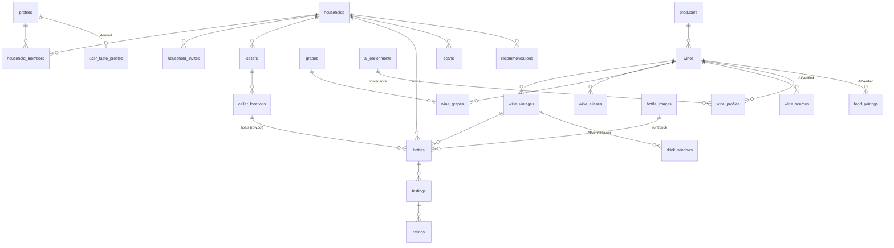

# CELLR — architecture & implementation plan

> Status: **proposal, nothing built yet.** Written before any application code, as requested.
> Everything marked **✅ verified** was tested in a throwaway Postgres 16 (scripts in
> [`docs/spikes/`](spikes/)). Everything marked **⚠ assumption** has not been tested and is called
> out so it can be killed early.

**Principle: complex underneath, effortless on the surface.**

---

## 0. Summary and decisions I need from you

CELLR is a **new product, not an evolution of the existing `wijnkelder/` app** (details in §1). It lives
in this repo — greenfield, as a modular monolith: Next.js + Supabase, one deployable, with the
framework-free business logic split out so a native app can reuse it later.

Three things shape everything else:

1. **Canonical wine ≠ vintage ≠ bottle**, and every AI-derived value carries provenance. This is
   the data model's spine (§4, §6).
2. **The database enforces who can see what** (RLS), the app layer never "remembers to check". ✅ verified (§5).
3. **AI is an explainer over a deterministic shortlist**, never the source of truth about what is in the
   cellar or about facts (§6). When AI fails, the product degrades to a plain-but-correct answer.

### Decisions (my default in bold — say "go" to accept all, or change any)

| # | Decision | Default |
|---|---|---|
| D1 | Supabase project | **A new, dedicated project** (EU / Frankfurt). *Not* the existing one (`dqwk…`) that serves Goals / Huisje OVS / Article Hub: Auth settings (Site URL, email templates, SMTP) are project-wide, and family members' wine data shouldn't share a project with your personal goals. You create it; keys go into Vercel / GitHub secrets, never into chat or the repo. |
| D2 | Sign-in | **Email one-time code (6 digits)**, typed into the app. Password later if wanted. Reason: on iPhone a magic link tapped in Mail opens *Safari*, not the installed PWA, so the session lands in the wrong place (§10, R7). |
| D3 | Auth email delivery | **Custom SMTP (e.g. Resend free tier)** from day one. Supabase's built-in mailer has a very low hourly cap and is meant for development only — a family sign-up evening would hit it. |
| D4 | UI language | **English source strings, i18n wired from the first screen** (`next-intl`), Dutch added in Phase 7. Retrofitting i18n later is far more painful than starting with it. Tell me if the family beta should be Dutch-first. |
| D5 | Rating system | **5 stars in half-star steps**, stored as integer 1–10 (`9` = ★★★★½). One system everywhere; 100-point conversion is a display concern later. |
| D6 | Money | Integer cents + ISO currency per household (default EUR). No conversion, no market-price lookups — "value" is what the user entered. (Same honesty rule as Wijnkelder.) |
| D7 | Git workflow | Feature branches + PRs into `main`; you merge. Phase 0 will add CI before anything else lands. |
| D8 | Existing Wijnkelder data | **Import tool in Phase 1** (its JSON backup → CELLR) so your real cellar is the test data. Wijnkelder itself stays untouched. |
| D9 | Test photos (needed before Phase 2) | **30–50 real front/back label photos** from your own bottles, as the scan regression set. Without these, scan thresholds are guesses. |
| D10 | OpenAI key for deployment | Set `OPENAI_API_KEY` as a Vercel env var. (The key available in my sandbox is injected by a proxy and is not usable by a deployment.) Model IDs are config, chosen in Phase 2 against what the API actually offers. |

---

## 1. What exists today (inspection of `First-series-of-apps-JP`)

**The repository is a shelf of independent, build-less static apps** deployed on GitHub Pages
(`.nojekyll`, no CI, no `package.json`, no tests). Nine folders/files:

| App | Stack | Notes |
|---|---|---|
| `wijnkelder/` | vanilla ES modules, IndexedDB, optional Firebase sync, service worker | **A full wine-cellar PWA, ~6.9k LOC, Dutch UI.** See below. |
| `goals/` | vanilla, IndexedDB + optional Supabase (`goals_records`) | Has the repo's only RLS example (`user_id = auth.uid()`, one table, jsonb). |
| `article-hub/` | single HTML file + Supabase (`hub_*` tables, RLS, Storage) | |
| `geldzaken/`, `boodschappen/`, `geheime-dienst-final/` | vanilla + Firebase | |
| `Huisje OVS app*.html`, `verbouwing*.html`, `sportplan.html` | single-file HTML | five near-duplicate OVS versions |

**Not touched by this work.** Hygiene check: I scanned for secrets — the only credentials committed are
public-by-design (Firebase web keys, Supabase publishable/anon key; I decoded the one JWT: `role: anon`).
No `service_role` key is committed. One thing to be aware of: with `.nojekyll` + Pages, *every file in that
repo is publicly reachable*, which is another reason CELLR must not live there.

### What `wijnkelder/` already is — and isn't

| It has | Relevance to CELLR |
|---|---|
| Flat `fles` record: wine + vintage + bottle collapsed into one, `aantal` = count | **Exactly the collapse the spec forbids.** Can't be evolved; needs a real import (explode `aantal` into N bottles). |
| Drink-window model (`aging.js`): per-region style table × quality words × price × grape longevity; user-set window always wins | **Reuse the idea and the tables** as the `heuristic` source (§6). Its own comment is the right philosophy: "an estimate, not an oracle". |
| Food-pairing scorer (`pairings.js`): dish profiles vs wine body/tannin/acid/sweet (1–5 scale + tolerance) | **Reuse** as the deterministic ranking stage of "Tonight" (§6). |
| Catalog (`catalog.js`): 19 countries, 51 regions, ~420 appellations, 168 grapes | **Reuse as seed data** for reference tables and for the matching pipeline. |
| "3D" plattegrond | CSS-transform tilt of a grid — no WebGL. Nothing to carry over except rack addressing (`rek/rij/vak`). |
| Tombstone + last-write-wins sync, IndexedDB-first | Not carried over: CELLR is server-authoritative; offline is a later, narrower concern (§10, R10). |
| Manual entry, no OCR/AI, single user, no households | The gap CELLR fills. |

**Conclusion.** The stack suggested in the brief (Next.js / Supabase / Vercel) is *not* contradicted by the
repo — it simply has no equivalent project. Rewriting `wijnkelder` would mean discarding its data model
anyway. So: **new repo, port the domain knowledge, import the data, leave the old app alone.**

---

## 2. Environment facts that constrain the plan

| Fact (checked in the sandbox) | Consequence |
|---|---|
| Node 22, pnpm 10, npm registry reachable; current majors: Next 16.4, Tailwind 4.3, three 0.186, R3F 9.8, Motion 14 | Scaffolding is feasible here. Versions get pinned in Phase 0. |
| Docker daemon is **not** running | `supabase start` can't run in this sandbox → RLS tests run on **plain Postgres 16 + an `auth` shim** (✅ proven below). GitHub Actions runners do have Docker, so CI additionally runs the real Supabase stack. |
| `supabase.com` is **unreachable** from the sandbox | I cannot provision or exercise hosted Supabase (Auth emails, Storage, PostgREST) from here. Those parts are verified by CI (local Supabase stack) and on Vercel previews; I will say so when I can't test something. |
| Postgres 16 server binaries present; headless Chromium + Playwright present | Real DB tests: yes. UI/E2E and screenshots: yes. **GPU/3D performance: no** (headless = software rendering) → needs a real phone (please be ready to open preview URLs on your iPhone). |
| OpenAI API reachable via injected credential | Vision-extraction experiments are possible once there are photos (D9). |

---

## 3. Architecture

### 3.1 Shape: modular monolith, pure core

```
Frontend (RSC + client features)
   ↓  RSC → services directly (reads)   |   client → typed /api/v1 (mutations, AI)
Services   (business rules, orchestration, permission semantics)
   ↓
Repositories (the only code that talks to Supabase; map DB rows ⇄ domain types)
   ↓
Supabase (Postgres + RLS, Auth, Storage)  /  AI provider  /  external catalogs
```

```
cellr/
├─ apps/web/                       Next.js 16, App Router, TypeScript strict
│  └─ src/
│     ├─ app/                      routes only — compose, never contain logic
│     │  ├─ (public)/              landing, sign-in
│     │  ├─ (app)/                 shell: home · cellar · scan · sommelier · profile
│     │  └─ api/v1/                versioned HTTP contract (web now, native later)
│     ├─ server/                   `import "server-only"`
│     │  ├─ db/                    supabase clients, generated DB types
│     │  ├─ {auth,households,cellars,wines,bottles,tastings,
│     │  │   recommendations,pairings,scanning,insights}/
│     │  │      └─ service.ts · repository.ts     (+ tests)
│     │  ├─ ai/                    provider interface, adapters, prompts@vN, context builder, budgets
│     │  └─ privileged/            the ONLY importer of the service-role key
│     ├─ features/                 client modules: cellar, scan, tonight, sommelier, bottle, profile,
│     │                            cellar3d  (lazy-loaded chunk)
│     ├─ ui/                       design system: tokens, primitives, motion, BottleGlyph
│     └─ lib/                      typed API client, analytics `track()`, reduced-motion / device hooks
├─ packages/domain/                **pure TS — no I/O, no React, no Next**
│                                  zod contracts · types · drinkWindow · tasteDna · matchScore ·
│                                  pairingScore · labelMatch · rackLayout (slot → xyz)
├─ supabase/{migrations,seed,tests}
├─ docs/    .github/workflows/
```

**Mapping from the suggested domain list.** I propose 10 server domains rather than 14, to avoid
anemic folders: `auth`+`users` → `auth` (profiles); `wines` also owns vintages, aliases, grapes, sources;
`cellars` owns locations; `tastings` owns ratings; `collections` → `insights` (collection intelligence,
"don't waste this bottle", wishlist later); `3d-cellar` is **client-only** (`features/cellar3d`) with its
geometry maths in `packages/domain/rackLayout` so it is testable without WebGL. Services named in the
brief all exist: `wineService`, `bottleService`, `cellarService`, `recommendationService`,
`tastingService`, `householdService`, `aiSommelierService`, `scanService` (+ `pairingService`,
`tasteService`, `insightService`).

### 3.2 Rules that keep it clean (enforced, not hoped for)

1. **Dependency direction** `app → features/ui → lib → /api → services → repositories → db`; `packages/domain`
   imports nothing from the app. Enforced by `eslint-plugin-boundaries`, failing CI.
2. **Supabase is imported only in `server/**/repository.ts` and `server/db`.** Lint rule + a CI grep.
3. **Services run as the user.** Every request builds a Supabase client from the caller's JWT (cookie *or*
   `Authorization: Bearer`) so RLS applies identically for web and a future native app.
   The service-role client exists only in `server/privileged/` (catalog import, shared AI enrichments,
   analytics rollups) and each use is an explicit, reviewed function.
4. **One mutation path.** Domain mutations go through `/api/v1` (Zod-validated), *not* Server Actions —
   so web and mobile share one contract. RSC may read through services directly (no waterfalls).
5. **Domain types ≠ DB rows.** Repositories map; the DB can change shape without touching UI.
6. **Errors are typed and human.** Services throw `DomainError(code, retryable)`; one map turns codes
   into copy ("We couldn't identify this bottle yet"), never HTTP jargon. Note ✅: with RLS, a write
   that no policy permits affects **0 rows silently** instead of erroring, so repositories treat
   "0 rows affected" as `NOT_FOUND_OR_FORBIDDEN`.
7. **Strict TypeScript** (`strict`, `noUncheckedIndexedAccess`, `exactOptionalPropertyTypes`), Zod at every boundary.

### 3.3 Client data & performance

- Reads in RSC; client interactivity via TanStack Query against `/api/v1`.
- **Household inventory is small** (≤ low thousands): ship it to the client and search/filter locally with a
  tiny in-memory index (MiniSearch-class) → instant search, "Under €25 / Drink this year" are structured
  filters over local data. Server-side trigram search is for the *canonical catalog* only.
- Grid/list virtualization from the start; blur-up placeholders (store a tiny dominant colour / blurhash per image).
- Keyset pagination on the API when a household exceeds ~1,000 bottles.

---

## 4. Data model

### 4.1 Overview



### 4.2 Core tables (columns that matter; audit columns `created_at/updated_at` implied)

**Identity & sharing**
- `profiles(id → auth.users, display_name, avatar_path, locale, active_household_id)`
- `households(id, name, currency, created_by)` · `household_members(household_id, user_id, role ∈ owner|member)` PK(household_id,user_id)
- `household_invites(id, household_id, code_hash, expires_at, created_by)` — only the **hash** of a 12-char random code is stored; shown once.
  *A user can belong to several households (the schema allows it); the MVP UI shows one "active" household.*

**Storage places** (the physical cellar, independent of any renderer)
- `cellars(id, household_id, name)` — "Wine fridge", "Cellar".
- `cellar_locations(id, cellar_id, label, kind ∈ rack|fridge|cabinet|shelving|wall, rows, cols)` — a grid unit.
- A bottle's place = `(location_id, row, col)`; **no slot table** — only occupied slots exist. Uniqueness is enforced by a
  partial unique index `(location_id,row,col) WHERE status='in_cellar'`, bounds by trigger. The 3D scene is a pure function of this data.

**Canonical wine catalog**
- `producers(id, name, normalized_name, country_code)`
- `wines(id, producer_id, name, normalized_name, wine_type, country_code, region, appellation, bottle_style jsonb, status ∈ canonical|provisional, owner_household_id)`
  with `CHECK ((status='canonical') = (owner_household_id IS NULL))`. **Provisional wines are private to the household that
  created them and can never be edited into canonical by a user** (✅ verified).
- `wine_vintages(id, wine_id, year NULL for NV, abv, UNIQUE(wine_id, year))`
- `wine_aliases(wine_id, alias, normalized_alias, locale)` — trigram-indexed (`pg_trgm`) for matching.
- `grapes(id, name, …)` + `wine_grapes(wine_id, grape_id, pct NULL)`.
- `wine_sources(wine_id, source_name, source_ref, license, url, retrieved_at)` — where a canonical record came from.
- `wine_type` is one enum (red · white · rosé · sparkling · orange · dessert · fortified) because it drives the filter chip **and** the 3D bottle default.

**Owned things**
- `bottles(id, household_id, vintage_id, format_ml=750, status ∈ in_cellar|opened|gifted|removed, location_id?, row?, col?,
  purchase_price_cents?, currency, purchased_at?, purchased_from?, added_by, opened_by?, opened_at?, notes,
  front_image_id?, back_image_id?, bottle_style_override jsonb?)`
  — **one row per physical bottle.** "3 bottles" = 3 rows (500 bottles ≈ 500 rows: trivial). `household_id` is immutable (trigger ✅).
  Price lives per bottle: simpler than an acquisitions table and handles mixed cases; revisit only if needed.
- `bottle_images(id, household_id, side ∈ front|back, original_path, web_path, texture_path?, crop jsonb?, width, height, blur_color, source='user_upload')`
  — **a household-owned asset referenced by bottles**, not a child of one bottle, so three identical bottles
  share one front-label photo and deleting is reference-counted. (Small deliberate deviation from the brief's `bottle_images(bottle_id…)`.)
  Originals are never overwritten.
- `favorites(user_id, wine_id)` — per person, not per household.

**Experience**
- `tastings(id, household_id, bottle_id?, vintage_id, occasion, food_text?, opened_at, photo_path?, created_by)` +
  `tasting_participants(tasting_id, user_id? | guest_name?)`
- `ratings(id, user_id, vintage_id, tasting_id?, score ∈ 1..10, descriptors text[], note, rated_at)` — **individual**; one per user per tasting.
- `user_taste_profiles(user_id, body, tannin, acidity, sweetness, fruit, oak, earthiness, freshness, signals_count, preferences jsonb, computed_at, version)`
  — **derived and rebuildable** from ratings × wine profiles; readable by people who share a household with you, writable only by `tasteService`.
- `recommendations(id, household_id, requested_by, kind ∈ tonight|sommelier, context jsonb, results jsonb, ai_enrichment_id?, accepted_bottle_id?)`
  — stored so we can learn which suggestion was actually opened.

**Scanning**
- `scans(id, household_id, user_id, kind ∈ bottle_label (wine_list later), status, front_image_id, back_image_id?, extraction jsonb, candidates jsonb,
  match_confidence, chosen_wine_id?, chosen_vintage_id?, created_bottle_ids[])` — pipeline state, so a scan can resume/retry, and the
  *confirmed vs top-candidate* pair is the quality signal (§6.4).

**Wine intelligence — all rows carry provenance (§6.1)**
- `wine_profiles(wine_id, body, tannin, acidity, sweetness, fruit, oak, earthiness, freshness (1–5, nullable), + provenance)`
- `drink_windows(vintage_id, household_id NULL, from_year, peak_from, peak_to, until_year, + provenance)` — `household_id` set ⇒ a user override that always wins.
- `food_pairings(wine_id, dish_tag, strength, rationale, + provenance)`
- `ai_enrichments(id, task, subject_type, subject_id, provider, model, prompt_version, schema_version, input_hash, output jsonb, validation_status, confidence, tokens_in, tokens_out, requested_by)` —
  the audit log; `UNIQUE(task, input_hash, prompt_version)` doubles as the **cache** so the same wine is never enriched twice.

**Operations**
- `ai_usage(user_id, task, model, tokens_in, tokens_out, cost_micro, status, at)` — per-user rate limits and spend, in Postgres (no Redis at this scale).
- `analytics_events(id, user_id, household_id, name, props jsonb, at)` — first-party, insert-only, no IP / user-agent / third party.

### 4.3 Scale answer: does this survive 100,000 users? — ✅ measured

The brief asks it explicitly, and the obvious RLS policy turned out to be the thing that would *not* survive.
Test: 50,000 households, ~70,000 users, **600,000 bottles**; one user opens their cellar (12 bottles):

| RLS policy form | Query time | Plan |
|---|---|---|
| `using (is_household_member(household_id))` — per-row function | **3.2 – 3.6 s** | seq scan, function per row |
| `using (household_id in (select my_households()))` | 58 ms | seq scan, hashed filter |
| `using (household_id = any (((select my_household_ids()))::uuid[]))` — **array InitPlan** | **0.25 – 0.8 ms** (varies by run) | index scan on `(household_id, status, added_at)` |

Same 12 rows returned as the ground-truth query. **Rule for every household-scoped table: use the array-InitPlan form**
and index `household_id` first. (The per-row helper is still fine for small tables and for `WITH CHECK` on single rows.)
Other scale notes: stable PKs are UUIDs; `normalized_name` + `pg_trgm` GIN for catalog search; partition nothing yet; `analytics_events` is
the first table that would ever need pruning/partitioning.

---

## 5. Security & RLS model

### 5.1 Principles
- **Default deny.** RLS on every table in `public`; no policy ⇒ no access. Revoke broad default grants from `anon`; explicit grants only.
- Helpers in a **non-exposed `private` schema**, `SECURITY DEFINER`, `SET search_path = ''`, `EXECUTE` granted to `authenticated` only.
- **Membership is never client-writable.** Households, members and invites change only through three `SECURITY DEFINER` RPCs:
  `create_household`, `create_invite` (owner only), `join_household(code)` (hash lookup, expiry, owner-set role = member).
- Ownership columns (`household_id`, `user_id`, `created_by`) are immutable via trigger; `WITH CHECK` also forbids *inserting* into a household you aren't in.
- Referential leaks closed: a bottle may only reference a wine **visible to the caller** (`EXISTS (SELECT 1 FROM wines…)` under RLS), so guessing a UUID of another household's provisional wine fails. ✅
- The service-role key lives in `server/privileged/` only; it is never reachable from a route without an explicit allow-listed function.

### 5.2 Permission matrix (MVP)

| Action | owner | member | outsider | anon |
|---|:-:|:-:|:-:|:-:|
| View household, members, cellar, bottles | ✓ | ✓ | – | – |
| Add / move / open bottles, rate, own taste profile | ✓ | ✓ | – | – |
| Read a co-member's taste profile (for "match for both") | ✓ | ✓ | – | – |
| Create invite, remove member, delete cellar/household | ✓ | – | – | – |
| Read canonical wines | ✓ | ✓ | ✓ (signed in) | – |
| Create/edit **provisional** wine in own household | ✓ | ✓ | – | – |
| Create/edit **canonical** wine | service role only (manual admin script) |

### 5.3 ✅ What was verified (`docs/spikes/rls-model.sql`, Postgres 16)

31 assertions, 0 failures, including: cross-household read/insert/delete blocked; guessing another household's ID
returns nothing; a plain member cannot promote themselves, remove the owner, or rename the household
(0 rows changed); `household_id` immutable; provisional wine can't be promoted to canonical or attached by
another household; taste profile invisible until a household is shared, then visible, never writable; wrong /
expired / non-owner invites rejected; `anon` sees nothing. **Negative control:** the naive "policy that queries its own
table" fails with `42P17 infinite recursion` — the reason for the helper functions.
*Not verified (no Docker/hosted Supabase here):* Storage policies and PostgREST behaviour → CI with the Supabase stack in Phase 0.

### 5.4 Storage
Buckets (all **private**, signed URLs only): `bottle-images` (originals + variants, path `{household_id}/{image_id}/…`),
`tasting-images`, `user-avatars`, and `wine-labels` (canonical label art, if ever licensed; service-role write).
Storage policies reuse the same membership helper on the first path segment. Bucket-level `file_size_limit` + `allowed_mime_types`.
Uploads go **directly to Storage via signed upload URL** (Vercel functions cap request bodies at ~4.5 MB, phone photos exceed
that); the server then validates magic bytes, re-encodes, **strips EXIF/GPS from all derived variants**, and writes `web`/`texture` copies with `sharp`
(Supabase's image-transformation add-on is a paid-plan feature, so I'm not depending on it).

### 5.5 Other
Zod on every mutation; user text rendered as text (React escaping) and length-capped before reaching prompts; AI and upload endpoints
rate-limited from `ai_usage`; no secrets with the `NEXT_PUBLIC_` prefix except Supabase URL + publishable key; CSP + secure headers in `next.config`;
dependency audit in CI; `gitleaks` in CI.

---

## 6. AI architecture & data provenance

### 6.1 Provenance (verified vs estimated, never blurred)

Every intelligence row (`wine_profiles`, `drink_windows`, `food_pairings`, and fields extracted from labels) carries:

```
source_type ∈ verified | licensed_import | label_ocr | user_entered | ai_estimate | heuristic
confidence  ∈ 0..1  (shown to users only as low / medium / high, never as a fake-precise number)
model, prompt_version, schema_version, enrichment_id → ai_enrichments, generated_at
```

**Resolution priority when several rows exist:** `user_entered` > `verified` / `licensed_import` > `ai_estimate` > `heuristic`.
(Wijnkelder's "your own window always wins" rule, generalised.) A single SQL view per table exposes the *current* row.

**UI contract.** Casual users see one quiet distinction — values that are not verified show a small "Estimated" hint; the
detail screen reveals source and confidence on request. They never see "gpt-…" or JSON.

### 6.2 Provider abstraction

```ts
interface LlmProvider {
  generateObject<T>(req: { task: TaskId; schema: ZodType<T>; messages: Message[]; images?: ImageRef[];
                           maxOutputTokens: number; timeoutMs: number }): Promise<Result<T, AiError>>;
}
```
- `OpenAICompatibleProvider` (configurable `baseURL`, so other OpenAI-compatible hosts work) is adapter #1.
- Model per **task** via config (`label_extraction`, `wine_enrichment`, `tonight_explain`, `sommelier_chat`) — cheap model for chat, stronger for vision.
- Structured outputs → Zod-validated; **one repair retry, then fail** (never "best effort" parse). Prompts are versioned files (`prompts/label_extraction@v1.ts`).
- Every call writes `ai_usage`; enrichments are cached by `input_hash`. Per-user hourly/daily budgets; per-request token ceiling (~2k in).
- Any failure returns a typed `AiError` → deterministic fallback path (below). **AI is never on the critical path of adding a bottle.**

### 6.3 Never trust AI facts blindly
1. Ask only for what is **visible/derivable**; schema allows `null` and per-field confidence; instructions forbid guessing.
2. Label extraction is `label_ocr` (an observation of *this* bottle), whereas profile / window / pairing are `ai_estimate`.
3. Plausibility guards in code, not prompts: vintage ∈ [1800, current+1]; ABV ∈ [5, 20]; appellation must belong to the stated country when known (catalog from Wijnkelder);
   drink window must contain-or-follow the vintage year and span ≤ 60 y; out-of-range ⇒ field dropped and confidence lowered.
4. **Heuristic cross-check:** the ported `aging.js` model runs alongside; if AI and heuristic disagree wildly, confidence is capped at `low` and the
   *heuristic* is shown with an "Estimated" label.
5. Recommendations can only name bottles that exist (§6.5).

### 6.4 Scan → match pipeline

```
photo(s) → client downscale (≤1600px) + EXIF-orient → direct upload → POST /api/v1/scans
 → server: validate (magic bytes, size) → web variant (EXIF stripped)
 → vision extraction → LabelExtraction{producer, name, vintage, region, appellation, country, grapes[], abv, volume, type, raw_text, per-field confidence}
 → normalise (lowercase, strip accents, tokens) → candidates: trigram over wines+aliases (household-visible set) → top 10
 → deterministic score: producer sim, name sim, vintage equality, appellation equality (domain: labelMatch)
 → vintage resolve (create vintage row from label if wine matches but year missing)
 → branch:  strong & clear margin → "We found it"  |  ambiguous → ≤3 candidates  |  none → provisional wine
 → user confirms → bottle(s) created → async enrichment (profile, window, pairings) via after()/waitUntil; UI shows "Estimated" until it lands
```
- ⚠ **Initial thresholds** (strong: score ≥ 0.85 *and* ≥ 0.15 above runner-up; ambiguous: 0.5–0.85) are placeholders — calibrated on the D9 photo set.
- **Matching is deterministic code, not LLM judgement**, so confidence is reproducible and testable. (An LLM re-ranker can be added later behind the same interface.)
- **Confirmed matches are signals, never writes:** `scans.chosen_*` vs top candidate feeds a review list; promoting anything to `canonical` is a manual, scripted admin step.
- **Cold start is real.** The canonical table starts empty, so early scans mostly yield provisional wines. That's by design: matching first checks the
  household's own wines (the second bottle of the same wine hits 100%), reference data seeds from the Wijnkelder catalog, and richer catalogs are a
  later *research* item — I am **not** assuming any specific free wine database exists; only licensed/legit sources get imported (`wine_sources` records licence).
- No queue infrastructure: DB `status` + `after()` + client polling. If enrichment fails it's retried on next open and never blocks the user.
- Privacy: label photos go to the AI provider; the onboarding/privacy copy says so, and capture guidance asks for the label only.

### 6.5 "What should we drink tonight?" and the sommelier — grounded retrieval

```
input: food, people, occasion, budget
 1. SHORTLIST (deterministic, no AI): in_cellar bottles of the household
      → filter by budget/occasion rules → score = pairingScore(dish profile vs wine profile)       [ported from pairings.js]
                                                + tasteMatch(each selected person) + urgency(drink window)
      → top ≤12, compact records (~60 tokens each)
 2. EXPLAIN (LLM, structured): choose BEST / ALTERNATIVE / SPECIAL *from the shortlist ids only*, write ≤2-sentence "why"
 3. VALIDATE: every returned id ∈ shortlist; else drop. Percentages come from step 1's maths, not from the model.
 4. FALLBACK: if AI fails/times out → same three picks with templated reasons ("Enough tannin for steak · at its peak now").
```
- Sommelier chat uses the same builder: question → intent → retrieval (cellar search, taste summary ≤150 tokens, last ≤5 ratings, drink-window status) → one call.
  The model never sees the whole database, and can only reference bottle ids it was given. A tool-calling loop is a later upgrade, not MVP.
- **Match %** (`matchScore`): distance between a wine's profile and a person's taste vector, weighted by how confident each dimension is;
  never shown below 5 ratings ("We're still learning your taste"), clamped to ≤ 98%, per-person for households ("91% Joost · 78% Merel").
- **Taste DNA** (`tasteDna`): rating-weighted average of wine-profile dimensions with **shrinkage toward neutral** (`(Σwx + k·prior)/(Σw + k)`, k≈3) — no false precision from two ratings.

### 6.6 Drink windows & the urgency system
States: `too_early · ready · peak · drink_soon · past_peak`. Computed in `packages/domain/drinkWindow` from the current row of `drink_windows`
(user > verified > AI > heuristic) and today's date; labels never imply exactness ("Peak 2026–2029", confidence dots in detail view only).
The drinking strategy for N bottles is a simple spread over `[peak_from, until]` (e.g. 6 bottles → 1/2/2/1), clearly labelled a suggestion.
"Don't waste this bottle" = bottles in `drink_soon` or `past_peak`, worded helpfully ("Currently at peak"), max 3 on Home.

---

## 7. Design system

**Intent:** calm · luxurious · tactile · editorial · slightly cinematic; the **bottle label and photography do the visual work**, chrome stays almost invisible.
Dark is the primary identity (best for 3D); light ("ivory") is a first-class twin via the same tokens.

### 7.1 Colour (tokens in CSS variables via Tailwind 4 `@theme`; contrast ✅ computed)

| Token | Dark (primary) | Light |
|---|---|---|
| `bg` | `#141211` warm charcoal (never `#000`) | `#F6F2EA` ivory |
| `surface-1` / `surface-2` | `#1B1816` / `#242019` | `#FBF8F2` / `#EFE9DE` |
| `hairline` | warm-white @ 8% | ink @ 10% |
| `text` | `#F3EEE6` — 16.2:1 | `#1E1A17` — 15.5:1 |
| `text-2` | `#B9B1A5` — 8.8:1 | `#5A524A` — 6.9:1 |
| `text-3` | `#8F877B` — 5.3:1 | `#766D63` — 4.6:1 |
| `accent` (burgundy **fill**) | `#7D2234` (warm-white label on it: 8.5:1) | same |
| `accent-fg` (burgundy **on dark surfaces**: focus ring, markers, links) | `#D98A9B` — 7.2:1 | `#7D2234` — 8.8:1 |
| `bronze` (rare: "peak", special moments) | `#B8975F` — 6.8:1 | `#85652B` — 4.8:1 |

**Why two accents:** ✅ computed — burgundy `#7D2234` directly on the dark background is only **1.9:1**, failing the 3:1 needed for UI
components. So burgundy is a *fill with a light label*; anything thin (outline, ring, marker, link) uses `accent-fg`. All text tokens pass AA.
Status is never colour-only: every drink state has a word and a marker shape. No gradients, no per-card colours; the only extra hue in the product is the
tint of wine types, used at small sizes (dot, bottle glass).

### 7.2 Typography
- **UI:** Geist (variable) — neutral, contemporary, good at small sizes on phones. **Display / wine names:** Instrument Serif — editorial, used ≥ 24 px only, for wine
  names, hero questions ("What should we drink tonight?") and big numbers. Both via `next/font` (self-hosted, no layout shift).
  ⚠ taste call — I'll view both on a real phone in Phase 0; swapping is a one-line token change.
- Scale (px / line): 12/16 caption · 14/20 small · 16/24 body · 20/28 title · 28/34 headline · 40/44 display. Tracking −1 % on display. Tabular numerals for prices and years.

### 7.3 Space, shape, depth
- 4-pt base, 8-pt rhythm; page gutter 20 px (phone) → 32 px (tablet) → content max 1200 px with a two-pane layout on desktop (never stretched cards). Touch targets ≥ 44 px; bottom controls inside thumb reach; safe-area insets honoured.
- Radius: **8** (inputs, chips) · **14** (cards) · **24** top corners (sheets). No pills except the 5-dot scale and the toggle; no "bubble UI".
- Depth in dark mode = **surface tone + 1 px hairline**, not shadows. Light mode: one soft two-layer shadow (`0 1px 2px / 0 8px 24px`, ink @ 6–8 %). Modals dim the world rather than boxing it.
- Primitives (restyled from shadcn/Radix; no default look): Button, Segmented, Chip, Sheet (vaul), Dialog, Tabs, Stepper, Stars, Scale (5-notch, replaces charts), DrinkWindowBar, Skeleton, Toast, EmptyState, BottleGlyph (2-D SVG silhouette used wherever no photo exists and as the 3D fallback).

### 7.4 Motion language (Motion library)
| Token | Spec | Use |
|---|---|---|
| `press` | scale .98, 90 ms | every tappable |
| `snap` | spring k=420 d=34 | toggles, chips, small moves |
| `glide` | spring k=240 d=30 (≈ 320 ms) | sheets, card → detail |
| `hero` | choreographed 700 ms (bottle extraction, §8 F6) | the one signature moment |
| `fade` | 150 ms opacity | **everything under `prefers-reduced-motion`** — springs/parallax/camera moves are replaced, not shortened |
Rules: motion explains hierarchy or physicality or it doesn't ship; no looping decoration; parallax only on the Home hero; nothing > 400 ms except `hero`.

### 7.5 Content rules
Cards show ≤ 3 lines at rest (name · "2020 · Rioja" · "3 bottles · Drink now"); detail is revealed by tap (progressive disclosure). Error copy is human and always offers a next step.
Empty states are invitations ("Your cellar starts here." + Scan CTA, a quiet rack illustration) — every list/screen gets one before it counts as done.

### 7.6 Navigation
Phone: bottom bar **Home · Cellar · (Scan) · Sommelier · Profile**, Scan as the raised central action. Tablet: same, wider content. Desktop: left rail + two-pane
(cellar/3D left, bottle panel right). Theme: system by default, manual override.

---

## 8. Core user flows

Each flow lists the happy path and the failure path (the product is judged on the latter).

**F1 First run.** Welcome → email → 6-digit code → *create household* ("Joost & Merel") **or** enter invite code → *(optional, skippable)* "Pick wines you tend to like" (3–5 taps)
→ "Scan your first bottle" → on first bottle: a small reward moment (bottle settles into a rack) and Home becomes useful.
*Fails:* code expired → "Send a new code"; no email → resend with cooldown; offline → keep typed email.

**F2 Add a bottle (scan).** Scan → native camera (`<input capture>`; live viewfinder only as enhancement) → front → "Add back label?" (skip OK) →
"Reading label…" → *found* (Confirm) / *which one?* (≤3) / *new wine* (name prefilled, editable) → **HOW MANY** stepper → **WHERE** (slot picker; "Decide later" allowed) → optional price → done.
*Fails:* unreadable → "We couldn't read this label — try another photo / Add manually" (photo retained, never lost); AI down → manual path with the photo attached; upload blip → queued retry, photo kept in memory/IndexedDB.

**F3 Tonight.** Home hero → *What are you eating?* (type / common dishes) → *With whom?* (household members, optional) → *Occasion* → *Budget feel* → 3 cards (Best match · Alternative · Special choice) with %, one-line why, **location** ("Wine fridge · Shelf 3 · B4") → **Open this bottle** → F4.
*Fails:* empty cellar → "Add a few bottles first"; AI fails → deterministic picks; nothing fits → honest "closest options" + suggestion of what to buy.

**F4 Open & rate.** Open bottle → confirm which physical bottle → inventory 3→2, tasting created → "Enjoy" → later (or immediately) "How was it?": stars → optional descriptors → optional note/photo → taste profile updated. Skipped rating ⇒ in-app reminder next day (push later).

**F5 Browse & find.** Cellar defaults to grid (instant) · list · 3D toggle; search is local & instant; filter sheet (type, country, region, grape, vintage, drink status, price, rating, location, favourites); each wine card is the 3-line card; detail on tap.

**F6 3D bottle moment** (Phase 6): tap bottle → world dims 40 % → bottle slides out along its axis → rotates toward camera (~15° tilt) → camera dollies in → label readable → name/vintage/region fade in, then match %, drink state, then actions (Open · Details · Move · Rate · Ask) → drag rotates (back label on flip) → swipe down/close → bottle returns to its slot. Target 500–1000 ms. Reduced motion: crossfade to a detail sheet, no camera move. 3D failure/low-power: grid is always available; selecting a bottle opens the normal detail.

**F7 Sommelier.** Chat with suggestion chips; answers cite bottles as tappable cards (with location); household context toggles ("for Joost & Merel").

**F8 Invite.** Profile → Household → *Invite* (owner) → share link/code (expires 7 d) → joiner enters code → sees the cellar immediately.

---

## 9. Implementation steps

### Phase 0 — Foundation (exit: a signed-in, installable, empty-but-beautiful app with green CI)
1. **Scaffold** pnpm workspace; `apps/web` (Next 16, TS strict), `packages/domain`; Tailwind 4 tokens; ESLint (+boundaries, +no-restricted-imports), Prettier, Vitest, Playwright; `.env.example`; `server-only` guards.
2. **CI** (GitHub Actions): lint · typecheck · unit · **RLS suite** (Postgres service + shim) · Supabase-stack job (Storage/Auth/PostgREST smoke) · build · gitleaks · audit.
3. **Supabase**: `supabase/` init; migrations: `0001` extensions/enums/`private` helpers → `0002` identity, households, RPCs, RLS → `0003` catalog (producers, wines, vintages, aliases, grapes, sources) → `0004` cellars, locations, bottles, images, RLS → `0005` storage buckets/policies. Seed: reference data from Wijnkelder's catalog. Generated DB types. **RLS test suite grows from `docs/spikes/rls-model.sql`** and is mandatory in CI.
4. **Auth**: email OTP, session cookies via `@supabase/ssr`, bearer-token support for `/api/v1`, `householdService` (create/invite/join/active), profile.
5. **Design system**: tokens, fonts, primitives, AppShell (bottom nav / desktop rail), theme, `BottleGlyph`, EmptyState; a dev-only `/design` gallery reviewed **on your phone** via Vercel preview.
6. **PWA**: manifest, icons from one SVG, splash/theme metadata, standalone display, install prompt; service worker approach decided by a short spike (Serwist if it works with the current bundler, else a ~60-line hand-written SW: app-shell cache + offline page).
7. **Platform bits**: typed API client + error map, `track()` → `analytics_events`, `ai_usage` table + rate-limit helper (empty AI), i18n scaffold.
8. **Deploy**: Vercel project + preview deploys, env vars, Supabase project wiring (needs D1/D3).

### Phase 1 — Core cellar (exit: you can run your real cellar in it, 500 bottles feel instant)
1. Domain contracts (Zod) + `wineService` / `bottleService` / `cellarService` + repositories + `/api/v1` handlers, each with unit + integration tests (real Postgres).
2. **Add-bottle (manual)**: search household + canonical wines (trigram) → pick or "create new (provisional)" → vintage → HOW MANY → WHERE → price. This becomes the fallback that scanning plugs into in Phase 2.
3. **Cellar**: create cellar + rack (5×8 default, editable), slot picker (2-D, reused by 3D later), move bottle, remove/gift/open (status transitions, derived counts).
4. **Cellar views**: grid + list, 3-line wine card, local instant search, filter sheet, favourites, empty states; virtualization.
5. **Bottle detail v1**: hero (photo or `BottleGlyph`), wine info, location, purchase info, history stub — no AI yet; drink-window bar appears in Phase 3.
6. **Wijnkelder importer** (D8): backup JSON → wines/vintages/bottles (explode `aantal`), locations (`rek/rij/vak`), notes → tastings/ratings (score scale mapped to half-stars), photos → `bottle_images`; dry-run report before committing.
7. **Perf harness**: seed 500 / 2,000 bottles; budgets: cellar interactive < 1.5 s on a mid phone over 4G, search keystroke < 50 ms, RLS queries < 10 ms server-side.
8. Home v0 (greeting, empty-state hero, recently added) so the app opens to something real.

### Testing strategy (applies from Phase 0)
`packages/domain`: unit + property tests (drink window, taste maths, label matching, rack layout). Repositories/services: integration against real Postgres.
**RLS: a permission-boundary suite is a merge gate.** E2E (Playwright, mobile viewport): sign-in, add bottle, cellar search. AI: contract tests with recorded fixtures + a nightly eval over the D9 photo set once it exists.

---

## 10. Risks

| # | Risk | Why it bites | Mitigation / decision point |
|---|---|---|---|
| R1 | **Label scan accuracy** | Curved glass, glare, foil, stylised fonts, back labels in 6 languages; cold-start catalog means many "no match" | Photo-guidance UX; two-photo flow; deterministic matcher with calibrated thresholds on the D9 set (≥30 bottles) before Phase 2 ships; "no match" is a first-class, pleasant path; manual add always available. **Phase 2 gate:** ≥ 80 % of test bottles reach "found" or "≤3 candidates containing the right one". |
| R2 | **Mobile camera in a PWA** | Live `getUserMedia` in iOS standalone mode has permission/lifecycle quirks | Primary capture = `<input type="file" capture="environment">` (native camera UI, robust); live viewfinder is progressive enhancement; keep captured file until the pipeline succeeds. |
| R3 | **Uploads vs hosting limits** | Serverless body ≈ 4.5 MB; phone photos are larger | Client downscale + direct-to-Storage signed upload; server processes from Storage. |
| R4 | **AI hallucination** | Fabricated appellations, windows, pairings; invented bottles in chat | §6.3: schema-constrained output, plausibility guards, heuristic cross-check, id-validated recommendations, percentages computed in code, "Estimated" labelling, deterministic fallbacks. |
| R5 | **Provenance erosion** | The moment one AI value is stored as plain text it's indistinguishable forever | Provenance is columns + NOT NULL on every intelligence table (not a convention); user > verified > AI > heuristic resolved in SQL views; `ai_enrichments` audit log. |
| R6 | **Canonical DB cold start / licensing** | No known free, complete wine database; scraping would be illegal/fragile | Start household-scoped + provisional; seed reference data only (own catalog); canonical growth by curated promotion; evaluate licensed sources as a separate research task. No assumption baked into schema. |
| R7 | **iOS sign-in loop** | Magic links open Safari, not the installed PWA → "I'm not logged in" | D2: email OTP typed in-app. |
| R8 | **Auth email caps** | Built-in Supabase mailer is dev-grade | D3: custom SMTP before inviting anyone. |
| R9 | **3D performance** | WebGL on mid Android; memory from textures; main-thread jank | Budgets (⚠ unvalidated): 3D chunk ≤ ~400 KB gz, lazy on toggle only; one rack = ≤ 40 bottles ⇒ ~1 instanced glass draw + 40 label meshes (<100 draws); label textures 512² in rack (≈1.4 MB each with mipmaps ⇒ ~56 MB worst case), 1024² only for the selected bottle; DPR cap & adaptive quality via frame-time monitor; `frameloop="demand"` when idle, unmount when hidden. **Must be measured on real devices — not possible in this sandbox.** KTX2 texture compression deferred (needs encoding tooling Vercel lacks). |
| R10 | **Offline expectations** | Wijnkelder worked offline; users may expect it in a cellar with poor signal | MVP = cached app shell + read-only last-known cellar + *don't lose a pending photo/form*; queued writes later. Said plainly in the UI when offline. |
| R11 | **Label → texture mapping** | A photo of a curved label isn't a flat texture; auto-cropping is unreliable | MVP: **manual 4-point crop** with perspective correction (own small canvas/WebGL warp, no opencv), aspect assumed from label type, cylindrical wrap angle fixed (~140°); auto-detection is a later enhancement. Fallback: generic label tinted by wine type. |
| R12 | **The rack hides labels** | In a real horizontal rack you see bottle *ends*, not labels — so "label as hero" can't hold in the rack view itself | The label becomes hero **on selection** (F6). Rack view needs another identification cue (type-tinted end cap, foil colour, vintage tag). Phase 6 starts with a 1-day on-device prototype of two rack styles (end-on realistic vs. tilted label-forward display) before committing. |
| R13 | **iOS PWA push/storage quirks** | Web push only for installed PWAs; storage can be evicted | Reminders are in-app first (as specified); no critical data client-only. |
| R14 | **Scope creep** | The brief is ~8 products | Phase gates with exit criteria; Restaurant mode & blind tasting are explicitly out; schema is additive-ready (`scans.kind`, nullable tasting `session_id` to be added when needed). |
| R15 | **Name** | "CELLR" for a commercial product | Before going commercial: trademark/domain check. Not blocking now. |

---

## 11. Quality-bar answers (from the brief, §49)

- *Remains fast with 500 bottles?* Local index, virtualization, keyset API; RLS ✅ < 1 ms at 600k rows.
- *What if AI fails / no data?* Deterministic shortlist and templated reasons (§6.5); manual add path; empty states.
- *Model correct at 100,000 users?* Yes — household-scoped, UUID keys, indexed array-InitPlan policies (§4.3). Multi-tenant "organisations", billing, roles beyond owner/member are intentionally absent and additive.
- *One-hand phone use?* Bottom nav, bottom sheets, steppers, no top-corner-only actions.

## 12. What I will not do (yet)
Restaurant mode, blind tasting, social features, billing, native apps, background queues, market-price lookup, automatic canonical edits.

---

**Next step on your word:** confirm/adjust D1–D10 → I start **Phase 0** on a feature branch (scaffold + CI + RLS suite first, so everything after lands on a safety net).
