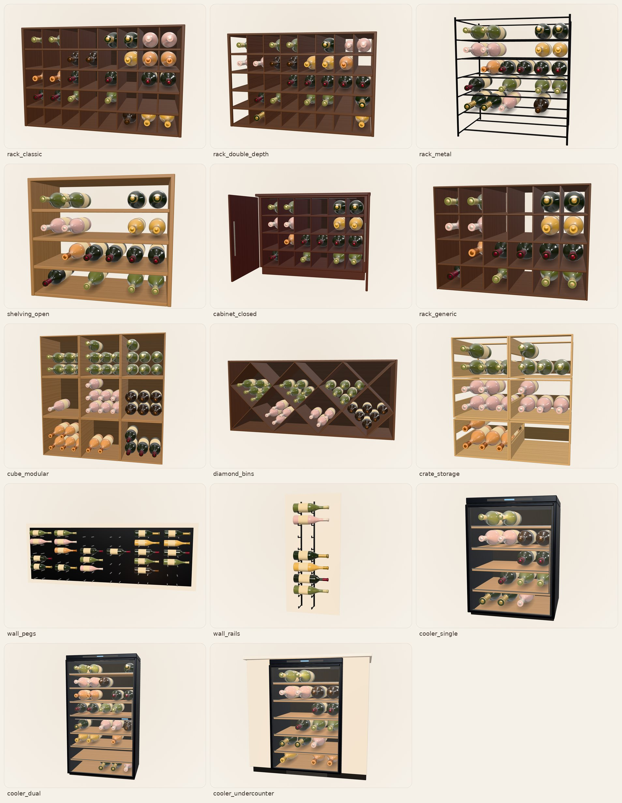

# Smart Cellar 3D — sprint 2A: the template renderer and its gallery

2026-11-14. A second 3D view that draws every storage template from its logical layout, a read-only flat picture
of the same layout, and a closed gallery to look at both. **No product screen uses any of it. Nothing was merged,
deployed, migrated or switched on, and no database was touched: this sprint has no SQL and no API in it.**

Read with: [`ADR-002`](./ADR-002-layout-driven-renderer.md) (why it is built this way) and
[`ADR-001`](./ADR-001-templates-and-slot-identity.md) (what a template, a family and an index mean).

## 1. What the existing view is, and what was kept

Audited before anything was written (`features/cellar/three/`):

| The existing view does                                                       | In the new view                                                                                       |
| ---------------------------------------------------------------------------- | ----------------------------------------------------------------------------------------------------- |
| Draws only when something changes (`frameloop="demand"`)                     | Same. Measured: 0 pictures drawn in 3 s at rest, every scene (§10).                                   |
| One instanced mesh per bottle shape and layer                                | Same layers (glass, label, capsule, contact shadow), same bottle profiles from `three/layout.ts`.     |
| Procedural grain and shadow pictures, nothing downloaded                     | The same pictures, reused from `three/materials.ts`. No new texture.                                  |
| A procedural studio to mirror in the glass (PMREM of `RoomEnvironment`)      | Same, same lights.                                                                                    |
| Sharpness capped for phones                                                  | Capped per level of detail: 2, 1.5, 1.25.                                                             |
| Orbit, zoom to the cursor, slide, with limits; a drag is not a tap           | Same controls and limits; the point looked at is kept on the place.                                   |
| Survives the browser taking the graphics memory back                         | Reports it (`onLost`); the gallery says so and can start again (tested).                              |
| Reduced motion                                                               | No damping; the view has no animation of its own.                                                     |
| Taking a bottle out to look at it (the showcase), with shader warm-up for it | **Not in the new view.** See §6: a tap chooses and marks a bottle, and the gallery says so on screen. |
| Furniture: one mesh per board                                                | Changed on purpose: one mesh per material (§3).                                                       |

`scene.tsx` and every other file in `three/` are unchanged, byte for byte. The new view imports from them and
exports nothing into them.

## 2. Architecture

```
ResolvedStorage (domain)                      what a stored place IS: template, layout, look, legacy, arrangementKnown
   │
   ├─ model.ts        rendererFor()           legacy | grid | bins | wall | neutral
   │                  buildModel()            parts + poseOf / pileOf + look + bounds          (plain numbers)
   │                  placeBottles()          every stored bottle → a pose, or "stranded"; nothing is dropped
   │                  frameFor(), qualityFor()
   │     ├─ families.ts   buildGrid / buildBins / buildWall / buildNeutral    slot → world, frame geometry
   │     ├─ parts.ts      Part, Pose, penetration(), bounds                    the checks physical truth is tested with
   │     └─ palette.ts    lookFor(appearance)                                  named look → surfaces
   │
   ├─ resources.ts    buildStructure()        parts → ONE merged mesh per material role
   │                  buildBottleKit()        the geometries and materials all bottles share, per level of detail
   │                  Owned                   who releases what, and when
   │
   ├─ template-scene.tsx                      React Three Fiber: lights, camera rig, furniture, bottles, picking,
   │                                          stepping detail down on slow frames, a readout for tests
   │
   └─ layout-cells.ts → layout-map.tsx        the same layout, flat, read-only
```

The six concerns the sprint asked to keep apart, and where each lives:

| Concern                          | Where                                                                                    |
| -------------------------------- | ---------------------------------------------------------------------------------------- |
| Slot → world position            | `families.ts` (`poseOf`, `pileOf`), chosen by slot semantics in `model.ts`               |
| Frame geometry                   | `families.ts` (parts), `resources.ts` (meshes)                                           |
| Bottle placement and interaction | `model.ts` (`placeBottles`), `template-scene.tsx` (`Bottles`, picking)                   |
| Materials and appearance         | `palette.ts`, `resources.ts` (`materialFor`)                                             |
| Camera framing                   | `model.ts` (`frameFor`), `template-scene.tsx` (`Rig`)                                    |
| Performance and lifecycle        | `resources.ts` (`Owned`, merging), `template-scene.tsx` (`Pace`), `model.ts` (`QUALITY`) |

A place from before templates never reaches any of this: `rendererFor` answers `legacy`, `TemplateScene` throws on
it, and the gallery mounts the existing `CellarScene` for it.

## 3. The three families

**Grid** (`buildGrid`): shelves from the top down, a cell per position, depth going back. One function; a template
is a `GridStyle` record: the pitch, what a shelf is (a board, a pair of rods, a slide-out with a lip), whether
positions have dividers, what the ends are (panels, posts, rod posts), whether there is a back, and an optional
shell (cabinet, cooler, undercounter). Zones become a bar across the cabinet with its own display.

**Bins** (`buildBins`): compartments that hold a pile. One function, three compartment shapes: a square cube with
its own four walls, a diamond in a lattice of boards at ±45°, an open crate of slats. A pile is a list of resting
places from the bottom up; `n` bottles take the first `n`.

**Wall** (`buildWall`): a backdrop of wall, then pegs (a backboard and two pegs under each bottle, the bottle lying
along the wall, label out) or rails (two strips per column with rods; bottles one before the other away from the
wall).

**Neutral** (`buildNeutral`) is the fallback, not a family of furniture: a plate per compartment, a counter per
bottle, a dot per free place.

## 4. The fourteen templates

| Template              | Family | Index means | What makes it itself                                                                                               |
| --------------------- | ------ | ----------- | ------------------------------------------------------------------------------------------------------------------ |
| `rack_classic`        | grid   | depth (1)   | Wooden boards, a divider between every position, side panels, a back.                                              |
| `rack_double_depth`   | grid   | depth       | The same joinery two or three bottles deep, posts instead of end panels and no back, so the depth shows.           |
| `rack_metal`          | grid   | depth       | No wood at all: each bottle on two thin rods, corner posts, open on every side.                                    |
| `shelving_open`       | grid   | depth       | Thick boards with no dividers and a wide pitch: bottles lie loose side by side.                                    |
| `cabinet_closed`      | grid   | depth       | A crown and a plinth, and doors: solid ones swung open, or a glass pane.                                           |
| `rack_generic`        | grid   | depth       | A plain divided frame in any of the three materials; what a place gets when nothing more is known of its template. |
| `cube_modular`        | bins   | ordinal     | Square boxes, each with its own walls (double walls between neighbours), a pile in rows.                           |
| `diamond_bins`        | bins   | ordinal     | Boards at ±45° in a rectangular frame; each diamond fills from its bottom corner: 1, 2, 3, 2, 1.                   |
| `crate_storage`       | bins   | ordinal     | Slatted wooden crates stacked with a gap, bottles in layers.                                                       |
| `wall_pegs`           | wall   | single      | A backboard, two pegs per bottle, the bottle along the wall with its label out.                                    |
| `wall_rails`          | wall   | depth       | Vertical strips with rods; up to three bottles on a rod, index 1 furthest from the wall.                           |
| `cooler_single`       | grid   | depth       | A dark shell, beech slide-out shelves with a lip, a head with a display, a glass door, a light inside.             |
| `cooler_dual`         | grid   | depth       | The same, taller, with a bar across between two zones, a display for each, and two lights.                         |
| `cooler_undercounter` | grid   | depth       | The same, low, built in: kitchen cabinets on both sides, a stone worktop over it, a toe kick with a vent.          |

`model.test.ts` pins that the fourteen have fourteen different sets of parts (a geometry signature per template),
not fourteen colours of one.

## 5. Placement that tells the truth

| Rule                                                     | How it is kept                                                                                                          | Test                                               |
| -------------------------------------------------------- | ----------------------------------------------------------------------------------------------------------------------- | -------------------------------------------------- |
| Index 2 is physically behind index 1                     | `z = −(index − 1) × (bottle length + gap)`                                                                              | `model.test.ts`, "depth"                           |
| Every valid spot has its own position                    | Poses of all spots of a depth or single layout are pairwise distinct                                                    | `model.test.ts`                                    |
| No bottle cuts into a shelf, a divider or another bottle | `penetration()` of every bottle against every hard part and every other bottle, all 14 templates, several sizes: ≤ 1e-6 | `model.test.ts`, "no penetration"                  |
| A bottle rests on something                              | Under every bottle of a grid or wall template a hard part within 0.06                                                   | `model.test.ts`                                    |
| A pile does not claim a position per index               | Bottles with indexes 3 and 5 in a bin are drawn as a pile of two, on the first two resting places                       | `model.test.ts`, "ordinal"                         |
| Occupancy and capacity are exact                         | placed + stranded = stored; placed + free = capacity                                                                    | `model.test.ts`, `layout-map.test.tsx`             |
| No valid bottle disappears                               | A bottle on a spot the layout does not have, or a second one on a taken spot, is reported as stranded, never moved      | `model.test.ts`, `layout-map.test.tsx`             |
| Arrangement not known → neutral, no invented depth       | Four kinds of unsure place: only plates and counters, all counters in one plane                                         | `model.test.ts`, `storage-gallery.spec.ts`         |
| A place from before templates is drawn as it always was  | It is drawn by the existing view. `legacy-parity.test.ts` (sprint 1A) is unchanged and passes.                          | `legacy-parity.test.ts`, `storage-gallery.spec.ts` |

## 6. Interaction, and what is deliberately missing

- **Picking.** A tap or a click chooses the nearest bottle on its ray. Tested with real rays in unit tests (every
  bottle of every family; in a deep rack the front one, never the one behind) and in a browser with a mouse and
  with a finger, including through a glass door.
- **Selection.** The chosen bottle gets a ring, and the same cell is marked in the flat picture. The gallery words
  where it is by what is known: "shelf 2, position 3, at the front", or "in compartment 1·2. Where in the
  compartment it lies is not recorded."
- **Camera.** Turn, zoom, slide, with the existing view's limits.
- **Not there: the showcase.** Taking a bottle out, turning it, reading its label is the existing view's and stays
  there. It assumes a bottle in a grid cell; a pile, a wall and a door each need a decision first. The new view
  offers no button, gesture or half-working version of it, and the gallery says in words that a tap only chooses.
- **Not there: placing, swapping, dragging.** Unchanged, in the existing racks view. The flat picture here is to
  read.

## 7. The gallery

`/design/cellar-3d` has a gate of its own, stricter than the existing `/design` page's (`lib/cellar-gallery-gate.ts`,
asked through `isCellarGalleryEnabled()` in `server/env.ts`). It is open in exactly three places:

| Where                                                                                             | Open when                                                                                |
| ------------------------------------------------------------------------------------------------- | ---------------------------------------------------------------------------------------- |
| Local development (`next dev`)                                                                    | always, unless the environment says it is production                                     |
| A Vercel **preview** deployment                                                                   | `VERCEL_ENV` is exactly `preview` **and** `DESIGN_GALLERY=1` is set on it                |
| A production build on one's own machine (browser tests)                                           | `DESIGN_GALLERY=1` **and** `CELLAR_GALLERY_LOCAL_BUILD=1`, and nothing that looks hosted |
| **A Vercel production deployment**                                                                | **never. No flag or combination of flags opens it.**                                     |
| Anything else (a custom Vercel environment, an unknown host, a host that does not say what it is) | never                                                                                    |

Where it is closed the address shows the app's "not found" page and nothing of the gallery (how exactly: §11); it
is always `noindex`. It needs no account and reads no database: places and bottles are made from numbers by
`fixtures.ts`, the same every time.

**To open it**

```bash
pnpm --filter web dev                       # then http://localhost:3000/design/cellar-3d
# or the production build, as the tests do (both switches):
pnpm --filter web build && DESIGN_GALLERY=1 CELLAR_GALLERY_LOCAL_BUILD=1 pnpm --filter web exec next start -p 3100
```

On Vercel: set `DESIGN_GALLERY=1` for the **Preview** environment. Setting it for Production opens `/design` there
(as it always has) but not this gallery. The gate decides what is shown; who can reach a preview deployment at all
is Vercel's deployment protection.

**Controls:** what to show (a template, a place from before templates, a place with an unknown arrangement); the
template (all 14); shelves, across, and deep or per bin, each inside the template's limits; material, colour,
lighting and door, each from the template's own list; bottles (none, about half, full); level of detail. The 3D
view and the flat picture stand side by side (one above the other on a phone), with what the 3D view last drew:
draw calls, triangles, geometries, textures, programs, time to the first picture.

The address holds the picture: `/design/cellar-3d?template=cooler_dual&door=solid&lighting=cool&fill=full` is that
picture for whoever opens it. What is typed there is clamped to what the template allows before it reaches
anything (`cellar-gallery-state.test.ts`).

## 8. The flat picture

`LayoutMap`, driven by the same `LogicalLayout`:

- A rack: a circle per position in the colour of its wine, dashed when free. In a deep rack, small dots beside it
  for the places behind, front to back.
- Bins: per compartment `used/capacity` and a bar. No bottle is drawn anywhere in a compartment.
- Arrangement not known: the same counts, and a sentence saying that the app does not know how the place is
  arranged.
- Bottles stored on a spot the place does not have are counted in a line under the picture.
- **Choosing.** A position stands for its FRONT bottle and only that one. Pressing a position whose front is free
  chooses nothing, even with a bottle behind it: a press does what the picture shows and what the cell says
  ("front: free"). A bottle behind the front is chosen where it can be pointed at, in the 3D view; the flat picture
  then marks which place it is (a ring on that dot, "back: … (chosen)" in the cell's name) and the cell is not
  "pressed". A compartment stands for no bottle.
- Keyboard: one Tab stop; arrow keys move between cells (skipping where a layout has none); Enter or Space chooses.
  Screen reader: a named grid; each cell says what is there ("Shelf 1, position 2: front: …; back: free").
- A phone: cells are at least 44 px; a wide place scrolls sideways inside its own box, the page does not
  (tested at 320 px).

It is a new component. `rack-grid.tsx` and drag-and-drop are not touched.

## 9. Pictures

In [`screens/`](./screens/), taken by `e2e/visual-storage3d.spec.ts` from the production build:

| Picture                                                                                                    | What                                                                                               |
| ---------------------------------------------------------------------------------------------------------- | -------------------------------------------------------------------------------------------------- |
| [`templates-default-desktop.jpg`](./screens/templates-default-desktop.jpg)                                 | All 14 templates in their default look, desktop-sized stage.                                       |
| [`templates-alternate-desktop.jpg`](./screens/templates-alternate-desktop.jpg)                             | All 14 in another look each offers (other wood, metal, lacquer, lighting, door, size).             |
| [`templates-default-phone.jpg`](./screens/templates-default-phone.jpg)                                     | All 14 on a 390 px wide phone.                                                                     |
| [`neutral-and-existing-desktop.jpg`](./screens/neutral-and-existing-desktop.jpg)                           | The neutral picture of an unknown arrangement; a place from before templates in the existing view. |
| [`neutral-existing-flat-phone.jpg`](./screens/neutral-existing-flat-phone.jpg)                             | The same two and the three kinds of flat picture, on a phone.                                      |
| [`flat-desktop.jpg`](./screens/flat-desktop.jpg)                                                           | The flat picture: a rack three deep, diamond bins, an unknown arrangement.                         |
| [`gallery-desktop.jpg`](./screens/gallery-desktop.jpg), [`gallery-phone.jpg`](./screens/gallery-phone.jpg) | The whole gallery page.                                                                            |



54 single pictures were taken (each template: default on desktop and phone, another look on desktop; plus the
specials) at twice the size and put together into these sheets; the single pictures are not in the repository.
To take them again: `VISUAL_STORAGE3D=1 SHOTS_DIR=/some/dir pnpm exec playwright test visual-storage3d
--project=desktop`.

They are drawn by software in a headless browser (no graphics card): edges and reflections are a little rougher
than on a device.

## 10. Measurements

**Read this first.** Everything below was measured in one place: headless Chromium 153 on Linux, 4 cores (Intel
Xeon 2.1 GHz), **no graphics card: WebGL drawn by software** (ANGLE on SwiftShader), a 1280×800 window at 1×, the
production build. A software rasteriser takes over half a second for one picture of either view, so:

- **Draw calls, triangles, textures and programs are properties of the scene.** They are the same on any device.
- **Times are only a comparison of the two views on this machine.** They are not frame rates, and they say nothing
  about a phone. No claim is made here about speed on a real device; that is the first job of sprint 2B.
- No phone-sized or phone-hardware run was made.

How: `e2e/perf-storage3d.spec.ts` (`PERF_STORAGE3D=1`). It counts the browser's own WebGL calls from outside the
page's code, so the existing view and the new one are measured by one ruler, both opened in the gallery with the
same made-up bottles on every spot. Draw calls and triangles are per picture drawn to the screen (the median while
the place is being turned). Texture memory is an estimate from the sizes textures were given (×1.33 for mip
levels). "First picture" is from the making of the graphics context to the first draw to the screen. "Turning" is
the time between pictures during a drag across the view. "At rest" is the number of pictures drawn in three
seconds with no input.

| Scene                          | View     | Bottles | Detail   | Draw calls | Triangles | Textures (est. MB) | Programs linked | First picture | Turning: ms per picture (median / p95) | At rest |
| ------------------------------ | -------- | ------: | -------- | ---------: | --------: | ------------------ | --------------: | ------------: | -------------------------------------- | ------: |
| Rack 5×8                       | existing |      40 | its own  |         29 |   109,224 | 7 (17.4)           |              15 |        245 ms | 950 / 1,117                            |       0 |
| Rack 5×8                       | **new**  |      40 | high     |     **15** |    87,952 | 7 (17.4)           |              10 |        229 ms | 683 / 783                              |       0 |
| Rack 10×20                     | existing |     200 | its own  |         46 |   533,204 | 7 (17.4)           |              15 |        158 ms | 1,750 / 1,967                          |       0 |
| Rack 10×20                     | **new**  |     200 | balanced |     **15** |   162,796 | 7 (17.4)           |               9 |        153 ms | 633 / 750                              |       0 |
| Rack 30×30                     | existing |     900 | its own  |         76 | 2,374,804 | 7 (17.4)           |              15 |        163 ms | over 2,000 (≈ 4,660 by the task clock) |       0 |
| Rack 30×30                     | **new**  |     900 | low      |     **12** |   349,956 | 6 (17.3)           |               8 |        186 ms | 850 / 983                              |       0 |
| Rack 30×30, detail forced high | new      |     900 | high     |         15 | 1,896,012 | 7 (17.4)           |              10 |        213 ms | over 2,000 (≈ 3,480 by the task clock) |       0 |
| Double-depth rack 20×30×2      | new      |   1,200 | low      |         11 |   466,752 | 6 (17.3)           |               8 |        177 ms | 1,500 / 1,867                          |       0 |
| Diamond bins 10×10×12          | new      |   1,200 | low      |         12 |   466,032 | 6 (17.3)           |               8 |        183 ms | 883 / 1,000                            |       0 |
| Cooler 10×20, glass door, lit  | new      |     200 | balanced |         20 |   162,864 | 8 (17.7)           |              11 |        208 ms | 583 / 650                              |       0 |
| Wall pegs 30×30                | new      |     900 | low      |         12 |   450,024 | 6 (16.3)           |               9 |        236 ms | 583 / 633                              |       0 |

The existing view cannot hold 1,200 bottles (a place from before templates is at most 30×30 with one bottle per
cell), so there is no existing row at that size.

**What the numbers say**

- **Draw calls no longer grow with the place.** The existing view draws a mesh per board: 29, 46, 76 calls at 40,
  200, 900 bottles. The new one merges furniture by material: 11 to 20 calls at every size, the most for a cooler
  (shell, shelves, trim, glass, two lights, displays).
- **Triangles are where the cost was, and the levels of detail are what cut it.** At 900 bottles the existing view
  submits 2.37 million triangles; the new view at `low` submits 0.35 million for the same bottles on the same
  spots. Forced to `high` it submits 1.9 million: the saving comes from the level, not from the new code as such.
  That is why the level follows the number of bottles (≤ 120 high, ≤ 450 balanced, above that low) and steps down
  by itself on slow frames.
- **Texture memory is the same and small.** About 17 MB by estimate in both views, nearly all of it the studio
  reflection map (16-bit float). The furniture and bottle pictures are three small procedural canvases, shared.
  No template adds a texture of its own: a cooler shows 8 because it uses both grain pictures (brushed metal and
  beech), and the lowest level shows 6 because it has no contact shadows.
- **Nothing is drawn at rest**, in either view, at any size.
- **First picture** is 150 to 250 ms after the context exists, in both views, here. It includes compiling the
  programs and making the reflection map.
- **Turning** is faster in the new view than in the existing one at every size on this machine (683 against 950 ms
  at 40 bottles; 850 against roughly 4,660 ms at 900). Under software these times follow the triangle counts and
  the cost of the glass material per pixel; on a graphics chip the proportions will differ.
- The 1,200-bottle double-depth rack turns slower here (1,500 ms) than 1,200 bottles in diamond bins (883 ms) with
  the same triangle count: its open frame leaves two rows of glass to be shaded over each other. Worth looking at
  on a device (drawing the back row plainer) before depth is switched on.

**Not measured:** a real phone or tablet; a phone-sized viewport; memory as the browser reports it; the time from a
tap to the selection ring (it is exercised by the browser tests, not timed); long sessions.

**The fallback.** `qualityFor()` picks the level from the bottle count and drops one more on a device that reports
four cores or 4 GB or less. `Pace` (in `template-scene.tsx`) lowers it one step after twenty consecutive pictures
slower than 50 ms while the place is moving. The lowest level has no contact shadows, plain glass and ten-sided
bottles; every bottle is still there, on its spot, and can still be chosen.

## 11. Tests and checks

All run on 2026-11-14 on the branch, against the production build where a browser is involved.

| Check                                                                                      | Result                                                                                |
| ------------------------------------------------------------------------------------------ | ------------------------------------------------------------------------------------- |
| `pnpm format:check`                                                                        | clean                                                                                 |
| `pnpm lint`                                                                                | 0 errors (1 warning, in `playwright.webkit.config.ts`, from before this sprint)       |
| `pnpm typecheck`                                                                           | clean, all four packages                                                              |
| `pnpm test`                                                                                | `apps/web` 970 passed, 12 skipped (as before); `packages/domain` 902; scripts 86 + 83 |
| of which new                                                                               | 165 tests in 6 files (below)                                                          |
| `three/legacy-parity.test.ts`, `three/layout.test.ts`                                      | pass, files unchanged                                                                 |
| `pnpm build`                                                                               | succeeds; `/design/cellar-3d` is a dynamic route                                      |
| `scripts/check-bundle-secrets.sh`                                                          | no server secrets in the client bundle                                                |
| `pnpm migrations:check`                                                                    | 0 new migration files, none changed                                                   |
| `e2e/storage-gallery.spec.ts`, desktop and phone profiles                                  | 60 passed, 2 skipped (the mouse and keyboard tests on the phone profile)              |
| `e2e/cellar3d.spec.ts`, `cellar3d-precision`, `three-view` (the existing 3D view), desktop | 18 passed, 1 failed, **and that one fails the same way on `main`** (below)            |

**New unit tests (165)**

| File                                  | Tests | What they pin                                                                                                                                                                                                                                                                                                                                                                                                                                                                |
| ------------------------------------- | ----: | ---------------------------------------------------------------------------------------------------------------------------------------------------------------------------------------------------------------------------------------------------------------------------------------------------------------------------------------------------------------------------------------------------------------------------------------------------------------------------- |
| `storage3d/model.test.ts`             |    86 | Every template → a renderer of its family; 14 different geometries; legacy → never drawn here; depth behind; distinct positions; nothing intersects; bottles rest on something; piles by count; stranded bottles reported; neutral fallback; every offered look resolves; framing of the smallest and largest place at three aspect ratios, holding every bottle; the levels of detail.                                                                                      |
| `storage3d/resources.test.ts`         |    29 | One mesh per material role for every template (900 spots = as many meshes as 6); glass does not write depth; everything made is released, per template and level, and after fifty open-and-close cycles; shared pictures are not released; fewer triangles per level; poses; **picking with real rays**: every bottle in racks, walls and bins, and the front bottle of a deep rack.                                                                                         |
| `storage3d/layout-map.test.tsx`       |    19 | The flat picture agrees with the 3D placement for all 14 templates; front and back are kept apart and never moved forward; a compartment is a count; unknown arrangements are counts; duplicates are reported; roles, names, one Tab stop. **A position with a free front and a bottle behind it chooses nothing** (two and three deep, whatever was chosen before); pressed means the front bottle is the chosen one; a rear bottle chosen in 3D is marked as the rear one. |
| `design/cellar-gallery-state.test.ts` |     7 | Every template at its default reads without a fallback; anything typed into the address is clamped to the catalogue; every offered look can be chosen; a link is a picture; the measured sizes are 40, 200, 900, 1,200.                                                                                                                                                                                                                                                      |
| `lib/cellar-gallery-gate.test.ts`     |    15 | The gate as plain data: development open; a Vercel preview open only when it asked; **Vercel production closed in every combination of switches**; custom environments, unknown environments and hosts that do not say what they are closed; a local production build needs both switches.                                                                                                                                                                                   |
| `app/design/cellar-3d/page.test.ts`   |     9 | The page behind its real gate in each configuration: development, Vercel preview (asked and not), Vercel production (with `DESIGN_GALLERY=1`, with every switch), a bare production build; closed means "not found" and no title; always noindex; `/design` keeps its own gate.                                                                                                                                                                                              |

**Browser tests (`storage-gallery.spec.ts`, 31 per profile):** each of the 14 templates is drawn by its family's
renderer with at most 30 draw calls and the same bottle count as the flat picture; nothing is drawn at rest; a tap
chooses the bottle under it in 3D and marks it flat; a tap on a deep position takes the front bottle; **a tap
through a glass door reaches the bottle**; a pile names the compartment and no place in it; turning and zooming
stop at their limits and a drag is not a tap; **going through all fourteen templates twice returns the geometry and texture
counts to where they were**; the flat picture from the keyboard; **a position with a free front and a bottle behind it chooses nothing, by
mouse, touch or keyboard; a rear bottle chosen in 3D is marked as the rear one and its position still chooses
nothing**; no WCAG 2.1 AA violations (axe) for a rack and
for bins; the four unknown arrangements get the neutral picture; a place from before templates is drawn by the
existing view; lost graphics memory is reported and recovered from; a 320 px phone does not scroll sideways; a
wild address is clamped.

**The one failing test is not from this sprint.** `e2e/cellar3d.spec.ts:171` ("tapping a bottle in the picture
selects it; switching units redraws") fails at its line 206 in this environment. `main` at `5802477` was built
clean and the same test run there: it fails identically. This sprint changes no file that page loads. It is
reported here so that it is not mistaken for a regression, and not fixed here because it is not in scope; it may
be the software renderer of this machine. Browser tests do not run on pull requests in this repository's CI.

**How the gallery is closed, exactly.** The production build was started in seven configurations and asked for
`/design/cellar-3d` and `/design`:

| Environment of the server                                                     | `/design/cellar-3d`           | `/design` (unchanged gate) |
| ----------------------------------------------------------------------------- | ----------------------------- | -------------------------- |
| nothing set                                                                   | not found, no gallery content | not found                  |
| `DESIGN_GALLERY=1` alone                                                      | **not found**                 | open                       |
| `VERCEL_ENV=production` + `DESIGN_GALLERY=1`                                  | **not found**                 | open                       |
| `VERCEL_ENV=production` + `DESIGN_GALLERY=1` + `CELLAR_GALLERY_LOCAL_BUILD=1` | **not found**                 | open                       |
| `VERCEL_ENV=preview`, not asked                                               | not found                     | not found                  |
| `VERCEL_ENV=preview` + `DESIGN_GALLERY=1`                                     | open                          | open                       |
| own machine, both switches (the tests' server)                                | open                          | open                       |

"Not found" is the app's not-found page with none of the gallery in it: no markup, no title, `noindex`. Its HTTP
status is 200, not 404: the app's root layout streams (`app/loading.tsx`), so `notFound()` cannot change a status
that has already been sent. The existing `/design` page behaves the same way. A hard 404 would be a rule in
`proxy.ts`, which this sprint does not touch; it is listed for 2B. The gallery's script, like every route's, is a
static file of the build; it holds drawing code and made-up wines and nothing else.

The Vercel rows were made by setting Vercel's variables on a local server, not on Vercel: no deployment was made.
The gate rests on `VERCEL_ENV`, which Vercel sets at build and run time while "Automatically expose System
Environment Variables" is on (the default). With that switched off a deployment cannot be recognised as a preview
and stays closed; the local case is refused on anything carrying a hosting marker.

## 12. Known gaps, for sprint 2B

1. **The showcase in the new view.** Where a bottle comes out of a pile, from behind another bottle, from a wall,
   through a door; and the shader warm-up that goes with it.
2. **Speed and look on real phones.** Nothing here was measured on a device with a graphics chip (§10). The levels
   of detail and the thresholds between them (120 and 450 bottles) are first guesses to be tuned there.
3. **Parity before replacement.** Whether the new grid family should also draw places from before templates is a
   decision for after 1 and 2, with pictures side by side. Until then the existing view draws them.
4. **Into the app.** The cellar screens still read `rows × cols` and know no template; the API (sprint 1C) does not
   yet return one. Mounting the new view there is behind a flag, after 1C.
5. **Words.** The gallery and the flat picture's labels are English only; `LayoutMap` takes its words as a prop, and
   the app's two languages are to be added when it enters a product screen.
6. **Zones on screen.** A dual-zone cooler shows two areas, two displays and two lights. Zone names and set
   temperatures are not drawn (and a set temperature must never be shown as a measured one).
7. **Solid doors are drawn open.** A closed solid door hides every bottle; opening and closing it is an animation
   and an interaction that were not built.
8. **Glass is one pane.** No refraction and no sorting of several transparent things; correct for one door.
9. **Visual regression is by eye.** The photographer makes the pictures; no pixel comparison runs in CI (software
   rendering differs between machines by more than a useful threshold).
10. **Browser tests do not run on pull requests** in this repository's CI (as before); they were run here (§11).
11. **A hard 404 for `/design/*` where the gallery is closed.** Today the "not found" page comes with status 200
    (§11). One rule in `proxy.ts` would make it a real 404 for both design pages; left for a sprint that may touch
    the proxy.
12. **`e2e/cellar3d.spec.ts:171` fails on `main` in this environment** (§11). To be looked at on a machine with a
    graphics card before the existing view is compared with the new one.

## 13. What did not change

- No file under `supabase/`: no migration added or run, the old unique index stays, depth stays switched off.
- No file under `packages/domain` or `apps/web/src/app/api`. In `apps/web/src/server` one function was ADDED to
  `env.ts` (`isCellarGalleryEnabled`, the gallery's gate, added in review); nothing there was changed, and
  `isDesignGalleryEnabled` and `/design` behave as before. `playwright.config.ts` gained one variable for the tests'
  own server.
- `three/scene.tsx`, `showcase.tsx`, `rack-grid.tsx`, `cellar-3d-view.tsx`, placing and swapping: untouched.
- No new dependency. No downloaded asset.
- No product screen imports `storage3d/`. The only route that does is closed in production.

## 14. Review corrections (2026-11-14)

Two corrections after review, both narrow.

**1. The flat picture chose the wrong bottle.** `LayoutMap` chose "the first taken place" of a deep position. With
the front free and a bottle behind, the picture showed the front as free, the cell said "front: free", and a press
chose the bottle behind. Now a position stands for its front bottle only (`frontOf`, `chosenByPressing` in
`layout-cells.ts`); a free front chooses nothing. The smallest change that makes sight, words and press agree: no
second control was added to the flat picture. A rear bottle is chosen in the 3D view, and the flat picture then
marks which place it is. `aria-pressed` now means "the front bottle of this position is the chosen one" (it used
to mean "some bottle of this position"). Pinned by unit tests, which fail when the old line is put back, and by
browser tests with mouse, touch and keyboard. Placing, swapping and dragging in the product were not touched.

**2. The gallery could be opened in production by one flag.** It shared `/design`'s gate, which `DESIGN_GALLERY=1`
opens anywhere. It now has its own (§7): a Vercel production deployment is closed whatever is set. `/design` is
unchanged. Tested as plain data, through the page, and against real servers (§11).

One judgement to confirm: the third open case, a production build on one's own machine with two switches. It exists
because the browser tests run against `next start`, and it is refused on anything that looks hosted. If the tests
should instead be the only thing able to open it, the second switch can be replaced by a value the test runner
generates per run.
