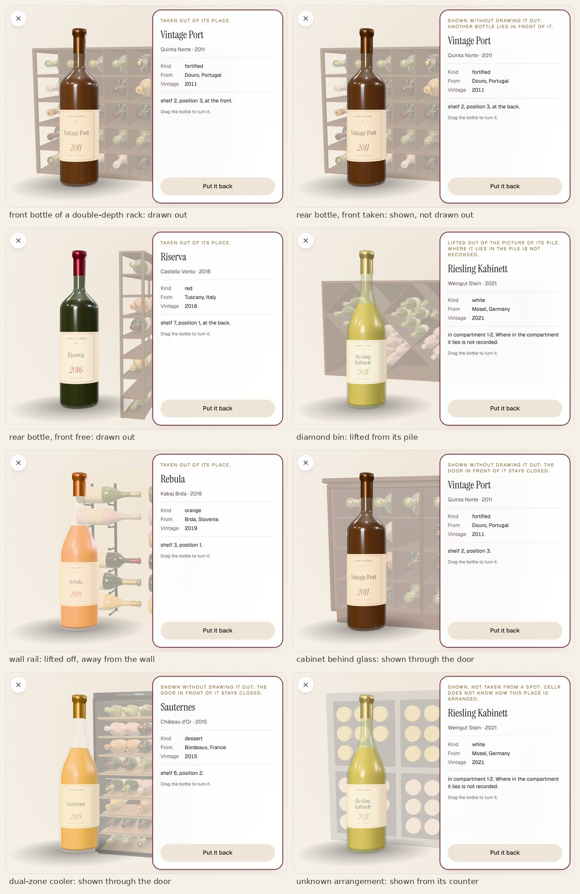

# Smart Cellar 3D — sprint 2B.1: the bottle showcase

2026-11-14. Taking a bottle out of the new storage view to look at it: a state machine, a plan per bottle for how
it may leave its place, a film that plays it, a picture of the place that stands in behind it, a panel, and the
gallery to try it in. **No product screen uses any of it. Nothing was merged, deployed, migrated or switched on,
and no database was touched: this sprint has no SQL and no API in it.**

Read with: [`ADR-003`](./ADR-003-bottle-showcase.md) (the decisions), [`ADR-002`](./ADR-002-layout-driven-renderer.md)
(the view it is built into) and [`ADR-001`](./ADR-001-templates-and-slot-identity.md) (what an index means).

## 1. What the existing showcase is, and what was reused

Read before anything was written: `three/showcase.tsx`, `scene.tsx`, `pose.ts`, `layout.ts`, `label-texture.ts`,
`cellar-3d-view.tsx`, and the browser tests of the existing showcase (`cellar3d*.spec.ts`).

| The existing showcase                                                         | Here                                                                                                                                            |
| ----------------------------------------------------------------------------- | ----------------------------------------------------------------------------------------------------------------------------------------------- |
| The movement is one number, `progress`, through `showcasePhases`              | **Reused**: the same phases (slide, rise, glide) for a bottle that is drawn out.                                                                |
| The bottle on display: fine lathe geometry, clear glass, the wine, the labels | **Reused**: the same profiles, colours and look (`three/layout.ts`), in a kit made once per scene.                                              |
| `makeLabelTexture`, `makeBackLabelTexture`, `makeShadowTexture`               | **Reused** as they are.                                                                                                                         |
| At progress 0 the bottle is exactly the rack's bottle (`rackMatrix`)          | **Same idea**, against the new view's own `poseMatrix`, for any pose.                                                                           |
| A still of the rack stands in once the bottle has slid clear                  | **Same idea**, simpler: the camera is locked, and a new size is a new still.                                                                    |
| Studio lights always in the scene; shaders compiled ahead (`Prewarm`)         | **Changed**: the lights are in the scene only while the place is a picture (§10 says why). Warm-up as before, plus the fonts labels are set in. |
| `showcaseFrame`: where the bottle stands beside the panel                     | **Reused** for a wide picture; a narrow one gives the bottle the whole picture (panel below).                                                   |
| A slot is `(row, col)` of a grid; out is `+z` by a fixed length               | **Not reused.** A bottle has a pose and an address; the way out is planned and checked per bottle.                                              |
| Hands off to `slotPosition` / `rackMatrix`                                    | **Not reused.**                                                                                                                                 |

`three/showcase.tsx` and every other file in `three/` are unchanged, byte for byte.

## 2. Architecture

```
showcase-machine.ts   idle → extracting → inspecting → returning → idle        WHAT MAY HAPPEN   (pure data)
showcase-plan.ts      planExtraction(model, bottle, placed) → ExtractionPlan   HOW IT LEAVES     (pure numbers)
                        physical: a checked path  ·  lift / emerge: no path, and why
showcase-film.ts      filmAt(plan, progress, display, yaw) → position, turn,   THE MOVEMENT      (arithmetic)
                        scale, opacity, look
hero-kit.ts           the one bottle on display: geometry, materials, look     THE RESOURCES     (three.js, owned)
showcase-hero.tsx     plays the film in the view; the picture of the place;    THE ANIMATION     (React Three Fiber)
                        turning; hand-off measurement; warm-up
inspectable-storage.tsx   the view + the picture behind it + the panel;        WHAT A PERSON TOUCHES (DOM)
                        taps, Escape, focus; holds the machine's state
template-scene.tsx    + optional `inspection`: hides the bottle that is out, locks the camera, mounts the hero
```

Animation and meaning are apart: the machine and the plan know nothing of frames or three.js and are tested
without a browser; the hero knows nothing of which bottle may be taken or what an index means.

## 3. The interaction, and the state machine

```
idle ──open──▶ extracting ──arrived──▶ inspecting ──dismiss──▶ returning ──returned──▶ idle
                   │                                               ▲  │
                   └──────────────dismiss──────────────────────────┘  └──open (the same bottle)──▶ extracting
any state ──cancel──▶ idle
```

| What a person does                                          | What happens                                                                                |
| ----------------------------------------------------------- | ------------------------------------------------------------------------------------------- |
| Taps a bottle in the 3D view                                | It becomes the chosen bottle and is taken out (`open`).                                     |
| Chooses a bottle in the flat picture, presses "Take it out" | The same.                                                                                   |
| Drags across the picture while a bottle is out              | The bottle turns (with a little momentum). The place does not: its controls do not listen.  |
| Taps beside the bottle, presses Escape, either close button | It goes back (`dismiss`), from wherever it is, the way it came.                             |
| Taps another bottle while one is out                        | The one that is out goes back. The selection does not change halfway through a movement.    |
| Changes the template, the look or the bottles               | `cancel`: the inspection is over at once; the place is drawn again; nothing is left behind. |
| The browser takes the graphics memory back                  | `cancel`; the gallery says so and can start again (as in 2A).                               |

Refused (the same state object comes back, which the tests check): another bottle while one is out or moving;
"arrived" or "returned" with nothing to end; an ending reported by an inspection that is already over.

Events are judged against the state as it is at that instant, not as of the last render: several taps can arrive
before React draws again.

**Focus and keys.** When the bottle has arrived the panel (a named `dialog`, not modal) takes the focus without
scrolling the page; when it is home the focus returns to where it came from. Closed, the panel is `inert`.
**Reduced motion.** The two ends of the film are all there is: out, and back on the same spot.

## 4. What each family does

| Place                                                   | A bottle is…                                                       | Why                                                                                                     |
| ------------------------------------------------------- | ------------------------------------------------------------------ | ------------------------------------------------------------------------------------------------------- |
| Racks, shelving, an open cabinet (grid, front bottle)   | **drawn out** along its own axis until clear, then turned          | The path is checked against every board, rod and bottle: it touches nothing.                            |
| Wall pegs and rails (wall)                              | **drawn out**: lifted off what carries it, then away from the wall | The same check. (The rail's tip was lowered by 8 hundredths so a bottle can pass over it.)              |
| A rack or rail several deep, bottle behind a free front | **drawn out** through the free place                               | Nothing is in its way. Its index stays what it is.                                                      |
| …bottle behind a taken front                            | **shown, not drawn out** (`emerge`)                                | It is not drawn through the bottle in front.                                                            |
| A cabinet or cooler behind glass                        | **shown, not drawn out** (`emerge`)                                | The door is not opened by this view.                                                                    |
| A cooler with its door open                             | **shown, not drawn out** (`emerge`)                                | The lip of its slide-out shelf holds the bottle; the shelf is not slid out by this view.                |
| Cubes, diamond bins, crates (bins)                      | **lifted out of the picture** (`lift`)                             | The place in a pile is an illustration. No path is claimed, for any index.                              |
| A place whose arrangement is not known                  | **shown from its counter** (`emerge`)                              | There is no spot to take it from. The counter stays; the bottle fades up from it.                       |
| A place from before templates                           | the existing view's own showcase                                   | Not drawn by the new view at all (ADR-002). Its showcase is in the app; the gallery only chooses there. |

In every case the panel says which of the two it was ("Taken out of its place." or "Shown without drawing it out:
…"), and where the bottle is kept, in words that claim no more than is known.

## 5. The hard cases

| Case                                   | What happens                                                                                                                                                          | Pinned by                                                             |
| -------------------------------------- | --------------------------------------------------------------------------------------------------------------------------------------------------------------------- | --------------------------------------------------------------------- |
| Double-depth rack, front bottle        | Drawn out. The bottle behind stays.                                                                                                                                   | plan test; browser test                                               |
| Rear bottle, front **taken**           | `emerge`, reason `behind_bottle`. It fades up from its place and comes forward out of the picture; it is never moved through the front bottle. Address stays index 2. | plan test (also three deep); browser test; flat picture marks place 2 |
| Rear bottle, front **free**            | Drawn out through the free place: a longer way to the same point before the rack. Address stays index 2.                                                              | plan test; browser test                                               |
| Diamond bin                            | `lift`, reason `pile`. The same bottle stored with another index gets the same plan from the same place in the pile. The pile it returns to is the pile it left.      | plan tests; browser test                                              |
| Wall rails                             | Drawn out: up over the tip, away from the wall. Three deep: the front one drawn out, the others shown.                                                                | plan test (path shape, collisions); browser test                      |
| Closed cabinet with a glass door       | `emerge`, reason `behind_door`. A tap goes through the glass (2A) and the bottle is shown through it.                                                                 | plan test; browser test                                               |
| Cabinet with solid doors (drawn open)  | Drawn out between the open leaves.                                                                                                                                    | plan test; browser test                                               |
| Dual-zone cooler                       | `emerge`: `behind_door` behind glass, `blocked` (the shelf's lip) with the door open.                                                                                 | plan test; browser test                                               |
| Unknown arrangement                    | `emerge`, reason `unknown_arrangement`, from the counter, at a counter's size. No furniture, no depth, no path.                                                       | plan test (four kinds); browser test                                  |
| A bottle behind a bottle behind a door | Said as `behind_bottle`: what a person would see first.                                                                                                               | plan test                                                             |

## 6. Visual continuity, in numbers

Measured by the view at every return and read by the tests (`data-handoff-pose`, `data-handoff-drift`):

- **Pose**: the largest difference between the film's last matrix and the storage view's matrix for that bottle.
  Required ≤ 1e-9; measured **0** in every case run (the two are the same arithmetic at progress 0).
- **Drift**: how far, in px, the bottle's spot in the picture of the place is from where the camera sees it now.
  Required ≤ 0.5; measured **0.00**, also after the view was resized three times while the bottle was out.
- **No duplicate**: the instance of the bottle is shrunk to nothing in the same commit in which the bottle on
  display appears, and restored in the commit in which it is removed. A counter stays (it is not the bottle).
- **No gap between the place and its picture**: the picture is in the page before the frame that stops drawing
  the place is shown, and it is removed two frames after the place is drawn again.
- **No camera reset**: azimuth and distance are identical before, during and after (tested, including after the
  bottle was turned and the wheel was used).
- **The same spot on the screen**: the bottle on display stands at the same pixels for a rack, a wall and a bin,
  each turned to a different angle first (tested).

## 7. The gallery

`/design/cellar-3d`, behind the same gate as before (unchanged: `next dev`, or a Vercel preview that asked).

- **Tap a bottle** in the 3D view: it is taken out. Drag to turn it. Tap beside it, press Escape, or use the close
  button in the picture or "Put it back" in the panel.
- **From the flat picture**: choose a position, then "Take it out" (the way to reach a bottle by keyboard).
- **"Showcase: the hard cases, one link each"** under the picture: ten links, each opening a place with one bottle
  already taken out (front and rear of a double-depth rack, a diamond bin, wall rails, a cabinet with its door
  closed and open, a dual-zone cooler, an unknown arrangement).
- Any picture can be linked with a bottle out: `…&inspect=b-2:3:1` (row, column, index of a made-up bottle).
- The readout beside the controls shows draw calls, triangles, geometries, textures and shader programs live, so
  it can be watched that nothing grows.

The wines, their regions and their labels are made up (`fixtures.ts`). No request leaves the page while a bottle
is looked at (tested).

## 8. Pictures

In [`screens/`](./screens/), taken by `e2e/visual-showcase3d.spec.ts` from the production build (software
rendering: a little rougher than on a device):

| Picture                                                              | What                                                                                                         |
| -------------------------------------------------------------------- | ------------------------------------------------------------------------------------------------------------ |
| [`showcase-shown-desktop.jpg`](./screens/showcase-shown-desktop.jpg) | The eight hard cases on display, desktop: the bottle, the place behind it as a picture, the panel beside it. |
| [`showcase-film-desktop.jpg`](./screens/showcase-film-desktop.jpg)   | Each case three times: halfway home, on display, back on its spot (with the ring of the chosen bottle).      |
| [`showcase-shown-phone.jpg`](./screens/showcase-shown-phone.jpg)     | The eight cases on a 390 px phone: the bottle fills the picture, the panel is below it.                      |



In the film sheet the difference between the two kinds of movement can be seen: a bottle that is drawn out is
halfway out of its cell with the live place around it; a bottle that is only shown is already in front of the
picture of the place.

To take them again: `VISUAL_SHOWCASE3D=1 SHOTS_DIR=/some/dir pnpm exec playwright test visual-showcase3d
--project=desktop`.

## 9. Tests and checks

All run on 2026-11-14 on the branch, against the production build where a browser is involved.

| Check                                                                                                                       | Result                                                                                                                                                                  |
| --------------------------------------------------------------------------------------------------------------------------- | ----------------------------------------------------------------------------------------------------------------------------------------------------------------------- |
| `pnpm format:check`, `pnpm lint`, `pnpm typecheck`                                                                          | clean (lint: 0 errors, 1 warning from before this sprint)                                                                                                               |
| `pnpm test`                                                                                                                 | `apps/web` 1,058 passed, 12 skipped (as before); `packages/domain` 902; scripts 86 + 83                                                                                 |
| of which new in this sprint                                                                                                 | 85 tests in 4 files (below)                                                                                                                                             |
| `three/legacy-parity.test.ts`, `three/layout.test.ts`                                                                       | pass, files unchanged                                                                                                                                                   |
| `pnpm build`, bundle-secrets check, `pnpm migrations:check`                                                                 | build succeeds; no server secrets in the client bundle; 0 new migration files, none changed                                                                             |
| `e2e/storage-showcase.spec.ts` (new), desktop and phone profiles                                                            | 49 passed, 9 skipped (tests that need a mouse or a keyboard, on the phone profile; the phone-only test, on the desktop one)                                             |
| `e2e/storage-gallery.spec.ts` (2A, adapted where a tap now takes a bottle out)                                              | 66 passed, 2 skipped                                                                                                                                                    |
| The existing showcase's browser tests (`cellar3d`, `cellar3d-precision`, `cellar3d-premium`, `three-view`), files unchanged | 22 passed, 1 failed: `cellar3d.spec.ts:171`, which fails the same way on `main` in this environment (shown in sprint 2A; none of the files that page loads has changed) |

**New unit tests (85)**

| File                       | Tests | What they pin                                                                                                                                                                                                                                                                                                                                                                                                                                                                                                                                                          |
| -------------------------- | ----: | ---------------------------------------------------------------------------------------------------------------------------------------------------------------------------------------------------------------------------------------------------------------------------------------------------------------------------------------------------------------------------------------------------------------------------------------------------------------------------------------------------------------------------------------------------------------------- |
| `showcase-machine.test.ts` |    10 | The four states and their order; interruption on the way out; turning round on the way home; cancel from anywhere; every refusal returns the same state; a stale ending cannot finish a later inspection; ten thousand random events never break an invariant.                                                                                                                                                                                                                                                                                                         |
| `showcase-plan.test.ts`    |    46 | What every bottle of every template gets (a table); the address and the pose carried untouched; planning changes nothing; **every physical path, checked finer than the planner samples, touches no part and no bottle**; the shape of a wall bottle's way out; rear bottles (two and three deep, rails); doors; coolers; piles (the plan is about the bottle, not its index; the pile returned to is the pile left); four kinds of unknown arrangement.                                                                                                               |
| `showcase-film.test.ts`    |    17 | **At progress 0 the film's matrix equals the storage view's, bit for bit, for every bottle of every template, however it was turned**; the same frame in either direction; at 1 it is at the display spot, upright, at size; the same place on the screen for every template and camera angle; never a jump over 400 steps; a drawn-out bottle stays on its path, lying as it lay, until clear; an inspection transition goes straight; fading; reduced motion; where the bottle stands on a wide and a narrow picture, on a 320 px phone, below a notch, at any size. |
| `hero-kit.test.ts`         |    12 | A shape's geometry is made once; a hundred inspections make nothing new; everything is released with the scene, and a label's pieces with its inspection; shared pictures are not released; **in its place the bottle's glass equals the storage view's at every level of detail**; no step in any number of the look; the fading bottle; labels put on and taken off; the warm-up set covers what it must and releases its own.                                                                                                                                       |

**Browser tests (`storage-showcase.spec.ts`, 29 per profile):** a tap takes the bottle out, shows what it is, and
Escape puts it back with pose difference ≤ 1e-9 and drift ≤ 0.5 px; the bottle taken out is the bottle tapped;
the same place on the screen for a rack, a wall and a bin turned to different angles; a drag turns the bottle and
not the place, the wheel does not zoom the place, and the place can be turned again afterwards; **a finger takes
it out, turns it and puts it back** (touch events, phone profile); a 320 px phone; chosen by keyboard, taken out
with a button, the panel focused, put back, the focus returned; the close button; no accessibility violations
with a bottle on display (axe); reduced motion; a burst of taps and Escapes leaves at most one bottle out and
nothing half done; another bottle is refused while one is on its way home; **changing the template or the
bottles during a movement ends it cleanly**; **resizing the window three times while a bottle is out** retakes
the picture at each size and the bottle still lands on its spot; **losing the graphics context while a bottle is
out**; no growth of geometries, textures or programs over repeated inspections; no shader compiled at the first
inspection; nothing drawn while the bottle stands still and no request made; the nine hard cases, each with its
mode, its reason, its words, its spot in the flat picture, and its return; every one of the 14 templates.

**Two things of sprint 2A that these tests found**, both corrected here:

- The counters of the neutral picture (a place whose arrangement is not known) lost their places when the level of
  detail changed: the instanced mesh was made anew with the new level and its positions were not set again. It
  showed when turning a bottle made the view step its detail down. They are now made anew together with their
  positions, and detail no longer steps down while a bottle is out.
- A wall rail's upturned tip was taller than the room between a bottle and the rod of the row above: a bottle
  could not be lifted over it. It is 8 hundredths lower.

The gallery's selection also survived a change of template (the made-up bottles share ids); it is cleared now.

## 10. Performance and resources

**Read this first.** Measured in one place: headless Chromium 153 on Linux, 4 cores, **no graphics card: WebGL
drawn by software** (ANGLE on SwiftShader), a 1280×800 window at 1×, the production build. A software rasteriser
needs over half a second for one picture of a place. So: draw calls, triangles, geometries, textures and programs
are properties of the scene and hold on any device; **times only compare this build with the one before it, on
this machine. Nothing here is a claim about a phone, and no real device was used.** The checklist for that is §12.

How: `e2e/perf-showcase3d.spec.ts` (`PERF_SHOWCASE3D=1`), and for "before" the same script run on `main` at
`cbddbbb` before any change of this sprint. Six inspections per place. The numbers are three.js' own
(`renderer.info`) and timestamps the view writes.

### Before and after the showcase was built in, at rest and while the place is turned

| Place (bottles, detail)    |        | Draw calls | Triangles | Geometries | Textures | Drawn in 3 s at rest | Turning: ms per picture (median) |
| -------------------------- | ------ | ---------: | --------: | ---------: | -------: | -------------------: | -------------------------------: |
| Rack 5×8 (40, high)        | before |         15 |    87,952 |         26 |        5 |                    0 |                              600 |
|                            | after  |         15 |    87,952 |         26 |        5 |                    0 |                              600 |
| Rack 10×20 (200, balanced) | before |         15 |   162,796 |         26 |        5 |                    0 |                              583 |
|                            | after  |         15 |   162,796 |         26 |        5 |                    0 |                              600 |
| Rack 30×30 (900, low)      | before |         12 |   349,956 |         25 |        4 |                    0 |                              817 |
|                            | after  |         12 |   349,956 |         25 |        4 |                    0 |                              850 |

A place with no bottle out draws exactly what it drew before. (The turning times differ by less than they vary
between runs here.)

**This was not so at first, and the measurement is what showed it.** The first version kept the bottle's two
studio lights in the scene all the time, dark, as the existing view does, so that taking a bottle out would never
change the number of lights. Turning the place was then 17 to 20 % slower in this environment (717 / 700 / 967
ms): a light in the scene costs every pixel of every material, lit or not. Now the lights are in the scene only
while the place is a picture and only the bottle is drawn; the bottle's shaders are prepared for both.

### Taking a bottle out

| Place                      | Draw calls: rest → on display → back | Triangles on display | Tap to first movement: first, then later ones | Shaders compiled at the first inspection | Drawn in 2 s on display |
| -------------------------- | ------------------------------------ | -------------------: | --------------------------------------------- | ---------------------------------------- | ----------------------: |
| Rack 5×8 (40, high)        | 15 → **9** → 16                      |                7,692 | 37 ms, then 16 to 25 ms                       | none (26 before, 26 during)              |                       0 |
| Rack 10×20 (200, balanced) | 15 → **9** → 16                      |                7,692 | 35 ms, then 22 to 42 ms                       | none (25, 25)                            |                       0 |
| Rack 30×30 (900, low)      | 12 → **8** → 13                      |                7,402 | 56 ms, then 25 to 50 ms                       | none (24, 24)                            |                       0 |

- **On display only the bottle is drawn**: 8 or 9 draw calls and about 7,500 triangles, whatever the size of the
  place behind it, because the place is a picture then. "Back" is one more than "rest": the ring of the chosen
  bottle.
- **The first tap is not slower for compiling**: every shader the bottle uses, under both sets of lights, exists
  before it (the 8 to 10 programs of the place become 24 to 26 after warm-up, done while idle). The fonts labels
  are set in are fetched then too: no request leaves the page while a bottle is looked at.
- **Nothing is drawn while the bottle stands still**, on display or back.

### Frame pacing of the movement (software rendering)

| Place                 | On the way out: ms per picture, median / p95 (pictures) | On the way home: median / p95 (pictures) |
| --------------------- | ------------------------------------------------------- | ---------------------------------------- |
| Rack 5×8 (40, high)   | 100 / 633 (17)                                          | 483 / 567 (11)                           |
| Rack 10×20 (200)      | 83 / 667 (20)                                           | 450 / 617 (12)                           |
| Rack 30×30 (900, low) | 67 / 933 (23)                                           | 83 / 867 (13)                            |

Two kinds of picture are in there. While the place is live (the first part of the way out, the last part of the
way home) a picture costs what a picture of the place costs here: the p95. Once the place is a picture, a frame
is the bottle alone: the median on the way out. The frame in which the place is drawn for its picture is one
such expensive frame, not two. On a graphics chip both kinds will be far shorter; whether the expensive ones are
short enough on a phone at 900 bottles is the first thing to look at there.

### Resources over repeated inspections

Geometries / textures / programs held after each of six inspections:

| Place      | at rest     | after 1 | 2       | 3       | 4       | 5       | 6       |
| ---------- | ----------- | ------- | ------- | ------- | ------- | ------- | ------- |
| Rack 5×8   | 26 / 5 / 26 | 34/6/26 | 38/6/26 | 38/6/26 | 38/6/26 | 42/6/26 | 42/6/26 |
| Rack 10×20 | 26 / 5 / 25 | 34/6/25 | 34/6/25 | 34/6/25 | 34/6/25 | 34/6/25 | 38/6/25 |
| Rack 30×30 | 25 / 4 / 24 | 32/5/24 | 36/5/24 | 36/5/24 | 36/5/24 | 40/5/24 | 40/5/24 |

- The first inspection adds the bottle's kit, once: its shadow pieces, the ring, and the four geometries of that
  bottle's shape (+8 geometries, +1 texture).
- **A step of +4 geometries happens exactly when a bottle shape is looked at for the first time**, and there are
  three shapes: the ceiling is 16 geometries above the place's own, reached after one bottle of each. A browser
  test takes one bottle of each shape out and then twelve more: the counts do not move.
- While a bottle is on display it holds two textures more (its front and back label), released when it is back.
- Textures and programs do not grow at all after the first inspection.
- Hand-off over all eighteen inspections: pose difference 0, drift 0.00 px.

**Not measured:** any real phone or tablet; a phone-sized viewport; memory as the browser reports it; heat and
battery; long sessions; a place with the storage view at the highest detail and 900 bottles (the levels exist so
that it is not).

## 11. Known limitations

1. **Nothing was measured on a real device.** See §10 and the checklist in §12.
2. **A door is not opened and a cooler's shelf is not slid out.** Bottles behind them are shown, not drawn out.
3. **A pile does not settle** while one of its bottles is out: the picture of the place shows the pile with that
   bottle's place empty, dimmed, until it is back. (Settling, and returning to the top, is described in ADR-003
   as a later design.)
4. **A rear bottle behind a taken front fades up**, and the instance reappears at the end of its return in one
   frame. Behind another bottle that is a sliver; from the side of an open rack it can be seen.
5. **On a phone the picture keeps its size**: the bottle fills the picture (over 330 px tall on a 320 px phone), the
   panel is below it. It does not take the whole screen, and so does not meet a notch; `safeTop` is supported
   by the arithmetic and tested, for the screen that will.
6. **At the lowest level of detail** the bottles in the place are ten-sided and the bottle on display is round:
   at the hand-over the outline changes by less than a pixel at that size, but it is a change.
7. **The showcase of a place from before templates is not in the gallery.** It is the app's, unchanged, with its
   own tests.
8. **English only**: `InspectableStorage` takes its words as a prop; the app's two languages come with the screen.
9. **A rear bottle cannot be chosen in the flat picture** (2A's rule: a position stands for its front bottle). It
   is chosen in the 3D view when the front is free, or by a link.
10. **`e2e/cellar3d.spec.ts:171` fails on `main` in this environment** (reported in 2A; unchanged).

## 12. For sprint 2B.2

**Material and lighting work** belongs there (none was done here). And first of all, **real devices**:

### Device test checklist

Open `/design/cellar-3d` on a preview deployment that has `DESIGN_GALLERY=1`. For each device write down the model,
OS and browser version. Devices: one recent iPhone (Safari), one older iPhone (three or more years), one mid-range
Android (Chrome), one low-end Android (4 GB or less), one iPad, one laptop with integrated graphics.

For each of these three links (they fix the template, size and detail):

- `?template=rack_classic&rows=5&cols=8&fill=full` (40 bottles)
- `?template=rack_classic&rows=10&cols=20&fill=full` (200)
- `?template=rack_classic&rows=30&cols=30&fill=full` (900)

1. **Detail level chosen** ("Detail level" in the readout), and whether it steps down by itself while turning.
2. **Turning the place**: smooth, or stuttering? (Screen recording at 60 fps, count dropped frames over 5 s.)
3. **Tap a bottle**: time from the tap to movement (the readout does not show it; `data-inspect-latency` on the
   canvas does, in the web inspector). Does the first tap after loading feel slower than later ones?
4. **The way out and the way home**: any jump, flash, missing place, or second bottle? Any frame where the place
   is gone or doubled when it steps back or comes forward?
5. **Turning the bottle** with a finger: follows the finger, keeps a little momentum, the place behind does not
   move, the page does not scroll.
6. **The label**: readable at arm's length? Sharp?
7. **Put back** (tap beside, close button): lands exactly, no shift of the place afterwards.
8. **Twenty inspections in a row**: geometries, textures and programs in the readout stay the same after the
   first few; the device does not get warm; the page is not reloaded by the browser.
9. **Rotate the device** while a bottle is out; **switch apps and come back**; **lock and unlock**: the bottle is
   still on display or cleanly back, never half.
10. **The hard cases** (the links under the picture), each once.
11. **Reduced motion** switched on in the OS: out and back without movement.
12. **A screen reader** (VoiceOver, TalkBack): the flat picture reads; "Take it out" opens; the panel is announced;
    "Put it back" closes and the focus returns.

What to bring back: for each device and size, the detail level, a yes/no per point, the latency number, and a
recording of anything that is not right.

Also for 2B.2 or later: opening doors and sliding shelves; a pile that settles; the showcase filling a phone's
screen (with safe areas); the showcase for places from before templates in the same component, if the existing
view is to be retired; Dutch and English.

## 13. What did not change

- No file under `supabase/`: no migration added or run, the legacy unique index stays, depth stays switched off.
- No file under `packages/domain`, `apps/web/src/server`, `apps/web/src/app/api`, `apps/web/src/lib`.
- `three/scene.tsx`, `three/showcase.tsx` and everything else in `three/`, `rack-grid.tsx`, `cellar-3d-view.tsx`,
  placing, moving and swapping: untouched.
- The gallery's gate (`lib/cellar-gallery-gate.ts`) and its tests: untouched.
- No new dependency. No downloaded asset.
- No product screen imports `storage3d/`.
