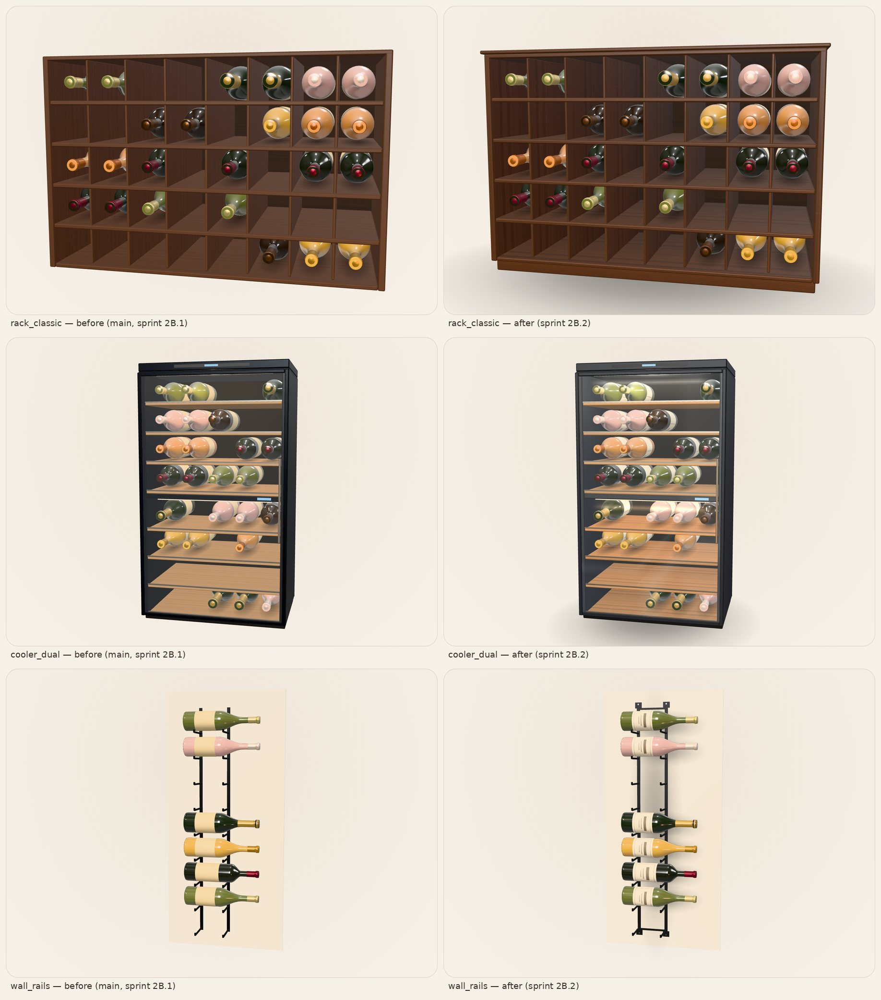
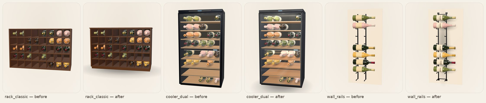
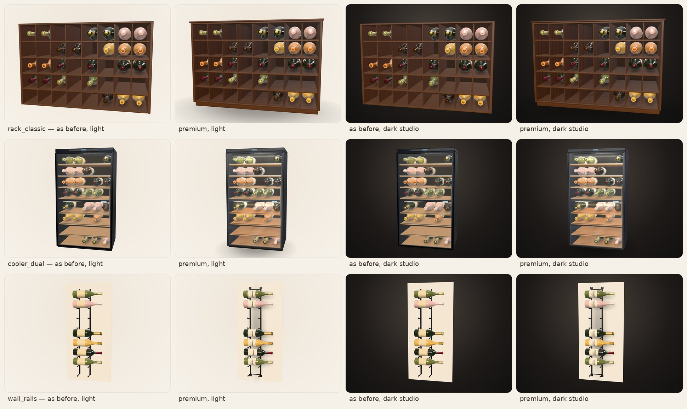
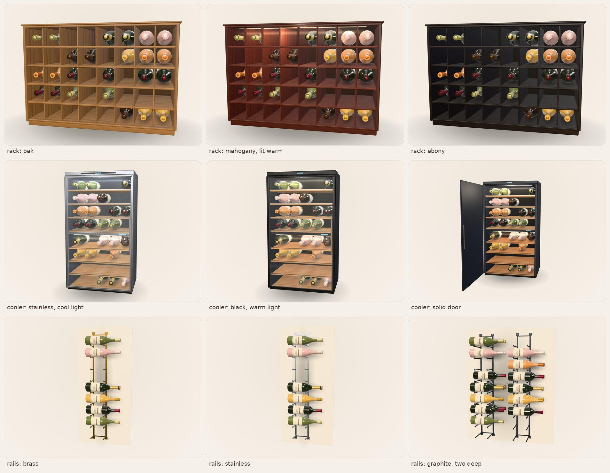
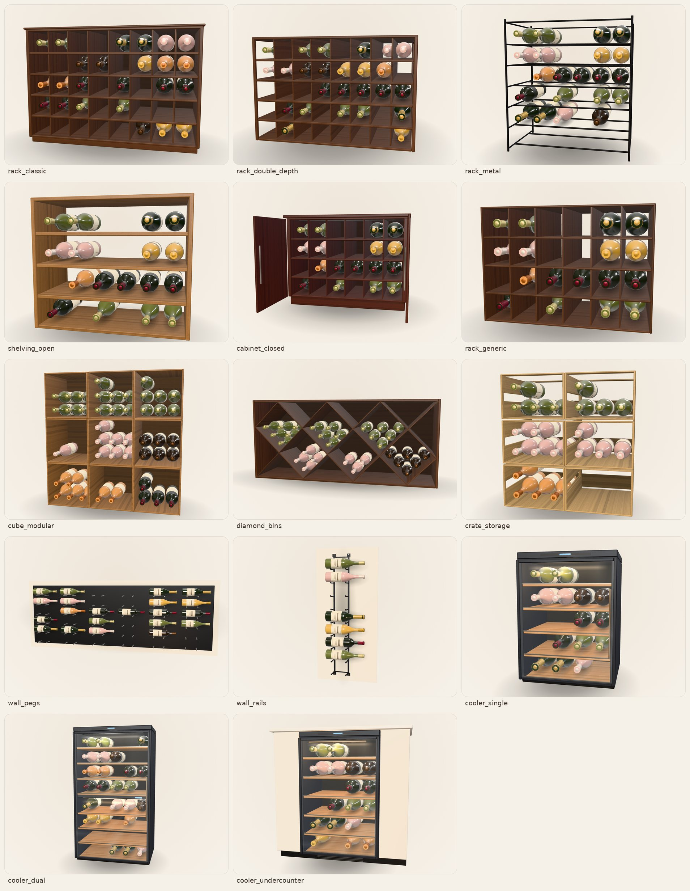
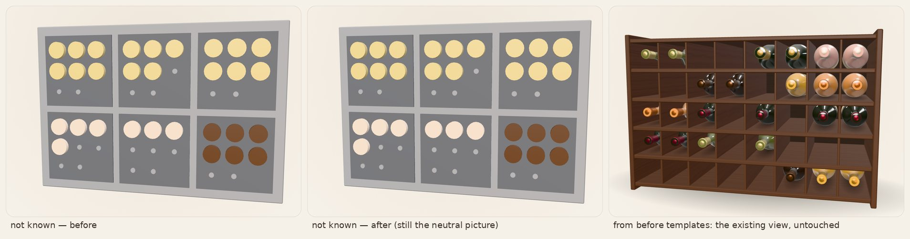
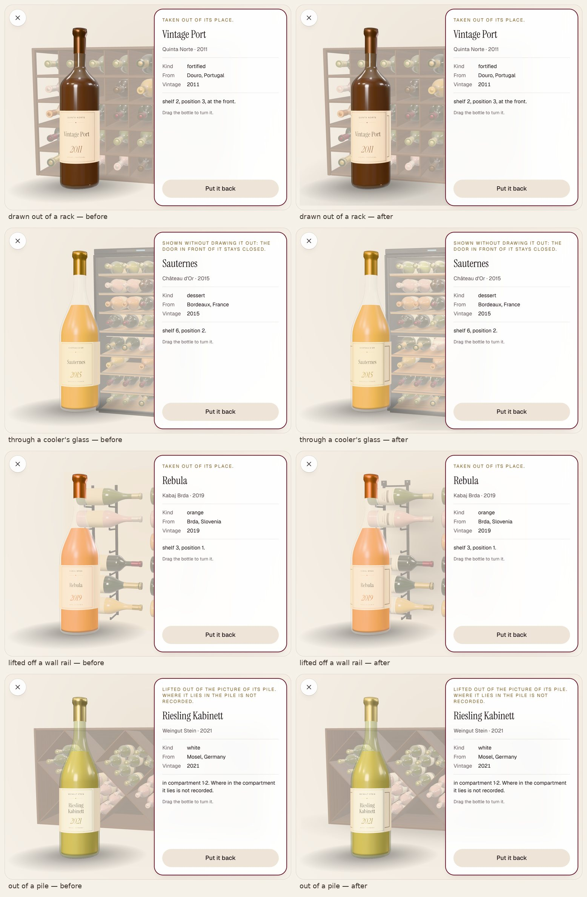
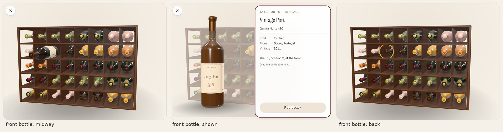

# Smart Cellar 3D — sprint 2B.2: premium visual fidelity and mobile cost

2026-11-14/15. The storage view of sprints 2A and 2B.1 drawn so that it reads as furniture and glass: finer
materials, shading, glass, labels, for all fourteen templates and for the bottle on display, at a measured cost.
**No product screen uses any of it. Nothing was merged, deployed, migrated or switched on, and no database was
touched: this sprint has no SQL and no API in it.**

**No real phone or tablet was available to this sprint.** Everything measured here was measured in software
rendering (SwiftShader) on a 4-core container. Those numbers compare one build with another under identical
conditions; they say nothing about the frame rate of a phone, and none is claimed. §8 is the protocol for the
device validation that is still owed, and that is required before anything is switched on.

Read with: [`ADR-004`](./ADR-004-premium-look.md) (the decisions), [`ADR-002`](./ADR-002-layout-driven-renderer.md)
(the view), [`ADR-003`](./ADR-003-bottle-showcase.md) (the showcase).

## 1. Audit: what made the old picture look artificial

The baseline is `main` at `b82a7e2` (PR #72 merged). Before any change, that build was photographed (54 pictures
of places, 32 of the showcase) and measured (§7). Looking at those pictures:

| Seen in the baseline pictures                       | Cause in the code                                                                      | What was done                                                                                 |
| --------------------------------------------------- | -------------------------------------------------------------------------------------- | --------------------------------------------------------------------------------------------- |
| Every board the same flat brown, grain barely there | One 256 px picture stretched over each face's own 0..1; one colour for the whole frame | A finer grain laid by the part's own measure, begun elsewhere on every part; a tone per board |
| A compartment as bright at the back as at the front | No occlusion: one environment lights everything alike                                  | Depth written into the geometry's corners: full tone in front, half at the back               |
| Furniture floats on the page                        | Nothing where it meets floor or wall                                                   | A soft shadow under it or behind it (one draw call)                                           |
| Bottles like polished marbles                       | Glass roughness 0.05 under environment 1.35                                            | Roughness 0.10, environment 1.05; satin foil; matt paper                                      |
| Blank cream labels                                  | A flat colour                                                                          | A label print seen from afar (one shared picture), and paper with a tooth on display          |
| A cooler's glass is not there; its zones are one    | 14 % glass without a reflection; one light for both zones                              | 34 % glass with two soft bands; each zone lit by its own strip, with a glow                   |
| Wall rails are two black lines                      | No hardware, no shadow                                                                 | Tie bars, wall plates, screw caps; shadows of frame and bottles on the wall                   |
| Black metal is a black silhouette                   | Metalness 0.75 on a dark colour                                                        | Powder coat: paint over metal (metalness 0.3, roughness 0.58)                                 |

The rendering architecture was not replaced: parts merged per material, instanced bottles, demand rendering, the
showcase and its state machine are as they were.

## 2. Architecture and what was improved

```
palette.ts        Fidelity = classic | premium · PREMIUM_FINISH · lookFor(appearance, { fidelity, twoZones })
bottle-look.ts    glass / foil / paper as numbers, read by the rack's bottles AND the bottle on display
textures.ts       7 small pictures, drawn once per page, shared, owned by no scene
resources.ts      premiumPartGeometry (grain by measure, tone per part) → shadingOf / shadeAt / paint (vertex
                  colours) → one merged mesh per material, as before  ·  buildAmbience (glow, ground shadow)
families.ts       + plinth and cornice (classic rack), rail hardware (premium only; no spot moves)
model.ts          buildModel(resolved, fidelity) · QualitySpec + relief / glow / labels
fine-label.ts     the display label on toothed paper (existing drawing, existing size)
inspectable-storage.tsx / showcase-film.ts   + the `sheet` panel layout
```

- **One renderer, two looks.** `classic` draws what sprint 2B.1 drew; it exists so that the gallery and the
  benchmark can compare from one build. `premium` is the default.
- **Materials are definitions, not template code.** A finish is chosen by material and colour; no template has a
  material of its own. The same grey picture serves every colour of a material.
- **Light is not added.** The same lights as before. Shading is computed once per place into vertex colours; the
  glow is a picture; the shadows are pictures. No shadow map, no extra pass, no per-bottle light.
- **Levels of detail** switch glow, ground shadow and label print (and, as before, clear coat, rounding, bottle
  roundness, pixel ratio). They never change a spot, a bottle or what a tap takes.
- **Lighting of zones is not temperature.** Two zones are lit apart so they can be told apart. The view shows no
  temperature; a temperature in CELLR is a target somebody entered, never a sensor reading.

## 3. Changed files

All in `apps/web` and `docs/`. Nothing under `supabase/`, `packages/domain`, `apps/web/src/server`,
`apps/web/src/lib`, `apps/web/src/app/api` or `apps/web/src/features/cellar/three` changed.

| File                                                                             | Change                                                                   |
| -------------------------------------------------------------------------------- | ------------------------------------------------------------------------ |
| `src/features/cellar/storage3d/textures.ts`                                      | **new** — the shared pictures                                            |
| `src/features/cellar/storage3d/bottle-look.ts`                                   | **new** — bottle glass, foil, paper for both looks                       |
| `src/features/cellar/storage3d/fine-label.ts`                                    | **new** — the display label on toothed paper                             |
| `src/features/cellar/storage3d/premium-look.test.ts`                             | **new** — 42 unit tests                                                  |
| `src/features/cellar/storage3d/palette.ts`                                       | fidelity, premium finishes and tones, zone lights                        |
| `src/features/cellar/storage3d/resources.ts`                                     | premium geometry, shading, ambience, bottle kit by look, wall shadows    |
| `src/features/cellar/storage3d/families.ts`                                      | interior zones, plinth/cornice, rail hardware (premium only)             |
| `src/features/cellar/storage3d/model.ts`                                         | `fidelity` on the model, three more level switches                       |
| `src/features/cellar/storage3d/hero-kit.ts`                                      | reads `bottle-look`; label print on the paper; one more shader warmed up |
| `src/features/cellar/storage3d/showcase-hero.tsx`                                | premium label; kit per fidelity                                          |
| `src/features/cellar/storage3d/template-scene.tsx`                               | draws ambience and wall shadows                                          |
| `src/features/cellar/storage3d/showcase-film.ts`, `inspectable-storage.tsx`      | the `sheet` panel layout                                                 |
| `src/features/cellar/storage3d/{model,resources,hero-kit,showcase-film}.test.ts` | extended (§9 says how)                                                   |
| `src/features/design/cellar-gallery.tsx`, `cellar-gallery-state.ts`, `.test.ts`  | look, studio, panel place; the place is not rebuilt for them             |
| `e2e/storage-premium.spec.ts`                                                    | **new** — 27 browser tests per project                                   |
| `e2e/storage-gallery.spec.ts`                                                    | one test's warm-up widened (§9)                                          |
| `e2e/perf-fidelity3d.spec.ts`, `e2e/visual-premium3d.spec.ts`                    | **new** — measuring bench and photographer (run only when asked for)     |
| `docs/sprints/smart-cellar-3d/*`                                                 | this report, ADR-004, the roadmap, 14 picture sheets                     |

## 4. The three reference models

Before: `main` at `b82a7e2`. After: this branch. The same link, the same camera direction and field of view, the
same lights, the same made-up bottles on the same spots. (The camera fits itself to the furniture. The classic
rack is 0.39 units taller with its plinth and cornice and the rails 0.5 with their plates, so those two are drawn
a few percent smaller; nothing else about the camera differs.)



On a phone-sized stage:



**A — `rack_classic`, walnut.** Grain that runs along each board at one scale and starts elsewhere on every
board; boards a few hundredths lighter and darker than their neighbours; compartments that darken towards the
back; a recessed plinth and a slim cornice so it stands as a piece of furniture; a soft shadow on the floor.

**B — `cooler_dual`.** A powder-coated cabinet instead of a black silhouette; a glass door that is there (two
soft bands of reflection) and still shows every bottle; beech shelves with their grain; the upper zone lit cooler
and the lower zone warmer by their own strips, each with a glow; the display a lit bar. No number is shown on it,
and nothing in the picture is a temperature.

**C — `wall_rails`.** Two strips become one rack: tie bars, wall plates and screw caps, all flat against the wall
behind the bottles. The rods under each bottle are where they were (bottle poses are identical to the last
digit, by test). Frame and bottles throw soft shadows on the wall; bottles wear a label print.

From one build, light and dark studio (the dark studio is the gallery box's own background; the app's theme is
untouched, by test):



Other materials and colours of the same three:



## 5. All fourteen templates



Before and after, side by side: [`2b2-templates-before-after-desktop.jpg`](./screens/2b2-templates-before-after-desktop.jpg).
Another look of each: [`2b2-templates-alternate-desktop.jpg`](./screens/2b2-templates-alternate-desktop.jpg).
On a phone: [`2b2-templates-default-phone.jpg`](./screens/2b2-templates-default-phone.jpg).
The three levels of detail: [`2b2-levels-of-detail.jpg`](./screens/2b2-levels-of-detail.jpg).

No layout changed: the catalogue, the spots and the poses are those of sprint 2A (a unit test compares every
bottle's pose in both looks for all fourteen). Only `rack_classic` and `wall_rails` have parts they did not have.

A place whose arrangement is not known still gets the neutral picture, with no furniture, no glow and no shadow
that would suggest more is known than is; a place from before templates is still drawn by the existing view:



## 6. The bottle





- **Glass** less of a mirror in its place and on display; dark and clear glass, the wine's colour and the three
  shapes (Bordeaux, Burgundy, Champagne) as before.
- **Labels in the rack**: one shared picture of a label's print seen from afar, multiplied by each bottle's paper
  colour. Not a label of any wine: lines and a block.
- **Label on display**: the existing drawing of the existing label infrastructure (`drawLabel`), on paper with a
  tooth. Deterministic, made-up wines in the gallery; nothing is downloaded and no AI is called.
- **No jump**: the bottle on display and the bottle in the rack read the same numbers from `bottle-look.ts`, at
  both looks and all three levels (unit test), and wear the same label print at the moment of hand-over. The
  hand-over is still exact: worst pose difference 0, worst drift 0 px over 80 measured inspections (§7).
- **The panel on a narrow screen** now always has a place: if the host gives none below the picture, it is a sheet
  over the lower 46 % of the picture and the bottle stands above it ([phone sheet](./screens/2b2-showcase-before-after-phone.jpg), last picture).

Two things were tried and taken out again because the measurements said so (§7): the display label at twice the
resolution, and relief (bump) on surfaces.

## 7. Performance: baseline against the new look

Bench: `e2e/perf-fidelity3d.spec.ts`. Chromium headless, SwiftShader (software WebGL), 4 cores, 1280×800 at 1×.
Scenes: 40 bottles (`rack_classic` 5×8, high), 200 (10×20, balanced), 900 (30×30, low), 1,200
(`rack_double_depth` 20×30 two deep, low). Each run alone on the machine.

- **before** = `main` at `b82a7e2`, built and measured before any change.
- **classic** = this branch drawing the look of before (`fidelity=classic`): a check that the branch itself costs
  nothing when the look is not used.
- **premium** = this branch as it is.

**Measured** unless marked. Frame times in software rendering are for comparing these columns with each other.
They are **not** a phone's frame times and no frame rate is derived from them.

Environment of all three columns: `ANGLE (Google, Vulkan 1.3.0 (SwiftShader Device (Subzero) (0x0000C0DE)), SwiftShader driver)`, 4 cores, 1280×800 @1x.

**At rest**

| Bottles | Measure                                              | before | classic (this branch) | premium | premium against before |
| ------- | ---------------------------------------------------- | ------ | --------------------- | ------- | ---------------------- |
| 40      | draw calls                                           | 15     | 15                    | 16      | +7 %                   |
| 200     | draw calls                                           | 15     | 15                    | 16      | +7 %                   |
| 900     | draw calls                                           | 12     | 12                    | 12      | same                   |
| 1,200   | draw calls                                           | 11     | 11                    | 11      | same                   |
| 40      | triangles                                            | 87952  | 87952                 | 88602   | +1 %                   |
| 200     | triangles                                            | 162796 | 162796                | 164782  | +1 %                   |
| 900     | triangles                                            | 349956 | 349956                | 355868  | +2 %                   |
| 1,200   | triangles                                            | 466752 | 466752                | 472824  | +1 %                   |
| 40      | geometries                                           | 26     | 26                    | 27      | +4 %                   |
| 200     | geometries                                           | 26     | 26                    | 27      | +4 %                   |
| 900     | geometries                                           | 25     | 25                    | 25      | same                   |
| 1,200   | geometries                                           | 24     | 24                    | 24      | same                   |
| 40      | textures                                             | 5      | 5                     | 7       | +40 %                  |
| 200     | textures                                             | 5      | 5                     | 7       | +40 %                  |
| 900     | textures                                             | 4      | 4                     | 4       | same                   |
| 1,200   | textures                                             | 4      | 4                     | 4       | same                   |
| 40      | shader programs in use                               | 10     | 10                    | 12      | +20 %                  |
| 200     | shader programs in use                               | 9      | 9                     | 11      | +22 %                  |
| 900     | shader programs in use                               | 8      | 8                     | 8       | same                   |
| 1,200   | shader programs in use                               | 8      | 8                     | 8       | same                   |
| 40      | shader programs after warm-up                        | 26     | 26                    | 32      | +23 %                  |
| 200     | shader programs after warm-up                        | 25     | 25                    | 31      | +24 %                  |
| 900     | shader programs after warm-up                        | 24     | 24                    | 28      | +17 %                  |
| 1,200   | shader programs after warm-up                        | 24     | 24                    | 28      | +17 %                  |
| 40      | texture memory, MB (**estimate** from texture sizes) | 17.4   | 17.4                  | 19      | +9 %                   |
| 200     | texture memory, MB (**estimate** from texture sizes) | 17.4   | 17.4                  | 19      | +9 %                   |
| 900     | texture memory, MB (**estimate** from texture sizes) | 17.3   | 17.3                  | 18.6    | +8 %                   |
| 1,200   | texture memory, MB (**estimate** from texture sizes) | 17.3   | 17.3                  | 18.6    | +8 %                   |
| 40      | first picture, ms                                    | 431.3  | 401.1                 | 565.1   | +31 %                  |
| 200     | first picture, ms                                    | 273.7  | 293.6                 | 362.5   | +32 %                  |
| 900     | first picture, ms                                    | 192    | 206.4                 | 206.9   | +8 %                   |
| 1,200   | first picture, ms                                    | 199    | 235.3                 | 204.5   | +3 %                   |
| 40      | frames drawn in 3 s at rest                          | 0      | 0                     | 0       | same                   |
| 200     | frames drawn in 3 s at rest                          | 0      | 0                     | 0       | same                   |
| 900     | frames drawn in 3 s at rest                          | 0      | 0                     | 0       | same                   |
| 1,200   | frames drawn in 3 s at rest                          | 0      | 0                     | 0       | same                   |

**Storage view: turning the place (40 pictures)**

| Bottles | Measure               | before | classic (this branch) | premium | premium against before |
| ------- | --------------------- | ------ | --------------------- | ------- | ---------------------- |
| 40      | frame time, median ms | 583.4  | 600                   | 649.9   | +11 %                  |
| 200     | frame time, median ms | 583.3  | 566.7                 | 616.5   | +6 %                   |
| 900     | frame time, median ms | 783.3  | 833.3                 | 833.3   | +6 %                   |
| 1,200   | frame time, median ms | 1249.9 | 1283.3                | 1366.6  | +9 %                   |
| 40      | frame time, p95 ms    | 683.3  | 733.4                 | 733.3   | +7 %                   |
| 200     | frame time, p95 ms    | 666.6  | 716.6                 | 716.6   | +8 %                   |
| 900     | frame time, p95 ms    | 866.6  | 933.3                 | 916.6   | +6 %                   |
| 1,200   | frame time, p95 ms    | 1450   | 1499.8                | 1716.6  | +18 %                  |

**Showcase: taking a bottle out and putting it back**

| Bottles | Measure                                       | before  | classic (this branch) | premium | premium against before |
| ------- | --------------------------------------------- | ------- | --------------------- | ------- | ---------------------- |
| 40      | tap to first frame, first bottle, ms          | 37.3    | 30.8                  | 45.3    | +21 %                  |
| 200     | tap to first frame, first bottle, ms          | 39.3    | 33.7                  | 47.2    | +20 %                  |
| 900     | tap to first frame, first bottle, ms          | 43.7    | 40.7                  | 72      | +65 %                  |
| 1,200   | tap to first frame, first bottle, ms          | 60.6    | 65.7                  | 60.8    | +0 %                   |
| 40      | tap to first frame, later bottles, median ms  | 18.7    | 18.8                  | 23.4    | +25 %                  |
| 200     | tap to first frame, later bottles, median ms  | 21.7    | 23.3                  | 22.9    | +6 %                   |
| 900     | tap to first frame, later bottles, median ms  | 30.4    | 32.9                  | 42.5    | +40 %                  |
| 1,200   | tap to first frame, later bottles, median ms  | 35.2    | 40.1                  | 41.6    | +18 %                  |
| 40      | programs before / during the first inspection | 26 / 26 | 26 / 26               | 32 / 32 |                        |
| 200     | programs before / during the first inspection | 25 / 25 | 25 / 25               | 31 / 31 |                        |
| 900     | programs before / during the first inspection | 24 / 24 | 24 / 24               | 28 / 28 |                        |
| 1,200   | programs before / during the first inspection | 24 / 24 | 24 / 24               | 28 / 28 |                        |
| 40      | draw calls while on display                   | 9       | 9                     | 9       | same                   |
| 200     | draw calls while on display                   | 9       | 9                     | 9       | same                   |
| 900     | draw calls while on display                   | 8       | 8                     | 8       | same                   |
| 1,200   | draw calls while on display                   | 8       | 8                     | 8       | same                   |
| 40      | way out, frame time median ms                 | 83.4    | 83.4                  | 99.9    | +20 %                  |
| 200     | way out, frame time median ms                 | 66.8    | 66.8                  | 66.7    | -0 %                   |
| 900     | way out, frame time median ms                 | 50      | 50                    | 50      | same                   |
| 1,200   | way out, frame time median ms                 | 50.1    | 66.6                  | 66.7    | +33 %                  |
| 40      | way out, frame time p95 ms                    | 600     | 616.6                 | 650     | +8 %                   |
| 200     | way out, frame time p95 ms                    | 599.9   | 633.3                 | 633.4   | +6 %                   |
| 900     | way out, frame time p95 ms                    | 833.2   | 833.3                 | 916.6   | +10 %                  |
| 1,200   | way out, frame time p95 ms                    | 1149.9  | 1183.2                | 1183.3  | +3 %                   |
| 40      | way home, frame time median ms                | 450     | 450                   | 516.7   | +15 %                  |
| 200     | way home, frame time median ms                | 116.6   | 450                   | 100.1   | -14 %                  |
| 900     | way home, frame time median ms                | 50.1    | 66.6                  | 66.7    | +33 %                  |
| 1,200   | way home, frame time median ms                | 66.6    | 66.7                  | 66.7    | +0 %                   |
| 40      | way home, frame time p95 ms                   | 516.7   | 566.6                 | 600     | +16 %                  |
| 200     | way home, frame time p95 ms                   | 516.6   | 566.7                 | 583.3   | +13 %                  |
| 900     | way home, frame time p95 ms                   | 750     | 733.3                 | 866.6   | +16 %                  |
| 1,200   | way home, frame time p95 ms                   | 1066.6  | 1099.9                | 1216.6  | +14 %                  |
| 40      | worst hand-over: pose difference              | 0       | 0                     | 0       | same                   |
| 200     | worst hand-over: pose difference              | 0       | 0                     | 0       | same                   |
| 900     | worst hand-over: pose difference              | 0       | 0                     | 0       | same                   |
| 1,200   | worst hand-over: pose difference              | 0       | 0                     | 0       | same                   |
| 40      | worst hand-over: drift, px                    | 0       | 0                     | 0       | same                   |
| 200     | worst hand-over: drift, px                    | 0       | 0                     | 0       | same                   |
| 900     | worst hand-over: drift, px                    | 0       | 0                     | 0       | same                   |
| 1,200   | worst hand-over: drift, px                    | 0       | 0                     | 0       | same                   |

### What the numbers say

- **Per frame, the premium look costs 6–11 % more at the median and 6–18 % more at the 95th percentile while a
  place is turned** (software rendering), with one more draw call at the two levels that draw the ground shadow
  and 1–2 % more triangles. That is inside the 20 % that needed no special case. The `classic` column, the same
  code drawing the old look, differs from `before` by −3 % to +6 %: that is the spread of this bench, and
  differences of that size between columns mean nothing.
- **The first picture of a place is about 30 % slower at `high` and `balanced`** (431 → 565 ms and 274 → 363 ms)
  and 3–8 % slower at `low`. This is over 20 % and is accepted for this reason: it is paid once when a place
  opens, not per frame, and it is what the visible difference is made of (the shading computed per corner, two
  more shader programs and three more pictures made for glow, shadow and label print). Which of those is how many
  milliseconds was **not** separated by measurement. It was not hidden behind a spinner or deferred, so the
  number is the whole of it.
- **Taking a bottle out answers as fast as before** once the display label was put back to its existing size:
  later taps 19–35 ms before, 23–43 ms now (4 samples a scene; `classic` on this branch: 19–40 ms).
- **No shader is compiled when the first bottle is taken out**, in any scene: the number of programs during the
  first inspection is the number after warm-up. Warm-up compiles 4–6 more programs than before (28–32 against
  24–26); that happens while nothing else is going on.
- **Texture memory: +1.3 to +1.6 MB (estimate)** for the shared pictures, on about 17.4 MB. Once per page,
  whatever is opened and closed.
- **The hand-over is still exact**: worst pose difference 0 and worst drift 0 px in all 80 measured inspections.
- **Nothing is drawn at rest**, in any scene.
- 900 and 1,200 bottles run at `low`, where the premium look is the finer pictures and the vertex shading only:
  no glow, no ground shadow, no label print. They are the bulk of the triangles and cost what they cost before.

### Two things the measurements took out

| Tried                                                    | Measured                                                                                                                                                                   | Decision                                                                                                                                                                                                                              |
| -------------------------------------------------------- | -------------------------------------------------------------------------------------------------------------------------------------------------------------------------- | ------------------------------------------------------------------------------------------------------------------------------------------------------------------------------------------------------------------------------------- |
| Display label drawn at 1280×1520 with 16,000 grain marks | Tap-to-first-frame went from about 20 ms to about 80 ms at every size                                                                                                      | Removed. On display a label is at most about 500 device pixels tall (an **estimate** from the display frame and a 3× screen); the existing 640×760 has more. The grain is now one 256 px tile laid as a pattern. Back to about 20 ms. |
| Relief (bump) on wood, metal and stone at `high`         | Turning the 40-bottle place: 750 ms median with it; without it 667 ms in a first run and 650 ms in the final one (baseline 583 ms): 29 % against 11–14 % over the baseline | Switched off at every level; the material can still do it (tested). To be judged again on real GPUs, where it is three texture reads a pixel.                                                                                         |

### Guardrails, one by one

| Guardrail                           | State                                                                                                                                                                                            |
| ----------------------------------- | ------------------------------------------------------------------------------------------------------------------------------------------------------------------------------------------------ |
| Demand rendering, no idle frames    | 0 frames in 3 s at rest, all four scenes (measured); a browser test per template                                                                                                                 |
| Instancing, no per-bottle material  | Unchanged: 3 shapes × (glass, label, foil, shadow); +1 instanced wall shadow per shape on wall places                                                                                            |
| Shared geometry and textures        | 7 shared pictures per page, never owned by a scene (unit test)                                                                                                                                   |
| Bounded GPU memory                  | Held resources stand still from the 5th–10th inspection on (measured to 20); look switched 3× there and back: identical counts (browser test)                                                    |
| Dispose owned resources             | Every geometry and material of a place freed on close, all templates × levels × looks (unit test)                                                                                                |
| No unnecessary shader recompilation | Programs during the first inspection = programs warmed up, all four scenes (measured) and the three reference models (browser test). One late shader was found by this test and is now warmed up |
| Context loss                        | Said, and started again, with the premium look up (browser test)                                                                                                                                 |
| No per-bottle shadow-map pass       | There is no shadow map at all                                                                                                                                                                    |
| No external assets, no network      | Nothing downloaded; no dependency added; `package.json` and the lockfile are unchanged                                                                                                           |

## 8. Real devices: not tested. The protocol

**No real device was available.** Nothing below has been done yet. It must be, by someone holding the devices,
before the new view is switched on anywhere in the product. 60 frames a second is the aim, 30 the floor; neither
is claimed.

### Setting up

1. On Vercel, the **Preview** environment needs `DESIGN_GALLERY=1` (the gallery is closed on production whatever
   is set, and stays so).
2. The preview of this branch:
   `https://cellr-git-claude-adoring-cori-jn7num-jp-builds.vercel.app/design/cellar-3d`
3. Add the query of each row below. The panel beside the picture shows draw calls, triangles, geometries, textures,
   shader programs, first picture and frames drawn, live.
4. Frame rate: Safari → Develop → the device → Timelines (iOS), or `chrome://inspect` → Performance (Android).
   Record while doing what the row says.

### Links

Base: `https://cellr-git-claude-adoring-cori-jn7num-jp-builds.vercel.app/design/cellar-3d?`

| #   | What                           | Query to add                                                 |
| --- | ------------------------------ | ------------------------------------------------------------ |
| 1   | Walnut rack, premium           | `template=rack_classic&fill=full`                            |
| 2   | The same, look of before       | `template=rack_classic&fill=full&fidelity=classic`           |
| 3   | Dual-zone cooler, premium      | `template=cooler_dual&fill=full`                             |
| 4   | The same, look of before       | `template=cooler_dual&fill=full&fidelity=classic`            |
| 5   | Wall rails, premium            | `template=wall_rails&fill=full`                              |
| 6   | 200 bottles                    | `template=rack_classic&rows=10&cols=20&fill=full`            |
| 7   | 900 bottles                    | `template=rack_classic&rows=30&cols=30&fill=full`            |
| 8   | 1,200 bottles, two deep        | `template=rack_double_depth&rows=20&cols=30&cap=2&fill=full` |
| 9   | Forced high on a phone         | `template=rack_classic&fill=full&quality=high`               |
| 10  | Dark studio                    | `template=cooler_dual&fill=full&studio=dark`                 |
| 11  | Panel with no place of its own | `template=rack_classic&rows=4&cols=4&fill=full&panel=inside` |
| 12  | A bottle taken out on load     | `template=rack_double_depth&fill=full&inspect=b-2:3:1`       |

### What to do on each device, and what to write down

For rows 1, 3, 5, 6, 7, 8: (a) open; note "First picture" and "Detail level". (b) Turn the place with one finger
for 10 s; note median and worst frame time. (c) Pinch to zoom in and out. (d) Tap a bottle; note whether it comes
out at once, and the frame rate while it moves. (e) Turn the bottle; put it back; do this 20 times; note
"Geometries · textures" after 1 and after 20 (they must stand still after the first few). (f) Leave it alone for
30 s; "Frames drawn" must not rise. (g) Lock the phone, unlock: the picture must be there or say that it can be
shown again. (h) Rotate the phone. Rows 2 and 4 are for telling the looks apart by eye and by frame rate.
Row 9 is for judging whether `high` (and, later, relief) is affordable on that device.

| Device, OS, browser            | Row | Detail level | First picture (ms) | Turning: median / worst frame (ms) | Taking out: frame rate | Geom·tex after 1 / after 20 | Idle frames in 30 s | Heat, battery, anything odd |
| ------------------------------ | --- | ------------ | ------------------ | ---------------------------------- | ---------------------- | --------------------------- | ------------------- | --------------------------- |
| iPhone (recent) · Safari       |     |              |                    |                                    |                        |                             |                     |                             |
| iPhone (4+ years old) · Safari |     |              |                    |                                    |                        |                             |                     |                             |
| Android mid-range · Chrome     |     |              |                    |                                    |                        |                             |                     |                             |
| Android low-end · Chrome       |     |              |                    |                                    |                        |                             |                     |                             |
| iPad · Safari                  |     |              |                    |                                    |                        |                             |                     |                             |
| Installed PWA (iOS)            |     |              |                    |                                    |                        |                             |                     |                             |

Pass: at least 30 frames a second while turning rows 1–6 at the level the view chose itself; no growth of
geometries or textures after the fifth inspection; no frames drawn at rest; labels and glass readable in
daylight; nothing cut off by a notch or a home bar; the panel always reachable. Rows 7 and 8 are stress cases:
note what happens, they are not a gate. The 12-point checklist of the 2B.1 report (touch, focus, reduced
motion, orientation) still applies and is not repeated here.

## 9. Tests

| Check | Result |
| ----- | ------ |

| `pnpm format:check` | clean |
| `pnpm lint` | 0 errors, 1 warning (the one `main` has: an anonymous default export in a config file) |
| `pnpm typecheck` | clean |
| `pnpm test` | web 1,103 passed, 12 skipped (82 files); domain 902; catalog-tools 86; scan-eval 83. Of these, 42 are new in `premium-look.test.ts` and 3 more are new in existing files |
| `pnpm build` | succeeds |
| `scripts/check-bundle-secrets.sh` | no server secrets in the client bundle (89 files) |
| `pnpm migrations:check` | OK: 0 new migration files, none changed |
| Browser, new view: `storage-premium`, `storage-gallery`, `storage-showcase` (desktop and phone projects) | **169 passed, 0 failed**, 11 skipped (tests written for one of the two projects) on the final build; `storage-premium` is 27 tests a project |
| Browser, existing view: `cellar3d*.spec.ts` (desktop and phone) | 32 passed, **3 failed, all three failing identically on `main`** (below), 1 skipped |

What the new browser tests hold: the same bottles on the same screen positions at all three levels of detail
(three reference models); a tap takes the tapped bottle at every level, and it lands back exactly; bottles are
chosen through premium glass; all fourteen templates are drawn, in at most 26 draw calls, and stand still;
switching looks there and back three times leaves geometries, textures and programs where they were; the first
bottle taken out compiles no shader (three reference models); a lost graphics context is recovered from; the dark
studio changes nothing of the app's theme and rebuilds nothing; on a narrow screen with no place for the panel,
the panel is a sheet inside the picture, the bottle is whole above it, and it closes.

**Existing tests that were changed, and why** (none was weakened):

| Test                                                      | Change                                                                                    | Why                                                                                                                                                                                                                                                          |
| --------------------------------------------------------- | ----------------------------------------------------------------------------------------- | ------------------------------------------------------------------------------------------------------------------------------------------------------------------------------------------------------------------------------------------------------------ |
| `model.test.ts` "every look a template offers…"           | Now runs for both looks; pins the classic tones and glow (1.7) and the premium ones (2.2) | It compared against the only tones there were                                                                                                                                                                                                                |
| `resources.test.ts` `everything()`                        | Counts the wall shadow's geometry and material                                            | The bottle kit has two more things to free                                                                                                                                                                                                                   |
| `hero-kit.test.ts` "releases its own copies…"             | 6 copies instead of 5, and checks the new one                                             | One more shader is warmed up                                                                                                                                                                                                                                 |
| `storage-gallery.spec.ts` "changing template gives back…" | Goes once round every template before taking its baseline, then two rounds as before      | The bottle kit outlives a template change and now holds a wall-shadow geometry that reaches the GPU the first time a wall place is drawn. It was caught by this test as +1 geometry; it is bounded (once), and the test still fails on any growth after that |

**Failing before this sprint, and still** (existing tests, not regressions; left alone, as they concern `three/`,
which this sprint does not touch):

| Test                                                                                             | Where             | On `main` at `b82a7e2`                                                                                                                                                       |
| ------------------------------------------------------------------------------------------------ | ----------------- | ---------------------------------------------------------------------------------------------------------------------------------------------------------------------------- |
| `e2e/cellar3d.spec.ts:171` "tapping a bottle in the picture selects it; switching units redraws" | desktop and phone | Fails the same way (known from the earlier sprints in this container)                                                                                                        |
| `e2e/cellar3d-premium.spec.ts:124` "wears both label photos for real…"                           | phone             | Fails the same way: `main` was built again and the test run alone on it during this sprint (expected < 1354, received 7280; on this branch expected < 1612.6, received 5756) |

Whether these two also fail in CI is for CI to say; they were not looked into here.

## 10. Resource lifecycle

Geometries / textures / shader programs held by the view after N inspections of different bottles (measured;
5 timed, 15 with reduced motion). They rise while the three bottle shapes are first seen, then stand still.

| Bottles | Look    | after 1 | after 5 | after 10 | after 20 | texture MB after 20 (**estimate**) |
| ------- | ------- | ------- | ------- | -------- | -------- | ---------------------------------- |
| 40      | before  | 34/6/26 | 42/6/26 | 42/6/26  | 42/6/26  | 17.5                               |
| 40      | premium | 35/8/32 | 43/8/32 | 43/8/32  | 43/8/32  | 19                                 |
| 200     | before  | 34/6/25 | 34/6/25 | 42/6/25  | 42/6/25  | 17.5                               |
| 200     | premium | 35/8/31 | 35/8/31 | 43/8/31  | 43/8/31  | 19                                 |
| 900     | before  | 32/5/24 | 40/5/24 | 40/5/24  | 40/5/24  | 17.4                               |
| 900     | premium | 32/6/28 | 40/6/28 | 40/6/28  | 40/6/28  | 18.7                               |
| 1,200   | before  | 31/5/24 | 35/5/24 | 39/5/24  | 39/5/24  | 17.4                               |
| 1,200   | premium | 31/6/28 | 35/6/28 | 39/6/28  | 39/6/28  | 18.7                               |

From the 10th inspection to the 20th the premium counts are identical in every scene (checked when this table was
made). Unit tests hold that closing a place frees every geometry and material it made, for all templates, levels and
looks, and frees none of the shared pictures; browser tests hold that switching looks three times there and back
leaves the counts where they were, and that a lost graphics context is recovered from.

## 11. Known limitations and risks

1. **No real device has drawn this.** The whole of §8 is open. Software rendering exaggerates what costs pixels
   and hides what costs memory bandwidth and heat.
2. **The shading is a picture of light.** It does not follow the camera, and it will be wrong the day a door opens
   or a shelf slides out: those features will have to repaint or blend it.
3. **Glass is alpha with a reflection picture**, not refraction: bottles behind it are a little washed, on purpose
   (readability over realism). Transparent sorting is as before: glass after everything else.
4. **The grain is procedural.** It reads as wood; it is not a photograph of walnut. A photographic material would
   be an asset to ship and a decision of its own.
5. **`classic` is still in the code.** It is there for comparison and should be removed once the premium look is
   accepted (it roughly doubles the look-related test matrix).
6. **Relief is off.** If device validation shows it is free on real GPUs, `QUALITY.high.relief` is one line.
7. **The first picture is slower** (§7): the shading is computed per vertex when a place is built. It is paid
   once per place, not per frame; a place of 900+ is not slower.
8. **A place with more than 160 parts is not rounded** (as before), so very large racks have hard edges.
9. **The gallery's "as before" look is the furniture of sprint 2A in the look of sprint 2B.1**, from this build;
   the true baseline pictures in this report were taken from `main`.

## 12. Before this reaches the product

1. Device validation (§8), with results written into its table.
2. Sprint 1C (the API reads and writes layouts); then 2B.3 mounts the view behind a flag.
3. Decide whether `classic` goes, and whether relief comes back at `high`.
4. Doors that open and shelves that slide, if wanted: an animation sprint of its own, which has to deal with
   limitation 2.
5. Real labels (photo labels go through the existing `makeLabelTexture` path already; untested here with real
   photos).
6. The standing rules of the roadmap: the legacy unique index stays, depth placement stays off, no migration is
   run against production from here, the gallery never opens on production.

## 13. What did not change

The template catalogue and every layout; `packages/domain`; every migration and the database; every API route
and server module; the production cellar screens (`cellar-3d-view.tsx`, `rack-grid.tsx`) and the existing 3D
view (`three/`), byte for byte; placement and swap behaviour; the showcase state machine and its plans; the
gallery's gate; the app's design system and theme; `package.json` and the lockfile.
