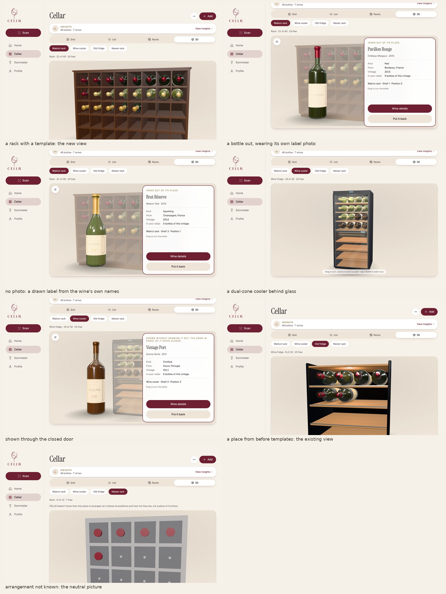
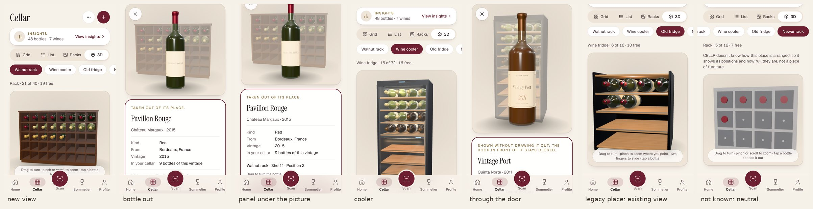

# Smart Cellar 3D — sprint 2B.3: product integration and safe preview

Status: in review (2026-11-18). Branch `claude/adoring-cori-jn7num`. Decisions: [ADR-006](ADR-006-product-integration.md).

**In one paragraph.** The new storage view (sprints 2A–2B.2) now draws real places with real bottles inside the
product's own 3D cellar, read through the Smart Cellar API (sprint 1C). It is behind a gate of its own that is off
by default and **cannot open on production**. With the gate closed the cellar is exactly what it was: no new
request, no new code downloaded. With it open (local development, a Vercel preview), a place with a stored
template is drawn by the new view; every place from before templates keeps the existing view with all its actions;
a place whose arrangement cannot be trusted gets the neutral picture and a sentence saying so. Nothing in this
sprint writes, migrates or deploys.

**Not done, on purpose or by lack of means** (details in §11 and §12):

- No physical phone was available. Every number below comes from software rendering in a container. The manual
  device procedure is in §10 and has to be run before any activation.
- No separate preview database exists. Everything was validated on the local stack (real Postgres 16 with the
  repository's migrations, real PostgREST 12). A Vercel preview talks to whatever database its environment names.
  While this sprint ran, `main` recorded that production holds 0043–0045 since 2026-11-18 (`docs/MIGRATIONS.md`);
  the code still assumes nothing and asks at run time. A database without them gives the existing view (tested for
  real, §8).
- The new view's panel is read-only: "Wine details" and "Put it back". "Open this bottle" and "Move" are not in
  it yet (ADR-006 §6). Places from before templates are unaffected: they keep the existing panel.

## 1. Audit: what was there, and what was reused

| Existing piece                                                      | What this sprint did with it                                                                                                                |
| ------------------------------------------------------------------- | ------------------------------------------------------------------------------------------------------------------------------------------- |
| `cellar-screen.tsx` (Grid / List / Racks / 3D, `cellr-view` cookie) | One prop (`smart3d`) decides which component the `3d` mode mounts. Modes, cookie, navigation untouched.                                     |
| `cellar-3d-view.tsx` (`Cellar3DView`, production 3D)                | Reused **as is** for every place without a template. One optional prop (`only`) lets a parent choose the place; without it nothing changes. |
| `three/` (production renderer)                                      | Not touched.                                                                                                                                |
| `racks-view.tsx`, swap, movement, drag                              | Not touched.                                                                                                                                |
| `hooks.ts` (`useRacks`, `useVintageDetail`, mutations)              | `useVintageDetail` reused for the bottle that is out. The four places that invalidate the racks now also invalidate the Smart Cellar cache. |
| `bottle-showcase-panel.tsx`                                         | Still the panel of the existing view. Not copied.                                                                                           |
| `storage3d/` (`buildModel`, `placeBottles`, `InspectableStorage`)   | Reused as is. `InspectableStorage` gained one optional slot (`actions`) for the product's link.                                             |
| `storage3d/from-api.ts`                                             | The only adapter from API to model, as designed in 1C. Not duplicated.                                                                      |
| `server/smart-cellar/`                                              | The placements read gained three read-only fields (region, country, the bottle's own label photo).                                          |
| `lib/smart-cellar-gate.ts` (API gate)                               | Unchanged. The renderer's gate is a separate file and asks it only "do you read?".                                                          |
| `lib/api-client`, TanStack Query                                    | Used as every other screen does. No new client, no new cache.                                                                               |
| `/api/v1/images/:id` (authorised label photos)                      | The only source of label pictures.                                                                                                          |

## 2. Architecture

```
app/(app)/cellar/page.tsx          server: isSmartCellarRendererEnabled() → smart3d (one boolean)
└─ CellarScreen                    view modes as before; "3d" mounts ONE of:
   ├─ Cellar3DView                 gate closed (default, and always on production)
   └─ SmartCellar3D  (lazy chunk)  gate open
      ├─ useSmartCapabilities ──── GET /api/v1/smart-cellar
      ├─ useSmartUnits ─────────── GET /api/v1/smart-cellar/storage
      ├─ one row of places
      └─ the ONE place on screen:
         ├─ legacy: true ───────── Cellar3DView only={id}        (existing view, existing panel and actions)
         └─ has a template ─────── SmartUnitStage
            ├─ useSmartPlacements(id) ── GET …/storage/:id/bottles
            ├─ from-api.ts → buildModel → placeBottles           (placed / stranded)
            ├─ InspectableStorage (lazy: three.js loads here)    (state machine of 2B.1, look of 2B.2)
            └─ useVintageDetail(vintage of the bottle that is out)
```

One scene exists at any time: the row of places switches which component is mounted, and a place's scene is
disposed when another is chosen (tested: one `canvas`, and geometries/textures do not grow).

## 3. The renderer's gate

`apps/web/src/lib/smart-cellar-renderer-gate.ts`, evaluated on the server in `server/env.ts`
(`isSmartCellarRendererEnabled`) and handed to the screen as a boolean. The browser reads no setting and there is
no `NEXT_PUBLIC_` variable.

| Deployment                                                             | `CELLR_SMART_CELLAR_3D=1` gives |
| ---------------------------------------------------------------------- | ------------------------------- |
| not set, or any value but exactly `1`                                  | off                             |
| `next dev` (environment does not say production)                       | on                              |
| Vercel preview (`VERCEL_ENV=preview`, no custom target)                | on                              |
| Vercel production, or `VERCEL_TARGET_ENV=production`                   | **off, whatever is set**        |
| production build without a Vercel marker, custom environment, test run | **off** (identity unknown)      |

Also required: the Smart Cellar API must read here (`CELLR_SMART_CELLAR=read` or `write`). The gate is independent
of the design gallery's gate (`DESIGN_GALLERY`) and of the API's permission to write: the renderer never writes,
and `read` is enough. Seven unit tests cover the table; two browser tests cover "off" and "asked for on a
production build".

With the gate closed, the browser tests assert: no request to `/api/v1/smart-cellar…`, no script containing the
new view, the `cellr-view` cookie still `3d`, and the existing view ready, for a cellar that even contains a place
with a template.

## 4. Data: hooks and adapters

`features/cellar/smart-cellar-hooks.ts`:

| Hook                              | Request                                        | When                                                    |
| --------------------------------- | ---------------------------------------------- | ------------------------------------------------------- |
| `useSmartCapabilities`            | `GET /api/v1/smart-cellar`                     | once per visit                                          |
| `useSmartUnits`                   | `GET /api/v1/smart-cellar/storage`             | when the 3D view opens; refreshed as the racks are      |
| `useSmartPlacements(id)`          | `GET /api/v1/smart-cellar/storage/:id/bottles` | only for the place on screen, only if it has a template |
| `useVintageDetail(id)` (existing) | `GET /api/v1/cellar/:vintageId`                | only for the bottle that is out; cached per vintage     |

- **Identity.** Bottles keep their own ids from the database end to end; a spot is `row, col, index` as the API
  gives it. `from-api.ts` passes them through; nothing is renumbered.
- **Nothing made up.** A bottle is drawn only on the spot the database names. A bottle whose spot the place does
  not have is listed under the picture with a link to its wine ("stranded"), not moved to a free spot and not left
  out. The count on the stage (`data-bottles` + `data-stranded`) always equals what the API returned.
- **Stable.** A refresh that changes nothing keeps object identity (TanStack's structural sharing), so the scene is
  not rebuilt and a bottle that is out stays out (tested).
- **Not stale.** The racks' four invalidation points now also invalidate `["smart-cellar","storage"]`; the place
  on screen is re-read when the window gets focus again or the view is come back to. A bottle that was opened
  elsewhere while it was selected simply is no longer selected (tested).
- **A selection belongs to its place.** `{unitId, bottleId}`; it only counts while that place is on screen and
  still holds that bottle (`selectedIn`, unit-tested and browser-tested with two places).

Server, read-only and additive: `SmartPlacementView` gained `region`, `countryCode` and `image` (the reference of
the bottle's own front label photo, of this household only). The image references are read in chunks of 150 ids
and go through the same `toImageRef` as the existing cellar API. No existing response changed.

## 5. What the inspection shows

Only what the record holds (`storage3d/product-details.ts`, pure and unit-tested):

| Shown                                              | From                                                                                                                                                                     |
| -------------------------------------------------- | ------------------------------------------------------------------------------------------------------------------------------------------------------------------------ |
| Wine name, producer, vintage, type                 | the placement                                                                                                                                                            |
| Region and country                                 | the placement (new fields)                                                                                                                                               |
| Appellation, bottles of this vintage in the cellar | `useVintageDetail`, asked when the bottle is taken out                                                                                                                   |
| Where it is                                        | `whereOf`: shelf and position; "at the front / place n from the front" only where depth is known; a compartment for bins; "not known" where the arrangement is not known |
| Front label                                        | the bottle's own photo through `/api/v1/images/:id` (the straightened label where there is one)                                                                          |
| Back label                                         | the vintage's own back photo, when the details bring one                                                                                                                 |
| No photo                                           | a label **drawn** from the wine's names and year by the 2B.2 label drawing: a fallback, imitating no real label                                                          |
| "Wine details"                                     | a real link to `/cellar/:vintageId`, where every existing action is                                                                                                      |

No price, drinking window or tasting note is shown that the record does not hold. Nothing is fetched from another
server and nothing is generated while drawing. Choosing the same bottle twice, or two bottles of one vintage,
makes one details request (tested by counting requests).

## 6. Places from before templates, and arrangements that are not known

| The place                                                                                | Drawn by                                                                                                                       | Tested                                                                                  |
| ---------------------------------------------------------------------------------------- | ------------------------------------------------------------------------------------------------------------------------------ | --------------------------------------------------------------------------------------- |
| no template (`legacy: true`)                                                             | the existing view, with its own panel and actions                                                                              | mixed cellar; legacy-only cellar                                                        |
| template, arrangement known                                                              | the new view                                                                                                                   | mixed cellar, cooler behind glass                                                       |
| template unknown to this version, wrong for the kind, or index meaning that does not fit | the new view's **neutral picture**, "CELLR doesn't know how this place is arranged", bottles shown but not "taken from a spot" | unknown arrangement                                                                     |
| the database lacks 0043–0045                                                             | the existing view, whole; nothing is said                                                                                      | route-mocked in the suite; **and for real** against a database stopped before 0043 (§8) |
| no connection / 401 / 500                                                                | an alert in words with "Try again", the existing view under it                                                                 | three scenarios                                                                         |
| one place fails                                                                          | an alert for that place; the others open                                                                                       | one scenario                                                                            |

Reading never writes: the test that opens a legacy place in the new screen compares the stored row before and
after (template still `null`, `slot_semantics` unchanged), and the inspection test compares every bottle row of
the place (spot, status, `updated_at`) before and after a whole inspection.

## 7. The interaction, with real data

All in `e2e/smart-cellar-3d.spec.ts`, against the local stack:

- choose a bottle (tap, or the list for keyboard and screen reader) → it comes out where that is safe, or is shown
  in place where it is blocked (behind glass, behind another bottle);
- turn it; the label is its own photo or the drawn one;
- "Wine details" → the wine's page → back: the same place and the same bottle;
- "Put it back" / Escape: back on exactly its spot. The hand-over pose drift is 0 in every measurement (§9);
- change place: the bottle and the details of the first place are not carried over;
- refresh while a bottle is out; a bottle opened elsewhere; a change made in the app;
- the browser takes the graphics memory back: "the 3D view has paused", "Show 3D again" starts a fresh scene with
  the same bottles;
- reduced motion: out and back without the flight, same spot.

The 2B.1 state machine is unchanged (no line of it was edited); its own suites still pass (§8).

### Pictures

Taken by `e2e/visual-product3d.spec.ts` from the product's screen with a real household in the local stack
(software rendering; colours and edges are softer than on a GPU).

Desktop: a rack with a template in the new view; a bottle out wearing its own label photo; a bottle without a
photo wearing the drawn label; the two-zone cooler behind glass; a bottle shown through the closed door; a place
from before templates in the existing view; a place whose arrangement is not known, as the neutral picture.



Phone: the same seven, with the panel in its place under the picture.



## 8. Tests and local-stack results

### The environment

The local stack (`scripts/local-stack/up.sh`): Postgres 16 with every migration of the repository applied in order
and the seed, a real PostgREST 12 in front of it, and a stand-in for sign-in. The app is the production build
(`next build`, `next start`), three times, one per state of the gate:

| Port | Says it is                               | Set                                                   | The new view  |
| ---- | ---------------------------------------- | ----------------------------------------------------- | ------------- |
| 3100 | nothing                                  | nothing                                               | off           |
| 3101 | a production build with no Vercel marker | `CELLR_SMART_CELLAR=write`, `CELLR_SMART_CELLAR_3D=1` | **stays off** |
| 3102 | a Vercel preview                         | `CELLR_SMART_CELLAR=write`, `CELLR_SMART_CELLAR_3D=1` | on            |

No production system was contacted. No separate preview database was available, so nothing was run against one.

### New tests

| What                                                                                  | Where                                                       | Result                                                                                            |
| ------------------------------------------------------------------------------------- | ----------------------------------------------------------- | ------------------------------------------------------------------------------------------------- |
| The gate: every row of the table in §3                                                | `lib/smart-cellar-renderer-gate.test.ts` (7)                | pass                                                                                              |
| Where a bottle is, which label it wears, whose selection it is                        | `storage3d/product-details.test.ts` (12)                    | pass                                                                                              |
| The placements read: label photo, region, country; ids in chunks; only this household | `server/smart-cellar/repository.test.ts`, `service.test.ts` | pass                                                                                              |
| The product's 3D cellar, 22 scenarios (list below)                                    | `e2e/smart-cellar-3d.spec.ts`                               | 21 of 21 on desktop, 21 of 21 on the phone project (one scenario is desktop-only, one phone-only) |
| A database stopped before 0043, nothing mocked                                        | `e2e/smart-cellar-3d-old-db.spec.ts` (by hand)              | pass, desktop and phone                                                                           |

The 22 browser scenarios: gate off (nothing shown, asked for or downloaded) · gate asked for on a production build
(stays closed) · a mixed cellar (one scene at a time) · a cellar of legacy places only · bottles but no place · a
bottle out, its real details, turned, back on its spot, nothing written · label photo against drawn label, no
picture asked of anyone else · changing place (selection and details stay with their place) · to the wine's page
and back · refreshed while a bottle is out, then the bottle opened elsewhere · a change made in the app · a place
whose arrangement is not known · a bottle on a spot the place does not have · missing schema · no connection ·
401 and 500 · one place failing · graphics context lost · keyboard and screen reader (with an axe audit) ·
reduced motion · the phone layout · a two-zone cooler behind glass.

### A database without the Smart Cellar steps, for real

`STACK_MIGRATIONS_BEFORE=20261120000043 bash scripts/local-stack/up.sh` starts the same stack with the 42
migrations before 0043 (a new, optional switch of the local stack; unset, nothing changes). Against it, with the
gate open: `GET /api/v1/smart-cellar` answers `schema: { reads: "missing", writes: "missing" }`, the list of
places answers 404 "isn't set up on this server yet", the old API answers as always, and the screen shows the
existing 3D view with every place and its panel ("Open this bottle") and no alert.

### Everything, on the final build

| Check                                                                                                                                                                                                                                                                            | Result                                                 |
| -------------------------------------------------------------------------------------------------------------------------------------------------------------------------------------------------------------------------------------------------------------------------------- | ------------------------------------------------------ |
| `pnpm format:check`, `pnpm lint`, `pnpm typecheck`                                                                                                                                                                                                                               | clean (lint: the one warning that was there before)    |
| `pnpm test`                                                                                                                                                                                                                                                                      | web 1,198 passed (12 skipped), domain 922, scripts 244 |
| `pnpm build`, `scripts/check-bundle-secrets.sh`                                                                                                                                                                                                                                  | built; no server secret in the client bundle           |
| `pnpm migrations:check`                                                                                                                                                                                                                                                          | OK: 0 new migration files, none changed                |
| `scripts/db-test.sh`                                                                                                                                                                                                                                                             | 1,591 passed, 0 failed                                 |
| Browser suites, desktop and phone: the new suite and `cellar3d*`, `cellar`, `racks`, `drag-swap`, `rack-fill`, `add-to-spot`, `storage-gallery`, `storage-showcase`, `storage-premium`, `smart-cellar-api`, `three-view`, `detail`, `drink`, `photos`, `smoke`, `sheet-overflow` | 462 tests: 409 passed, 48 skipped, 5 failed (below)    |

The five failures, none in the new suite:

| Test                                                     | What it is                                                                                                                                                                                                                          |
| -------------------------------------------------------- | ----------------------------------------------------------------------------------------------------------------------------------------------------------------------------------------------------------------------------------- |
| `cellar3d.spec.ts:171` (phone)                           | fails on `main` too (known before this sprint; reported in the earlier sprints)                                                                                                                                                     |
| `racks.spec.ts:371` (desktop light and dark, phone dark) | the racks' contrast audit; flaky on `main` (about half its runs)                                                                                                                                                                    |
| `cellar3d.spec.ts:293` (desktop)                         | timed out once (5 s) in the 50-minute run with all workers busy; 4 of 4 when run on its own. A matter of load on this machine, not of the change: on that server the gate is off and the screen mounts the existing view as before. |

**Every other browser suite** (the rest of the app, desktop and phone) was then run locally as well, because CI
runs the browser suites on `main`, nightly and on demand, not on pull requests: 564 tests, 519 passed, 43 skipped,
2 failed.

| Test                             | What it is                                                                                                                                                                                                        |
| -------------------------------- | ----------------------------------------------------------------------------------------------------------------------------------------------------------------------------------------------------------------- |
| `filters.spec.ts:254` (desktop)  | ran into its 30 s limit once with all workers busy; 3 of 3 on its own                                                                                                                                             |
| `insights.spec.ts:113` (desktop) | its axe audit sometimes finds the page without a `<title>` at that moment. Flaky on `main` too: 1 of 8 runs failed there with the same finding (checked on a build of `main`). A page this change does not touch. |

So across the whole browser suite (1,026 tests on two projects): no failure that this change causes. What CI does
run on the pull request (format, lint, types, unit tests, both database suites, migration integrity, dependency
audit, secret scan, the backup round trip) is green.

## 9. Performance: the product against the gallery

Measured with `e2e/perf-product3d.spec.ts` (kept in the repository, gated, not part of the normal run): one real
household in the local stack with `rack_classic` places of 5×8, 10×20 and 30×30, every spot holding a real bottle,
read through the Smart Cellar API; against the gallery showing the same template, size and kinds of wine on the
same spots from made-up data.

**Where:** headless Chromium 153, **software rendering** (SwiftShader), 4 cores, 1× pixels. These numbers compare
the two columns with each other. They say nothing about a phone, and **no frame rate is claimed**.

### Like for like: the same picture size, the same bottles

Both pictures 758×542 (the product's window narrowed before the place is opened; see the note further down).

|                                                     | 40 · product | 40 · gallery | 200 · product | 200 · gallery | 900 · product | 900 · gallery |
| --------------------------------------------------- | ------------ | ------------ | ------------- | ------------- | ------------- | ------------- |
| Level of detail the view chose                      | balanced     | balanced     | low           | low           | low           | low           |
| Camera distance                                     | 15.21        | 15.21        | 32.52         | 32.52         | 67.38         | 67.38         |
| Draw calls at rest                                  | 16           | 16           | 12            | 12            | 12            | 12            |
| Triangles                                           | 33,122       | 33,122       | 79,980        | 79,980        | 355,868       | 355,868       |
| Shader programs, all warmed before the first tap    | 31           | 31           | 28            | 28            | 28            | 28            |
| First picture, the view's own clock (ms)            | 324          | 312          | 174           | 176           | 184           | 172           |
| Pictures drawn in 3 s at rest                       | 0            | 0            | 0             | 0             | 0             | 0             |
| Turning: median time between pictures (ms)          | 400          | 400          | 483           | 483           | 883           | 917           |
| Turning: 95th percentile (ms)                       | 467          | 467          | 600           | 583           | 1,017         | 1,033         |
| First tap until the bottle moves (ms)               | 47           | 46           | 33            | 42            | 56            | 47            |
| Later taps, median (ms)                             | 19           | 18           | 19            | 20            | 31            | 30            |
| Draw calls with a bottle on display                 | 9            | 9            | 8             | 8             | 8             | 8             |
| Geometries / textures / programs after 1 inspection | 35 / 8 / 31  | 35 / 8 / 31  | 32 / 6 / 28   | 32 / 6 / 28   | 32 / 6 / 28   | 32 / 6 / 28   |
| The same after 5 inspections                        | 43 / 8 / 31  | 43 / 8 / 31  | 32 / 6 / 28   | 32 / 6 / 28   | 40 / 6 / 28   | 40 / 6 / 28   |
| Worst pose drift when a bottle goes back            | 0            | 0            | 0             | 0             | 0             | 0             |

**The integration adds nothing to drawing.** The same scene, the same calls, the same shaders, the same time per
picture within the noise of one run (the largest difference, 883 against 917 ms, is in the product's favour), no
picture at rest, no shader compiled after the start, the same resources held.

A CPU profile of the main thread while turning 200 bottles shows script time in the tens of milliseconds out of
twenty to thirty seconds, in both; the time is the software rasteriser's. The product's React code does no work
per picture.

### What the integration does add: getting the bottles

| Product only                                           | 40    | 200   | 900   |
| ------------------------------------------------------ | ----- | ----- | ----- |
| `GET …/storage/:id/bottles`, local stack (ms)          | 81    | 77    | 86    |
| Its answer as the local server sent it (kB)            | 14    | 70    | 315   |
| Place chosen → bottles arrived (ms, median of 3)       | 99    | 79    | 95    |
| Place chosen → scene exists (ms)                       | 183   | 259   | 314   |
| Place chosen → first picture (ms)                      | 2,948 | 3,039 | 3,409 |
| of which the view starting: scene → first picture (ms) | 2,730 | 2,780 | 3,071 |
| The gallery's own start, the same stretch (ms)         | 2,726 | 2,677 | 3,048 |

- The integration's share of opening a place is the stretch until the scene exists: **0.2–0.3 s** here, of which
  the request is about 0.1 s against a database on the same machine. Over a real network the request takes longer;
  that was not measured.
- The rest is the view starting (graphics context, shaders), equal to the gallery's. It is seconds here because a
  software renderer compiles the shaders; on a phone's GPU this number has to be measured (§10).
- The first time in a visit, "3D" → first picture took 3.7–4.3 s: it also downloads the view's code (the product's
  own part is 28 kB, 10.6 kB compressed; three.js and the storage view are chunks the gallery already uses) and
  asks for the capabilities and the list of places.
- The answer is about 350 bytes a bottle. 900 bottles in one place is 315 kB; worth watching when places that
  large exist, not a problem at the sizes cellars have today.

### What the first runs showed, and what it was

At the same 1280-wide window the product's picture is wider than the gallery's (974×542 against 758×542: 28 % more
pixels), and the camera is placed for the picture's shape when a place opens, so a wide rack is also drawn larger.
Under software rendering time goes with pixels: turning measured 16–40 % slower in the product in those runs.
Narrowing the window afterwards did not undo it (the camera stays where it was put: existing behaviour of the
view, which keeps the person's own view through a resize). Opening the place at the gallery's size gives the table
above. So: a larger picture costs more on a machine that draws in software, and on a desktop the product's picture
is larger than the gallery's. That is a property of the layout, not of the data path; on a phone the picture is
the phone's width in both.

While looking for the cause, the hint under the picture ("Drag to turn…") turned out to sit over the canvas with a
blur behind it; a blurred layer over a moving picture has to be composed again with every picture. It made no
measurable difference here, but the new view's hint is now drawn without the blur (the existing view's hint was
not touched).

### Guardrails

| Guardrail                               | Result                                                                      |
| --------------------------------------- | --------------------------------------------------------------------------- |
| Drawing only on demand; nothing at rest | 0 pictures in 3 s at rest, all sizes, in the product                        |
| Adaptive level of detail                | the product chose the same level as the gallery at every size               |
| Shared resources                        | geometries and textures as in the gallery; one scene at a time (one canvas) |
| No shader compiled after the start      | programs equal to the warmed count, before and after inspections            |
| Stable GPU resources                    | geometries / textures as in the gallery after 1 and after 5 inspections     |
| Zero drift                              | pose drift 0 at every size                                                  |
| Touch, safe panel, reduced motion       | browser-tested on the phone project (§8); physical devices: not done (§10)  |

## 10. Looking at it: locally, on a preview, and on real devices (not tested: the procedure)

**No physical device was available.** The local run below is what this sprint's tests do; the device procedure
at the end has not been done by anyone. It has to be, before the gate is opened for anyone outside the team.

### Looking at it on your own machine (no device, no preview database)

```bash
bash scripts/local-stack/up.sh          # terminal 1: the whole backend, every migration, on :54321
# apps/web/.env.local as in docs/SETUP.md §7, plus:
#   CELLR_SMART_CELLAR=read
#   CELLR_SMART_CELLAR_3D=1
pnpm dev                                # terminal 2
```

Sign in (the code: `curl "http://localhost:54321/__test/otp?email=you@example.com"`), make a place and add
bottles to it in the app, then give that place a template in the local database:

```bash
curl -s localhost:54321/__test/sql -H 'content-type: application/json' -d '{
  "sql": "update public.cellar_locations set template = $1, slot_semantics = $2 where label = $3",
  "params": ["rack_classic", "depth", "My rack"]}'
```

Cellar → 3D now draws that place with the new view and every other place with the existing one. Remove either
variable (or run `pnpm build && pnpm start`, a production build) and the screen is the existing one again.
For a fridge use `cooler_single` / `cooler_dual` (a dual cooler also needs its two zones: use
`PUT /api/v1/smart-cellar/storage/:id/layout` with `CELLR_SMART_CELLAR=write`, which works under `pnpm dev`).

### On a Vercel preview: setting up (once)

1. **Which database the preview uses.** `docs/SETUP.md` gives Production and Preview the same Supabase project, so
   a preview today reads and writes **production data**. With that in mind:
   - `CELLR_SMART_CELLAR=read` and `CELLR_SMART_CELLAR_3D=1` on Preview are safe there: this sprint only reads.
     Production holds 0043–0045 (`docs/MIGRATIONS.md`, 2026-11-18), so the new screen will open; but no place
     has a template, so every place is drawn by the existing view. That checks the fallback, not the new view.
   - **Do not set `CELLR_SMART_CELLAR=write` on Preview while previews share the production database.** The
     API's write gate goes by the deployment (a preview), not by the database behind it: a layout saved from
     such a preview is a write to production. That is the owner's decision, not a test step.
   - To see the new view on a device, use a database that is not production (a Supabase branch or a second
     project with the repository's migrations), and point the Preview environment at it.
2. On Vercel, environment **Preview** only: `CELLR_SMART_CELLAR=read` and `CELLR_SMART_CELLAR_3D=1`. Redeploy the
   branch preview. Do not add either to Production (it would change nothing there, by design, but it does not
   belong there).
3. Preview of this branch: `https://cellr-git-claude-adoring-cori-jn7num-jp-builds.vercel.app/cellar`
4. A place only has a template if someone gave it one. Until the Rack Builder exists that is done **on the
   non-production preview database** by its owner, for a test household, for example:
   `update public.cellar_locations set template = 'rack_classic', slot_semantics = 'depth' where id = '<place>';`
   (or `PUT /api/v1/smart-cellar/storage/:id/layout` with `CELLR_SMART_CELLAR=write` there). Prepare one
   household with: a templated rack of about 40 bottles, a templated rack of about 200, a `cooler_dual` fridge,
   and one place left as it was (legacy). Give two wines a label photo in the app.
5. Readout on the device: connect it to a computer (Safari → Develop → the device, or `chrome://inspect`), and in
   the console: `sessionStorage.setItem("cellr:3d-debug","1"); location.reload()`. Then
   `document.querySelector("canvas[data-engine]").dataset` shows `quality`, `calls`, `triangles`, `geometries`,
   `textures`, `programs`, `frames`, `firstFrameMs`, `inspectLatency`, `handoffPose`.

### On each device

| #   | Do                                                                              | Expect                                                                                            | Write down                                          |
| --- | ------------------------------------------------------------------------------- | ------------------------------------------------------------------------------------------------- | --------------------------------------------------- |
| 1   | Cellar → 3D                                                                     | the row of places; the first place drawn                                                          | time to picture; `quality`                          |
| 2   | Leave it alone 30 s                                                             | `frames` does not rise                                                                            | idle frames                                         |
| 3   | Turn the place with one finger, 10 s; pinch                                     | follows the finger; the page does not scroll with it                                              | median / worst frame time (Timelines / Performance) |
| 4   | Tap a bottle                                                                    | it comes out at once; the panel is right under the picture and fully reachable above the home bar | `inspectLatency`; frame rate during the flight      |
| 5   | Turn the bottle; read front and back                                            | the label photo is sharp and upright; a wine without a photo has the drawn label                  | anything unreadable                                 |
| 6   | "Put it back"; repeat 4–6 twenty times                                          | same spot every time (`handoffPose` 0); `geometries`/`textures` stand still after the first few   | values after 1 and after 20                         |
| 7   | "Wine details", then Back                                                       | the same place, the same bottle selected                                                          |                                                     |
| 8   | Choose the legacy place                                                         | the existing view, its panel with "Open this bottle" and "Move"                                   |                                                     |
| 9   | Choose the 200-bottle rack, the cooler                                          | drawn; a bottle behind the glass is shown in place                                                | time to picture; `quality`                          |
| 10  | Lock the phone 1 min, unlock; switch apps and back                              | the picture is there, or "the 3D view has paused" with "Show 3D again" that works                 | which of the two                                    |
| 11  | Rotate the phone                                                                | nothing cut off by notch or home bar                                                              |                                                     |
| 12  | Switch on Reduce Motion (iOS) / Remove animations (Android), repeat 4–6         | out and back without the flight                                                                   |                                                     |
| 13  | VoiceOver / TalkBack: the list of bottles, choose one, the panel is read, close | focus returns to the bottle in the list                                                           |                                                     |
| 14  | Airplane mode, open 3D                                                          | an alert in words with "Try again"; the existing view remains usable when cached                  |                                                     |
| 15  | Open a bottle of the templated rack from the wine's page, come back             | the bottle is gone from the picture                                                               |                                                     |

Devices: a recent iPhone (Safari), an iPhone of four years or older, a mid-range and a low-end Android (Chrome), an
iPad, and the installed PWA on iOS. **Pass:** at least 30 frames a second while turning the 40- and 200-bottle
racks at the level the view chose itself; no frames at rest; no growth of geometries or textures after the fifth
inspection; every row above as expected. 60 frames a second is the aim and is **not claimed**.

## 11. Known limitations and risks

- **No physical device.** Touch, frame rate, heat, memory pressure and context loss on real iOS and Android are
  untested. Software rendering hides and exaggerates in ways a GPU does not.
- **No preview database, and previews share production's.** `docs/SETUP.md` gives Preview the production Supabase
  project. This sprint only reads, so opening the renderer on a preview writes nothing; but the Smart Cellar
  API's `write` level is allowed on any preview (sprint 1C: it goes by the deployment, not by the database), and
  on a shared database that is a production write. Keep `CELLR_SMART_CELLAR` at `read` on Preview until previews
  have a database of their own. Worth closing in code too (the write gate could also require a database that is
  not production's); not done here: it is the API's gate, outside this sprint's scope.
- **Missing schema, in the normal suite, is route-mocked** (the shared test database has every migration). The
  real case is `e2e/smart-cellar-3d-old-db.spec.ts` against a stack started with
  `STACK_MIGRATIONS_BEFORE=20261120000043`: run by hand in this sprint (passed, desktop and phone), not part of
  CI.
- **The new panel has no "Open this bottle" or "Move"** (ADR-006 §6). The link to the wine's page is the way to
  every action.
- **No template can be given in the product.** Until the Rack Builder, a place gets one only through the layout
  API on a preview or by the database owner; the tests do the latter.
- **The picture is not re-framed when the window changes shape** (existing behaviour of the storage view since
  2A: the person's own view is kept). After rotating a phone the place may sit smaller or larger than a fresh
  open would put it. It is on the device list (§10, row 11) and was not changed here.
- **One request per place.** 900 bottles in one place is 315 kB of JSON. Fine today; paging or a leaner shape is
  the option if places grow.
- **Focus refresh.** The place on screen is re-read whenever the window gets focus back. That keeps a shared
  household honest, and costs one request per return.
- **Next.js advisory.** `next build` stopped three times during this sprint with "Your version of Next.js is
  affected by a known security vulnerability" (Next 16.4.1) and went through on retry. Nothing was upgraded here:
  it is a dependency decision outside this sprint, and CI's own audit gate is the authority. Worth a look on its
  own.
- **Failures that are not from this sprint** are listed in §8.

## 12. Before this is switched on in production

1. **Owner decision** to open the renderer, and a **reviewed code change** to `smart-cellar-renderer-gate.ts`
   (and to nothing else): a variable cannot open it there.
2. **Migrations 0043–0045 in production.** Recorded as applied and verified on 2026-11-18 (`docs/MIGRATIONS.md`,
   merged to `main` while this sprint ran; not checked from here). The app does not rely on that: it asks the
   database at run time and falls back to the existing view.
3. **`CELLR_SMART_CELLAR=read`** in production (reads only; writes cannot open there).
4. **Device validation** by §10 on physical iPhone and Android, with the numbers written down.
5. **"Open this bottle" and "Move" in the new panel**, or a decision that the link to the wine's page is enough
   for the first release. "Move" needs the movement work (a move must name an index).
6. **A way for a place to get a template** (the Rack Builder, sprint 3). Without it no production place has one
   and the new view never appears, gate or no gate.
7. **A preview database of its own** (Supabase branch or a second project). Today a preview uses production's
   (§10, §11): fine for reading, not for trying layouts.
8. A decision on the Next.js security advisory the build tool reports (§11), independent of this sprint.

## 13. What did not change

No migration, no SQL, no RLS policy, no change to `three/` (the production renderer), to racks, swap, drag or
movement, to placement semantics, to the existing API's responses, to export, or to the legacy unique index. Depth
placement stays off. No new write route. The design gallery and its gate are untouched. Nothing was merged or
deployed.
