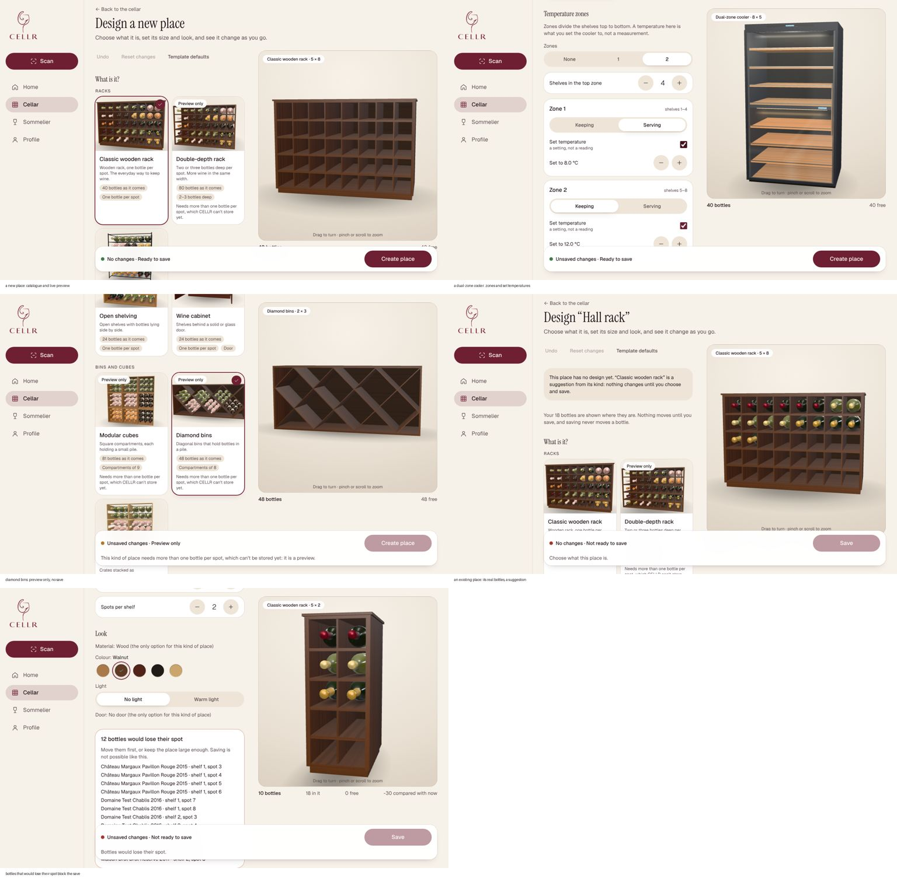
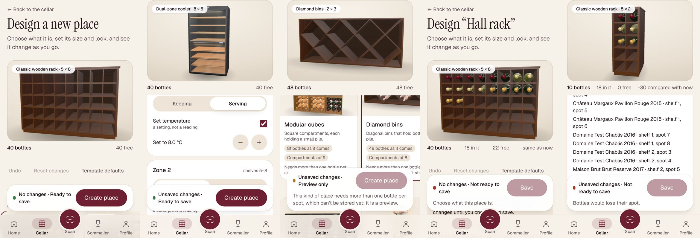
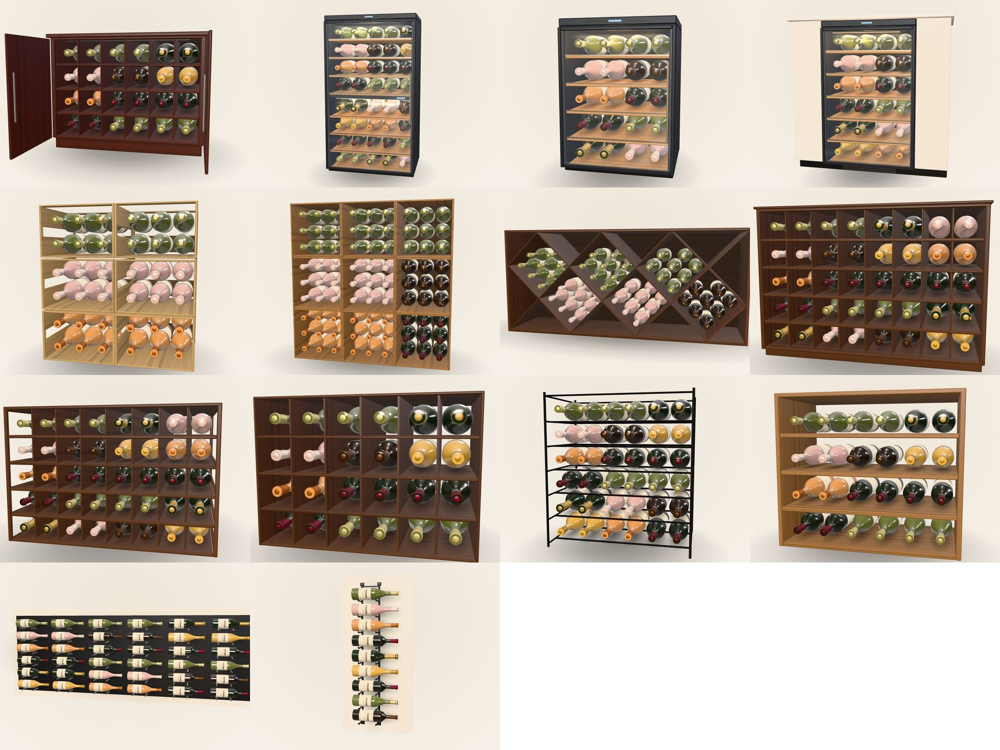

# Smart Cellar 3D — sprint 3: the Rack Builder

Status: in review (2026-11-19). Branch `claude/adoring-cori-jn7num`. Decisions: [ADR-007](ADR-007-rack-builder.md).

## 1. Executive summary

A person can now design a place for bottles and see it, live, in 3D: choose one of the fourteen templates, name
it, size it, choose its material, colour, light and door, set a cooler's temperature zones, and save it. An existing
place opens with its real bottles on their real spots; a design that would leave any bottle without a spot cannot be
saved, and saving never moves a bottle.

It reuses everything that existed: the template catalogue and every rule of the domain, the layout-driven renderer
with its premium look, the Smart Cellar API and its one-transaction layout save, the existing create and rename.
No new 3D engine, material system, rule, migration or database object.

It is **closed by default and cannot open on production**: a server gate of its own (`CELLR_SMART_CELLAR_BUILDER`),
and, new in this sprint, a second server-side condition on every layout write: the database the server writes to
must be known not to be production (the local stack, or a test database named by its exact host). A Vercel preview
that shares the production database can show the builder, never save from it, whatever is set.

Templates that need more than one bottle per spot (double-depth rack, modular cubes, diamond bins) are selectable
and drawn, labelled **Preview only**, and cannot be saved while depth placement is off. They are never quietly
saved as one bottle per spot.

**Not done, and why** (details in §14): no physical phone was available (software-rendered measurements only, no
frame rate claimed); the stale-draft check runs in the app before the database call, so a save landing in that gap
still wins (a migration that closes it is proposed, not applied: [`PROPOSAL-layout-compare-and-swap.md`](PROPOSAL-layout-compare-and-swap.md));
creating a place is two calls, made safe for retries but not atomic.

## 2. User workflows

**Create.** Cellar → Racks → _Design a place in 3D_ (shown only where the gate is open; the existing quick sheet
stays). The builder opens on the classic rack with a suggested unique name. Choose a template (cards grouped as
Racks, Shelves and cabinets, Bins and cubes, On the wall, Coolers, Other), change the name, shelves, spots per shelf,
material, colour, light, door, zones. Every change is drawn at once. _Create place_ → the page becomes that place's
builder with "“Kitchen cooler” is saved" and _See it in the cellar_.

**Edit.** Cellar → Racks → the place → _Manage_ → _Design in 3D_. The builder opens with the place as stored: name,
template, size, look, zones, occupancy and every bottle on its spot. A place from before templates opens with its
kind's template as a **suggestion** ("nothing changes until you choose and save"); a place whose stored template this
version does not know is drawn **neutral** until a template is chosen. Save asks for confirmation when the template,
the size or the bottles per spot change, listing exactly what changes.

**Leaving and coming back.** Unsaved work is kept for the tab (back and forward, reload); a banner says so and offers
_Start from what is saved_. _Back to the cellar_, _Reset changes_ and discarding a kept draft all ask first. _Undo_
steps back one change at a time; _Template defaults_ restores the template's size and look.

**Preview only.** Where the builder is open and saving is not (setting, deployment or database), there is no Save
button and a note says why. Where the database lacks the Smart Cellar step, the builder says so and does not open.

## 3. Architecture

```
/cellar/builder, /cellar/builder/:id   server page: getBuilderAccess() → notFound() when closed
└─ RackBuilder (client, only on these routes)
   ├─ useSmartCapabilities   GET /api/v1/smart-cellar               (writes? schema?)
   ├─ useSmartPlacements(id) GET /api/v1/smart-cellar/storage/:id/bottles   (edit: the place + its bottles)
   ├─ useSmartUnits          GET /api/v1/smart-cellar/storage       (new: names already taken)
   └─ BuilderEditor
      ├─ draft.ts            pure: draft ⇄ domain (StorageConfigSchema, layoutChangeProblem, defaultZones,
      │                      checkZones, readAppearance, STORAGE_PALETTES, templateSavable, CreateStorageSchema)
      ├─ preview             useDeferredValue(draft) → resolveStorage → buildModel → BuilderPreview (lazy:
      │                      the existing TemplateScene, one canvas) │ LayoutMap when there is no WebGL
      ├─ catalogue           STORAGE_TEMPLATES → 14 cards with stills made by the renderer (public/builder/templates)
      └─ save                new:  POST /api/v1/storage → PUT …/storage/:id/layout
                             edit: PUT …/layout (If-Match: revision) → PATCH /api/v1/storage/:id (name)
Server: PUT …/layout → smartCellarAccessIn (deployment AND write target) → StorageConfigSchema → stale check
        → layoutChangeProblem → save_storage_layout (one transaction: place, look, zones)
```

## 4. Changed files

| File                                                                                                                                  | What                                                                                                                                      |
| ------------------------------------------------------------------------------------------------------------------------------------- | ----------------------------------------------------------------------------------------------------------------------------------------- |
| `apps/web/src/lib/smart-cellar-write-target.ts` (+test)                                                                               | **New.** Which database a layout may be written to: loopback, or the exact declared host; never a production host (listed in code).       |
| `apps/web/src/lib/smart-cellar-gate.ts` (+test)                                                                                       | `write` now also needs a verified write target.                                                                                           |
| `apps/web/src/lib/smart-cellar-builder-gate.ts` (+test)                                                                               | **New.** The builder's gate and why saving is blocked.                                                                                    |
| `apps/web/src/server/env.ts`                                                                                                          | `getBuilderAccess()`.                                                                                                                     |
| `packages/domain/src/smart-cellar.ts` (+test)                                                                                         | `revision` on the read model; `cellCapacitySavable`, `templateSavable`; `STALE_LAYOUT_MESSAGE`.                                           |
| `apps/web/src/server/smart-cellar/{types,repository,service}.ts` (+tests)                                                             | Reads `updated_at` as the revision; refuses a save against an older revision.                                                             |
| `apps/web/src/app/api/v1/smart-cellar/storage/[id]/layout/route.ts`                                                                   | Reads `If-Match`.                                                                                                                         |
| `apps/web/src/app/api/v1/storage/[id]/route.ts`, `server/cellar/{types,repository,service}.ts` (+tests)                               | Review correction: `PATCH` takes an optional `If-Match` for a rename only: one conditional UPDATE, 409 when stale. Without it, unchanged. |
| `apps/web/src/features/cellar/smart-cellar-hooks.ts` (+test)                                                                          | Review correction: `readPlacementsFresh`, a read of a place that never answers with the cache and cancels an older refresh.               |
| `apps/web/src/lib/api.ts`, `known-messages.ts`, `messages/{en,nl}.json`                                                               | `put(…, { ifMatch })`; the stale sentence; builder, template and look words in English and Dutch.                                         |
| `apps/web/src/app/(app)/cellar/builder/page.tsx`, `[id]/page.tsx`                                                                     | **New** routes, behind the gate.                                                                                                          |
| `apps/web/src/features/cellar/builder/draft.ts` (+test)                                                                               | **New.** The draft and its operations; the assessment of what can be saved.                                                               |
| `apps/web/src/features/cellar/builder/catalogue.ts`                                                                                   | **New.** Groups and card facts, from the catalogue.                                                                                       |
| `apps/web/src/features/cellar/builder/draft-memory.ts`                                                                                | **New.** Unsaved drafts per tab.                                                                                                          |
| `apps/web/src/features/cellar/builder/rack-builder.tsx`, `builder-controls.tsx`, `builder-preview.tsx`                                | **New.** The screen, its controls, the lazy preview.                                                                                      |
| `apps/web/public/builder/templates/*.jpg`                                                                                             | **New.** 14 card stills (345 kB total, loaded lazily on the builder only).                                                                |
| `apps/web/src/features/cellar/storage3d/template-scene.tsx`                                                                           | The camera is placed again only when the place's size changes, not on every new model (a colour kept resetting the view).                 |
| `apps/web/src/features/cellar/{cellar-screen,racks-view,rack-sheets}.tsx`, `app/(app)/cellar/page.tsx`                                | Entry links, only when the gate is open.                                                                                                  |
| `apps/web/playwright.config.ts`                                                                                                       | The builder gate on the "must stay closed" and the preview servers.                                                                       |
| `apps/web/e2e/rack-builder.spec.ts`                                                                                                   | **New.** 22 browser scenarios.                                                                                                            |
| `apps/web/e2e/perf-builder.spec.ts`, `visual-builder.spec.ts`, `builder-snapshots.spec.ts`                                            | **New**, run only when asked: the bench, the photographer, the card stills.                                                               |
| `docs/…/ADR-007-rack-builder.md`, `PROPOSAL-layout-compare-and-swap.md`, this report, `README.md`, `docs/SETUP.md`, `screens/3-*.jpg` | Documentation.                                                                                                                            |

## 5. Screenshots

Desktop (Chromium, 1280 × 800, software rendering):



Phone (Pixel-class viewport): new place, cooler zones, preview-only bins, an existing place with its bottles, a
blocked resize. The picture stays on screen while choosing; the save bar sits above the bottom navigation.



## 6. The fourteen templates

The card stills, made by the renderer itself from the template gallery (`e2e/builder-snapshots.spec.ts`), in
catalogue order (cabinet, coolers ×3, crates, cubes, diamond bins, classic rack, double-depth, generic, metal,
shelving, wall pegs, wall rails):



## 7. Supported and preview-only

Decided by the domain (`templateSavable`, `cellCapacitySavable`, from `DEPTH_PLACEMENT_ENABLED = false` and each
template's `cellCapacity`), not by the UI:

| Template                                                                                   | Bottles per spot (min–max, default) | Today                                                                             |
| ------------------------------------------------------------------------------------------ | ----------------------------------- | --------------------------------------------------------------------------------- |
| rack_classic, wall_pegs                                                                    | 1                                   | **saved**                                                                         |
| rack_metal, shelving_open, cabinet_closed, cooler_single, cooler_dual, cooler_undercounter | 1–2, default 1                      | **saved** at 1; 2 is a preview                                                    |
| rack_generic, wall_rails                                                                   | 1–3, default 1                      | **saved** at 1; more is a preview                                                 |
| crate_storage                                                                              | 1–12, default 6                     | **preview** as it comes; _Use one per spot_ (an explicit choice) makes it savable |
| rack_double_depth                                                                          | 2–3                                 | **preview only**                                                                  |
| cube_modular, diamond_bins                                                                 | 2–16                                | **preview only**                                                                  |

A preview-only design is drawn exactly as the template is, the status says _Preview only_, the reason is shown, and
Save is disabled; the server and the database refuse it too (`depth_not_enabled`).

## 8. Saving and recovery

| Situation                                                                   | What happens                                                                                                                                                                                                                                                                                                                                                                                      |
| --------------------------------------------------------------------------- | ------------------------------------------------------------------------------------------------------------------------------------------------------------------------------------------------------------------------------------------------------------------------------------------------------------------------------------------------------------------------------------------------- |
| Edit, valid                                                                 | One `PUT …/layout` (place, look and zones in one transaction) with `If-Match`, then, if the name changed, a rename with `If-Match` against the revision that layout save answered with (§11). The draft's next starting point is the revision from the server's own answers, never from a refresh. Caches refreshed afterwards (racks, storage, Smart Cellar, inventory); the page shows _Saved_. |
| Edit, the place changed meanwhile                                           | Seen while editing (the place is re-read on focus; only a LATER revision counts): a banner, Save disabled, _Load the latest version_. Not seen: the server refuses the layout save or the rename (409), nothing changes, same offer.                                                                                                                                                              |
| _Load the latest version_ fails (no connection, signed out, a server error) | Said in the save bar with _Try again_; the draft, its undo history and the tab's memory of it stay exactly as they were. The place is read from the server; cached data is never taken for the latest version. Only a successful read replaces draft, starting point and revision (browser and unit tests).                                                                                       |
| A refresh after a save fails                                                | Nothing depends on it: the revision of the next save came from the save's answers (browser test: three saves in a row with every refresh of the place failing).                                                                                                                                                                                                                                   |
| Edit, layout saved, rename refused                                          | Said: "The design was saved, but the new name was not" (with the reason, or that the place changed meanwhile), with _Try the name again_. The layout's revision stays the starting point.                                                                                                                                                                                                         |
| New, `POST /storage` fails                                                  | Nothing was made (tested); the draft stays; Save again.                                                                                                                                                                                                                                                                                                                                           |
| New, the place was made, its design failed                                  | The builder moves to that place's address with the draft and a banner: "A basic place “X” was made, but its design was not saved". Saving there is an ordinary save of that place: a retry, a reload, the back button never make a second place (tested). _Keep the basic place_ drops the draft. Nothing is deleted to hide the failure.                                                         |
| Network failure, 401, 403, 404, 409, 422                                    | The server's own words through the app's error translation; nothing changed.                                                                                                                                                                                                                                                                                                                      |
| Not switched on here / not a test database                                  | No Save button; a note says why (§10).                                                                                                                                                                                                                                                                                                                                                            |
| Database without the Smart Cellar step                                      | _The Smart Cellar isn't set up on this server yet_; no builder.                                                                                                                                                                                                                                                                                                                                   |

An atomic "create with a layout" would remove the two-step case. It is a new write route (or an RPC that inserts and
lays out in one transaction); not built in this sprint because the existing calls, used as above, never lose or
duplicate anything. Worth doing when creation leaves internal preview.

## 9. Existing bottles

- Bottles are read once per place (`…/bottles`), with their own ids and whole spots (row, col, index), and drawn by
  the existing `placeBottles`: nothing is renumbered, redistributed or invented.
- A draft that would leave a bottle without a spot lists that bottle by name and spot, marks it in the stage
  (`data-stranded`), and cannot be saved (the client's `layoutChangeProblem`, the server's, and the database's
  `check_location_resize`).
- Saving a look, a template, zones or a larger size never touches a bottle row: the browser tests compare every
  bottle row (spot, status, `updated_at`) before and after.
- Opening a place writes nothing (row compared before and after, for a legacy place and an unknown one).

## 10. Preview and production write protection

Two independent server-side conditions, both enforced inside `smartCellarAccessIn` (the API's gate, which every
layout write passes):

1. **The deployment may write**: `next dev`, or a Vercel preview (unchanged since 1C). Production and unknown
   deployments: never.
2. **New: the database is known not to be production** (`lib/smart-cellar-write-target.ts`), judged on the URL the
   server itself connects with: a loopback host (the local stack), or exactly the host in
   `CELLR_SMART_CELLAR_WRITE_DATABASE`. A host in `PRODUCTION_DATABASE_HOSTS` (code, not configuration) is never a
   write target, even when declared. Unreadable, undeclared, or mis-declared (scheme, path, wildcard, case, trailing
   dot): closed.

Tested (unit: 8 cases of the target, 8 of the API's switch, 7 of the builder's gate): production by name, by upper case, with a path or port, with `http`, declared as the
test database; look-alikes of loopback; declarations that differ by one character; a production deployment with a
correctly declared test database (still closed). The builder's own gate is separate and opens no writes (§2).

Residual: a test database reached through an IP address or a custom domain must be declared exactly; a production
database reached through another host than the one listed (a custom domain, a new project) would be "undeclared"
and therefore closed — unless someone declares it on purpose. The list in code is the guard against accidents, not
against an administrator.

## 11. Concurrency

- **Atomic**: a layout, its look and its zones are one transaction (`save_storage_layout`). Two saves at once end as
  one of them, whole (browser test: five rounds of two concurrent saves with different zone splits; never a mix).
- **Stale drafts, layout**: detected twice, in the app before the call (If-Match against `updated_at`, 409) and on
  screen (the place is re-read when the window gets focus).
- **Stale drafts, name (review correction)**: a rename from the builder goes through the existing
  `PATCH /api/v1/storage/:id` with `If-Match`. With the header it is applied in ONE statement,
  `UPDATE cellar_locations SET label = … WHERE id = … AND household_id = … AND updated_at = <revision>`: Postgres
  re-evaluates that condition after taking the row lock, so another write cannot slip between check and rename. A
  stale or unknown revision → 409, nothing changed; anything but `{ label }` with the header → 422; another
  household → 404. Without the header the route is exactly what it was (tested: rename and resize, same answer).
  No migration: `updated_at` and its trigger exist since 0004.
- **Revisions after a save (review correction)**: the next starting point is the revision in the layout save's
  answer and then in the rename's answer, carried from one to the next; a refresh is never asked for it. The layout
  save's answer is the server reading the place back: if it does not show what was saved (another write landed in
  between), the builder says the place changed elsewhere and does not rename on top of it. An answer to a refresh
  that started before a save is cancelled, and an older revision arriving later is ignored.
- **Not guaranteed, layout saves**: a layout save that commits between the server's check and its RPC call still
  wins (the RPC is last-write-wins under the row lock). Renames are now conditional in the database; layout saves
  are not. This is not optimistic locking and is not called that. Closing it needs the
  comparison inside the transaction: [`PROPOSAL-layout-compare-and-swap.md`](PROPOSAL-layout-compare-and-swap.md)
  (an additive `save_storage_layout_v2` with `p_expected_updated_at`, its SQL tests, and the app change), for the
  database workstream; not applied. Until then writes stay limited to development and declared test databases.

## 12. Tests

Run on the final build. The local stack: Postgres 16 with every migration of the repository, real PostgREST 12, the
stand-in sign-in. The app as a production build (`next build`, `next start`) three times: 3100 nothing set, 3101 an
unmarked production build asking for builder and writes (must stay closed), 3102 a Vercel preview on the local
stack (open, saves). No production system was contacted.

### New tests

| What                                                                                                                                                                                                                                                                                                                                                                                                                | Where                                           | Result                                                          |
| ------------------------------------------------------------------------------------------------------------------------------------------------------------------------------------------------------------------------------------------------------------------------------------------------------------------------------------------------------------------------------------------------------------------- | ----------------------------------------------- | --------------------------------------------------------------- |
| The write target: production by name and in every spelling, loopback, declared hosts and near misses, unreadable URLs, at the API's gate                                                                                                                                                                                                                                                                            | `lib/smart-cellar-write-target.test.ts` (8)     | pass                                                            |
| The API's write switch with the new condition (existing cases kept, given a database)                                                                                                                                                                                                                                                                                                                               | `lib/smart-cellar-gate.test.ts` (8)             | pass                                                            |
| The builder's gate: closed by default and for anything but `1`, never on production or unknown deployments, opens no writes, preview-only on a database that is production or undeclared                                                                                                                                                                                                                            | `lib/smart-cellar-builder-gate.test.ts` (7)     | pass                                                            |
| Stale revision refused, current or none accepted; revision read                                                                                                                                                                                                                                                                                                                                                     | `server/smart-cellar/service.test.ts` (+2)      | pass                                                            |
| What can be saved (domain)                                                                                                                                                                                                                                                                                                                                                                                          | `packages/domain/src/smart-cellar.test.ts` (+2) | pass                                                            |
| The draft: all 14 templates valid as they come; preview-only never reduced; bounds and capacity for every template; zones always a split (every resize from every split); material/colour reconciliation; every look a template offers accepted by the schema; legacy and unknown places not decided by opening; blockers; capacity difference; names; remembered drafts validated; catalogue groups and card facts | `features/cellar/builder/draft.test.ts` (26)    | pass                                                            |
| The builder in the browser, 22 scenarios (below)                                                                                                                                                                                                                                                                                                                                                                    | `e2e/rack-builder.spec.ts`                      | 22/22 desktop and 22/22 phone (two of them on one project only) |

The 22 browser scenarios: gate closed (no entry, not-found page, no write); production build asking for it (closed,
API 403, nothing changed); the catalogue (14, three preview-only, never reduced, crates by explicit choice, every
template drawn, one canvas); a new place end to end (cooler, size, zones, colour, light, saved in one place, exactly
one place made, in the cellar); the design failing after the place was made (said, kept across a reload, saved on
retry, still one place); the create failing (nothing made, retry works); an existing place with 12 bottles
(suggested, nothing written by opening, blockers, undo, confirmation, saved, no bottle row changed; then edited again
with a rename and saved twice more); an unknown stored template (neutral, nothing written); a stale save (someone
else's colour kept, 409, latest loaded); If-Match on the API; two concurrent saves (five rounds, never a mix of
zones); another household's place (not found, API 404, unchanged); signed out (sign-in, API 401); unsaved changes
(kept across reload, undo, leaving and resetting ask); the look (reconciliation said, camera kept, one canvas);
preview-only mode (no Save button, the reason); missing schema; no WebGL (flat plan, still editable); context lost
and restored; keyboard and screen reader with an axe audit; reduced motion; phone layout (no horizontal scroll,
picture in view while choosing, save bar above the navigation, touch).

### Everything, on the final build

| Check                                                                                                                                                                                                                                                                                                                           | Result                                                  |
| ------------------------------------------------------------------------------------------------------------------------------------------------------------------------------------------------------------------------------------------------------------------------------------------------------------------------------- | ------------------------------------------------------- |
| `pnpm format:check`, `pnpm lint`, `pnpm typecheck`                                                                                                                                                                                                                                                                              | clean (lint: the one warning that was there before)     |
| `pnpm test`                                                                                                                                                                                                                                                                                                                     | web 1,243 passed (12 skipped), domain 924, scripts 244  |
| `pnpm build`, `scripts/check-bundle-secrets.sh`                                                                                                                                                                                                                                                                                 | built; no server secret in the client bundle (94 files) |
| `pnpm migrations:check`                                                                                                                                                                                                                                                                                                         | 0 new migration files, none changed                     |
| `scripts/db-test.sh`                                                                                                                                                                                                                                                                                                            | 1,591 passed, 0 failed                                  |
| Browser: the builder suite and every related existing suite, desktop and phone (`smart-cellar-3d`, `smart-cellar-api`, `cellar3d*`, `cellar`, `racks`, `drag-swap`, `rack-fill`, `add-to-spot`, `storage-gallery`, `storage-showcase`, `storage-premium`, `three-view`, `detail`, `drink`, `photos`, `smoke`, `sheet-overflow`) | 506 tests: 452 passed, 50 skipped, 4 failed (below)     |

The four failures, none in the builder suite:

| Test                                       | What it is                                                                                                                                                                                                                           |
| ------------------------------------------ | ------------------------------------------------------------------------------------------------------------------------------------------------------------------------------------------------------------------------------------ |
| `cellar3d.spec.ts:171` (desktop and phone) | fails on `main` (reported in the 2B.3 sprint)                                                                                                                                                                                        |
| `racks.spec.ts:371` (desktop, light)       | the racks' contrast audit; flaky on `main`                                                                                                                                                                                           |
| `smart-cellar-3d.spec.ts:701` (desktop)    | a 5 s wait ran out once in the 55-minute run with all workers busy; 4 of 4 when run on its own on the final build. Its code (`smart-cellar-3d.tsx`) is unchanged; the scene change (§4) only keeps the camera for a same-size model. |

CI runs format, lint, types, unit tests, the database suites, migration integrity, the audit and the secret scan on
the pull request; the browser suites run on `main`, nightly and on demand, so they were run here.

## 13. Performance

Measured with `e2e/perf-builder.spec.ts` (kept, gated, not part of the normal run) on the preview test server with
a real household in the local stack: rack_classic places of 5×8, 10×20 and 30×30 full of real bottles.

**Where:** headless Chromium 153, **software rendering** (SwiftShader), 4 cores; desktop 1280×800 @1×, phone
project 390×664 @3×. Every time below includes drawing frames in software, which is slow and grows with what is
drawn: compare the rows with each other and with earlier sprints on this machine. **No frame rate is claimed** and
nothing here stands for a phone's GPU.

### A new place, and changing it

|                                                                                 | Desktop          | Phone            |
| ------------------------------------------------------------------------------- | ---------------- | ---------------- |
| Navigation → first picture (median of 3)                                        | 1,510 ms         | 1,602 ms         |
| The scene's own first picture                                                   | 246 ms           | 208 ms           |
| At rest: draw calls / triangles                                                 | 4 / 642          | 4 / 642          |
| One shelf more or fewer → new picture (median / worst of 6)                     | 280 / 315 ms     | 256 / 280 ms     |
| Another colour → new picture (median / worst of 6)                              | 294 / 307 ms     | 289 / 301 ms     |
| Another template → new picture (median of 6 templates)                          | 485 ms           | 376 ms           |
| Geometries / textures / programs after 1, 2, 3, 4 rounds of 6 template switches | 17/8/8 each time | 17/8/8 each time |
| Pictures drawn in 3 s at rest                                                   | 0                | 0                |
| Canvases                                                                        | 1                | 1                |
| Layout shift (CLS)                                                              | 0                | 0                |

Template switches, first round (desktop): cooler_dual 794 ms (11 calls), diamond_bins 316, wall_rails 485,
cabinet_closed 488, rack_metal 305, rack_classic 411. The first switch to a template with new kinds of parts (the
cooler's glass and lights) is the slowest; the program count does not grow after the first round, so nothing is
compiled again.

### An existing place full of bottles

| Bottles      | Detail   | Navigation → picture | Calls / triangles | Held (geo/tex/prog) at rest → after changes | Idle frames 3 s | Colour → picture | One shelf more → picture |
| ------------ | -------- | -------------------- | ----------------- | ------------------------------------------- | --------------- | ---------------- | ------------------------ |
| 40, desktop  | balanced | 4,758 ms             | 8 / 33,122        | 21/7/11 → 21/7/11                           | 0               | 719 ms           | 446 ms                   |
| 200, desktop | low      | 4,268 ms             | 6 / 79,980        | 19/4/8 → 19/4/8                             | 0               | 896 ms           | 586 ms                   |
| 900, desktop | low      | 4,927 ms             | 6 / 355,868       | 19/4/8 → 19/4/8                             | 0               | 1,897 ms         | (at its 30-shelf limit)  |
| 40, phone    | balanced | 4,158 ms             | 8 / 33,122        | 21/7/11 → 21/7/11                           | 0               | 483 ms           | 377 ms                   |
| 200, phone   | low      | 4,237 ms             | 6 / 79,980        | 19/4/8 → 19/4/8                             | 0               | 672 ms           | 619 ms                   |
| 900, phone   | low      | 4,366 ms             | 6 / 355,868       | 19/4/8 → 19/4/8                             | 0               | 1,274 ms         | (at its limit)           |

### What the numbers say

- **The app's own work per change is milliseconds.** Rebuilding the model for a 30 × 30 rack takes 2–10 ms and
  placing 900 bottles 1–4 ms (measured in Node on the same machine). The rest of "change → picture" is the software
  renderer drawing one or two frames: in sprint 2B.3 one frame of 900 bottles took ~0.9 s on this machine, and a
  colour change of the 900-bottle rack here took 1.9 s (desktop) / 1.3 s (phone, smaller picture): one to two frames.
- **The same picture costs the same as before.** At 40/200/900 bottles the triangles are exactly those of the 2B.3
  product view and the 2B.2/2B.3 gallery (33,122 / 79,980 / 355,868), at the same level of detail. Draw calls and
  shader programs are lower (8 vs 16, 6 vs 12; 11 vs 31 programs) because the builder's picture does not carry the
  bottle showcase (no inspection kit, nothing prewarmed for it).
- **Stable across rapid changes.** Twenty-four template switches and the size and colour changes leave geometries,
  textures and programs exactly where they were after the first round: nothing leaks and no shader is compiled
  again. Nothing is drawn at rest. There is one canvas, always. No layout shift.
- **Responsive while it rebuilds.** The controls never wait for the picture (`useDeferredValue`); the stage says
  _Updating…_ while a newer draft is being drawn.
- **Loading an existing place takes 4–5 s here**, almost all of it the first picture (shader compilation in
  software) and the place's bottles (one request); a new place, with no bottles, 1.5 s. On a GPU this must be
  measured on the device (§15).
- One improvement not made: a colour change rebuilds the place's merged geometry as well as its materials. It costs
  milliseconds on the CPU and one GPU upload; it could be avoided by caching the built structure by size. Not worth
  the risk in this sprint.

## 14. Open issues

| Severity                         | Issue                                          | Note                                                                                                                                 |
| -------------------------------- | ---------------------------------------------- | ------------------------------------------------------------------------------------------------------------------------------------ |
| High (before any production use) | Stale-save race between check and RPC          | Proposal ready (§11); needs a migration and its review.                                                                              |
| High (before any production use) | No physical-device validation                  | Procedure: 2B.3 report §10 applies, plus the builder rows below (§15).                                                               |
| Medium                           | Create is two calls, not atomic                | Safe for retries and reloads (tested); a lost `POST` response retried by hand can still make a second place.                         |
| Medium                           | Previews share the production database         | The builder is preview-only there by construction; real preview testing needs a test database (`CELLR_SMART_CELLAR_WRITE_DATABASE`). |
| Low                              | The builder's words ship with every page       | As for every feature (the app passes all messages to the client): +9.1 kB, +3.3 kB gzipped.                                          |
| Low                              | Card stills are files                          | Re-made with `builder-snapshots.spec.ts` when a look changes; a test does not yet compare them with the renderer.                    |
| Low                              | Camera after a size change frames the new size | Intended; rotation is kept for look changes only.                                                                                    |
| Low                              | Next.js advisory notice during `next build`    | Printed on some builds (Next 16.4.1), retry continues; unrelated to this sprint, CI's audit gate decides.                            |

## 15. Before production activation

1. Owner decision; a reviewed code change to `smart-cellar-builder-gate.ts` (and, for writes, to
   `smart-cellar-gate.ts`): variables cannot open either on production.
2. The compare-and-swap migration (proposal) reviewed, applied, and the app switched to it.
3. Device validation on iPhone and Android: the 2B.3 procedure, plus: open the builder, step shelves 1→30 quickly,
   switch all templates twice, watch frame times and `geometries/textures/programs`; rotate the phone; background
   the tab during a save; VoiceOver/TalkBack through the catalogue and the save bar.
4. A decision on creating in one call (atomic create).
5. Scope the builder's messages to its routes, if payload size matters.

## 16. What sprint 4 needs from this

- Depth: switching `DEPTH_PLACEMENT_ENABLED` and the database setting together (a migration and an owner decision)
  turns the preview-only templates into saveable ones with no builder change (`templateSavable` follows).
- Moving bottles with an index (the 1C contracts), so a blocked resize can offer "move these bottles" instead of only
  listing them.
- Zones in daily use: the builder writes them; showing them on the cellar's views and using them for placement is
  sprint 4's.
- The compare-and-swap save, shared by every layout writer.

## 17. Self-review: findings and how each was resolved

The whole diff was read again as a reviewer would, and the builder was looked at in screenshots on desktop and
phone after every change of layout.

| #   | Finding                                                                                                                                        | Resolution                                                                                                                                              |
| --- | ---------------------------------------------------------------------------------------------------------------------------------------------- | ------------------------------------------------------------------------------------------------------------------------------------------------------- |
| 1   | The API's `write` level trusted the deployment only; a preview sharing the production database could have saved layouts there.                 | Write target checked on the server (§10), fail closed, unit-tested against accidental and deliberate settings.                                          |
| 2   | _Load the latest version_ rebuilt the draft from the cached place, so after a stale save it showed the old colour (found by the browser test). | It now asks the server again and starts from that.                                                                                                      |
| 3   | After a save the old revision stayed the draft's starting point; the next edit could be taken for "changed elsewhere" and refused.             | After a save the current revision is read back; while this screen saves, a new revision is its own. Browser test: edit, save, edit again, rename, save. |
| 4   | Every new model re-framed the camera, so a colour change undid the person's rotation.                                                          | The scene frames again only when the place's size changes (also an improvement for the product view). Browser test compares the azimuth.                |
| 5   | On a phone the catalogue's scrolling row made the whole grid wider than the screen.                                                            | Grid tracks `minmax(0,1fr)`; browser test: no horizontal scroll on the phone.                                                                           |
| 6   | On a desktop the preview scrolled away with the controls.                                                                                      | The preview column stretches with the row and its inner box is sticky.                                                                                  |
| 7   | On a phone the save bar took a quarter of the screen next to the sticky picture.                                                               | One row (status, Save), the first reason only, tools moved above the controls; checked in screenshots.                                                  |
| 8   | A draft read back from browser storage reached the domain unchecked.                                                                           | `parseDraft`: known template, whole numbers within the database's limits, look and zones by the domain's schemas; tested with malformed input.          |
| 9   | The name rule was about to be written a second time.                                                                                           | The existing `CreateStorageSchema` label rule is used.                                                                                                  |
| 10  | The "not set up" answer was recognised by the start of a sentence.                                                                             | One shared constant (`SMART_CELLAR_NOT_SET_UP`).                                                                                                        |
| 11  | A Dutch sentence kept the English product name (caught by the translation test).                                                               | Translated.                                                                                                                                             |
| 12  | `notFound()` in the signed-in area answers 200 with the not-found page (that area streams).                                                    | Existing behaviour of the app, not changed; tests check the page's content and that nothing of the builder is in it.                                    |
| 13  | A colour change rebuilds the merged geometry too.                                                                                              | Measured (milliseconds of CPU); left as is and recorded (§13).                                                                                          |
| 14  | The builder's words ship with every page.                                                                                                      | As every feature's do; measured (+3.3 kB gzipped) and recorded (§14).                                                                                   |
| 15  | A lost response to the create call, retried by hand, could make a second place.                                                                | Recorded (§14); the builder itself never repeats a create (after a made place it works on that place).                                                  |

## 18. Final review corrections (2026-11-19)

An independent review of the PR found two correctness issues. Both are fixed on this branch.

**1. A failed refresh could discard unsaved work.** `loadLatest()` cleared the draft, its history and the tab's
memory before it knew the server had answered, and `reload()` used a React Query refetch, which resolves with the
CACHED data when the request fails, so a failure looked like "the latest version" (an old one). After a save, the
revision was taken from that same refresh, falling back to the old revision when it failed.

- `readPlacementsFresh` (smart-cellar-hooks.ts): cancels a refresh of the place already on its way, asks the server,
  throws on any failure without touching the cache, and puts only a fresh answer in the cache.
- `loadLatest`: replaces draft, starting point, revision, history and memory only after that read succeeded; a
  failure is said in the save bar (`builder-reload-failed`, with the reason and _Try again_), and nothing is lost.
- After a save: the revision comes from the save's own answers (layout save, then rename), never from a refresh; a
  refresh that fails afterwards changes nothing. Only a LATER revision of the place is treated as news, so an old
  answer arriving late cannot undo a save. A layout-save answer that does not show what was saved is reported as
  "changed elsewhere", and no rename is made on top of it.
- Tests: unit (fresh read answers fresh and fills the cache; a failure, network or 401, is thrown and leaves the
  cache; an older in-flight refresh is cancelled and cannot land on top; revision ordering; save-answer matching);
  browser (load-latest failing by network and by 401 keeps colour, size, dirty state, history and memory, then
  succeeds on retry; three saves in a row with every refresh of the place failing, no false conflict).

**2. A rename-only save bypassed the revision.** It went to `PATCH /api/v1/storage/:id` with no condition and could
silently overwrite a concurrent edit.

- `PATCH /api/v1/storage/:id` accepts `If-Match` for `{ label }` only: one conditional UPDATE (`… AND updated_at =
<revision>`), atomic in Postgres; 409 when stale (also for a revision that is not a time), 422 for anything more
  than a rename or a header that names no single revision, 404 for another household. The answer carries the new
  `revision`. Without the header the route is unchanged. Template and household protections are untouched (a rename
  was always allowed on a templated place; row-level security and the household filter still apply). No migration.
- The builder sends the revision its draft stands on (or that its layout save just answered with).
- Tests: service unit tests (renamed with the new revision, refused when stale, not found); browser/API (legacy
  PATCH without If-Match: rename and resize, answer unchanged; stale, non-time and reused revisions → 409;
  rename plus resize → 422; `*` → 422; current → 200 with a new revision; another household → 404; a rename in the
  builder against a version someone else renamed → refused, theirs kept, then accepted against the latest).

**What stays open:** layout saves are still not compare-and-swap inside the database. The check happens in the server
before the RPC, so a save that lands in that window still wins. The migration proposal
([`PROPOSAL-layout-compare-and-swap.md`](PROPOSAL-layout-compare-and-swap.md)) is still needed.

**Verification of the corrections (final build of this branch):**

| Check                                                                                                                               | Result                                                                                                                                                                                                                                         |
| ----------------------------------------------------------------------------------------------------------------------------------- | ---------------------------------------------------------------------------------------------------------------------------------------------------------------------------------------------------------------------------------------------- |
| `pnpm format:check`, `pnpm lint`, `pnpm typecheck`                                                                                  | clean (lint: the one pre-existing warning)                                                                                                                                                                                                     |
| `pnpm test`                                                                                                                         | web 1,249 passed (12 skipped), domain 924, scripts 244                                                                                                                                                                                         |
| `pnpm build`, `check-bundle-secrets.sh`                                                                                             | built; no server secret in the client bundle                                                                                                                                                                                                   |
| `pnpm migrations:check`                                                                                                             | 0 new migration files, none changed                                                                                                                                                                                                            |
| `scripts/db-test.sh`                                                                                                                | 1,591 passed                                                                                                                                                                                                                                   |
| `e2e/rack-builder.spec.ts`, now 26 scenarios, desktop + phone                                                                       | 50 passed, 2 skipped (single-project scenarios)                                                                                                                                                                                                |
| `rack-builder`, `smart-cellar-api`, `smart-cellar-3d`, `racks`, `cellar`, `three-view`, `drag-swap`, `add-to-spot`, desktop + phone | 196 tests: 160 passed, 33 skipped, 3 failed: two builder waits after a page reload ran out at 5 s under load on the phone (the spec's assertions now wait up to 15 s; whole suite 50/50 afterwards), and `racks.spec.ts:371` (flaky on `main`) |
