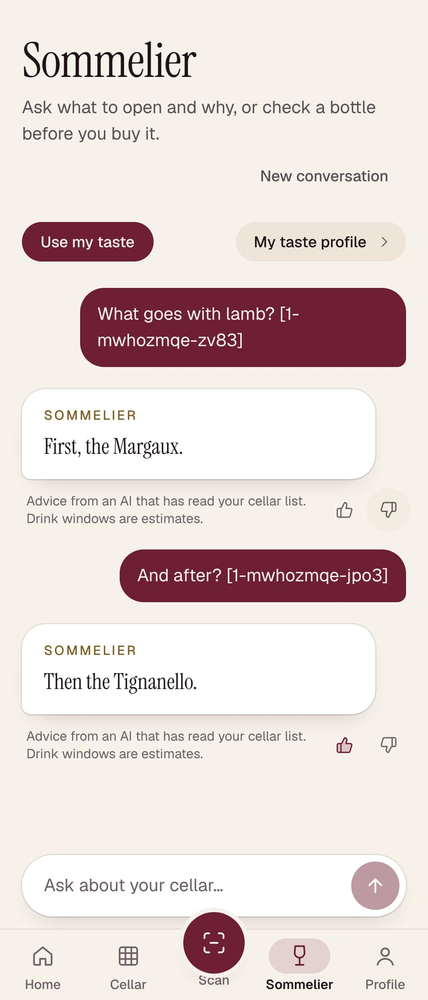
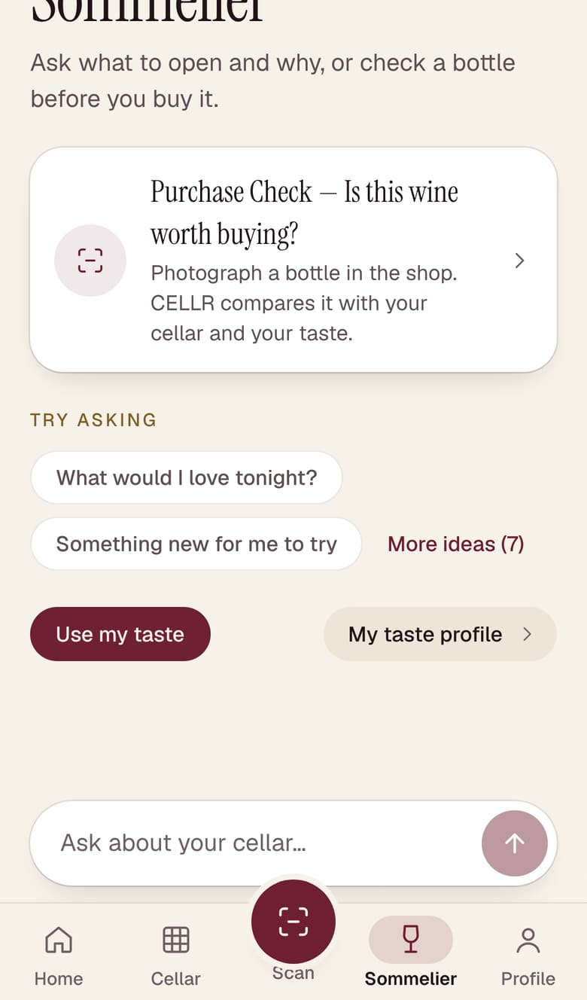

# Sommelier UX & feedback V1

2026-11-15. Three improvements to the general sommelier (`/sommelier`):

1. **The conversation is kept**: across other screens, a reload, and closing and reopening the app; one per person,
   for 7 days after it was last used; "New conversation" starts again.
2. **Answers can be rated**: two quiet thumbs under every kept answer; one rating per person per answer, changeable
   and withdrawable; stored for quality analysis only.
3. **"My taste profile" is a button**: a secondary pill beside the "Use my taste" toggle.

Nothing in the AI itself changed: no prompt, no model choice, no recommendation, scoring or pairing logic. Tonight's
pairing chat (`/tonight`, the same component in `mode="tonight"`) is deliberately left as it was: not kept, no
thumbs.

**Release order: migration `20261123000046_sommelier_conversations.sql` first, then the app** (see
[`MIGRATIONS.md`](../../MIGRATIONS.md); its STOP notice applies). Until the migration has run, the app keeps working
as before: the chat lives in memory (now also across screens), nothing is kept on the server, and no thumbs are
shown.

## 1. Architecture

```
Browser (SommelierChat, mode "chat")
 ├─ React Query cache ["sommelier","conversation"]  ← the turns on screen; outlives the screen (SPA navigation)
 ├─ GET    /api/v1/sommelier/conversation            ← read once: the page (RSC) brings it along, no loading flash
 ├─ POST   /api/v1/sommelier  { messages, questionId } → answer + saved { conversationId, messageId }
 ├─ DELETE /api/v1/sommelier/conversation            ← "New conversation"
 └─ PUT    /api/v1/sommelier/feedback { messageId, rating | null }

server/sommelier/conversation.ts   createSommelierChatService: wraps the unchanged sommelier service
 ├─ repository.ts                  reads, delete, rating RPC — as the person (row-level security)
 └─ privileged/sommelier-conversations.ts   keeps a question + answer — service role, verified user id
```

**Why these choices**

| Decision                                                                             | Why                                                                                                                                                                                              |
| ------------------------------------------------------------------------------------ | ------------------------------------------------------------------------------------------------------------------------------------------------------------------------------------------------ |
| The existing `POST /sommelier` gets an optional `questionId` (additive)              | One ask endpoint; native clients and Tonight keep working unchanged; the reply only gains an optional `saved` field.                                                                             |
| The model still hears what the screen sends (the last 10 messages)                   | No change to the AI path. After a restore the screen holds the restored turns, so a follow-up carries them; after "New conversation" it holds none.                                              |
| Question and answer are kept **after** the answer, in one transaction                | Nothing half-asked is ever kept; no orphan question or answer.                                                                                                                                   |
| The question id is chosen by the client; the same id again returns the kept answer   | Idempotent: a retry of a question that did reach the server costs no second model call and stores nothing twice (checked before the model is asked, and again under a per-person advisory lock). |
| Messages are written only with the service role                                      | What is kept as "the sommelier's answer" is exactly what the server answered; a client cannot plant answers or fake the model / kind of question that feedback is recorded against.              |
| Reads and deletes run as the person, under RLS                                       | The database decides what is theirs (project principle). Another member of the same household sees nothing.                                                                                      |
| Feedback via one `SECURITY DEFINER` function, no direct table writes                 | The client picks only a rating; model, kind of question and source are copied from the stored answer. The primary key `(user_id, message_id)` makes double records impossible.                   |
| The cache is never refetched behind the screen's back (`staleTime/gcTime: Infinity`) | Coming back to the screen never replaces or doubles what is shown, and never asks anything. A failed first read is retried on the next visit.                                                    |
| "Asking" is the mutation cache's state (`useIsMutating`), plus a synchronous ref     | A question still on its way when the person left shows as "thinking" when they return and blocks a second ask and "New conversation"; a double tap within one frame sends once.                  |
| Feedback requests per answer run serially (`scope`), shown optimistically            | The last tap is what stays on the server; a failure puts the previous rating back and shows a toast.                                                                                             |
| One conversation per person, bound to the household it was held in                   | The requirement ("one active conversation per user"), enforced by `unique (user_id)`. A question in another household starts a new one, so the model is never handed talk about another cellar.  |

## 2. Retention policy

| Data                        | Kept                                                                                    | Deleted                                                                                                                                                                                          |
| --------------------------- | --------------------------------------------------------------------------------------- | ------------------------------------------------------------------------------------------------------------------------------------------------------------------------------------------------ |
| Conversation + its messages | While used: 7 days after the **last** question. At most 100 messages (oldest go first). | "New conversation" (at once) · the next question after it expired or in another household · hourly pg_cron purge (`sommelier-conversations-purge`, `41 * * * *`) · account or household deletion |
| Feedback rows               | Until the account is deleted. Holds no words: ids, rating, time, model, kind, source.   | Withdrawing a rating (row deleted) · account deletion (cascade). Deliberately **not** with the conversation (no FK), so the quality numbers outlive the 7 days.                                  |

**Expiry is enforced by the database, not by the clean-up.** The read policy on `sommelier_conversations` only shows a
conversation used after `private.sommelier_cutoff()` (now − 7 days) in a household the person still belongs to; the
messages policy follows it. So an expired conversation is never loaded again even if the purge has not run.

**Physical deletion.** On Supabase the migration schedules `public.sommelier_purge_expired()` hourly with pg_cron
(the same pattern as `catalog-scan-reads-purge` in migration 0024). Where pg_cron is missing (plain Postgres in CI)
the migration warns and skips it; then an expired conversation is deleted when its person next asks, and stays hidden
until then. Check after deploying:

```sql
select jobname, schedule, active from cron.job where jobname = 'sommelier-conversations-purge';
```

If it is missing: `select cron.schedule('sommelier-conversations-purge', '41 * * * *', 'select public.sommelier_purge_expired()');`

## 3. Quality analysis (feedback)

`public.sommelier_feedback`: `user_id, message_id, conversation_id, rating ('positive'|'negative'), model,
question_kind ('cellar_location'|'cellar_quantity'|'cellar_selection'|'pairing'|'occasion'|'general'), answer_source
('ai'|'basic'), created_at, updated_at`. The kind of question uses the sommelier's own existing classification
(`isCellarQuestion`/`cellarQuestionKind`, `detectIntent`) via `sommelierQuestionKind` in `packages/domain`.

Read it with the service role (SQL editor), e.g.:

```sql
select question_kind, answer_source, model,
       count(*) filter (where rating = 'positive') as useful,
       count(*) filter (where rating = 'negative') as not_useful
  from public.sommelier_feedback
 where created_at > now() - interval '30 days'
 group by 1, 2, 3 order by not_useful desc;
```

Nothing reads feedback automatically; it changes no answer and trains nothing (V1 scope).

## 4. Files

| Area     | Files                                                                                                                                                                                                              |
| -------- | ------------------------------------------------------------------------------------------------------------------------------------------------------------------------------------------------------------------ |
| Database | `supabase/migrations/20261123000046_sommelier_conversations.sql` (new), `supabase/tests/99_sommelier_conversations.test.sql` (new), `apps/web/src/server/db/database.types.ts` (regen)                             |
| Domain   | `packages/domain/src/sommelier-conversation.ts` (+ test, new), `sommelier.ts` (`questionId`), `index.ts`                                                                                                           |
| Server   | `server/sommelier/conversation.ts` (+ test), `repository.ts`, `types.ts` (new); `server/privileged/sommelier-conversations.ts` (new); `server/sommelier/service.ts` (model observer, + test); `server/services.ts` |
| API      | `app/api/v1/sommelier/route.ts`, `…/conversation/route.ts` (new), `…/feedback/route.ts` (new)                                                                                                                      |
| Screen   | `features/sommelier/sommelier-screen.tsx`, `hooks.ts`, `turns.ts` (+ test, new); `app/(app)/sommelier/page.tsx`; `messages/en.json`, `nl.json`                                                                     |
| E2E      | `apps/web/e2e/sommelier-memory.spec.ts` (new)                                                                                                                                                                      |

## 5. Tests

- **Database** (`pnpm db:test`, 1555 assertions, of which 42 new): server-only writes; same-household and other users
  read, rate, clear nothing; idempotent replay; household check; 6d23h alive / 7d+ hidden / purge; household switch
  and leaving; 100-message cap; feedback copy-from-answer, change, withdraw, no duplicates, no direct writes; account
  deletion cascades.
- **Unit**: domain (question kind, contracts, stored-answer guard), chat service (keep, replay, race, failure paths,
  Tonight untouched), sommelier model observer, screen turns helpers.
- **E2E** (`e2e/sommelier-memory.spec.ts`, phone + desktop, 14 runs): wine page → back, nav and browser back ×3, reload,
  fresh tab (no memory) restore with no extra model call, follow-up carries restored context; question in flight
  while leaving answered once; new conversation clears screen + server and context; 7-day expiry; API isolation,
  idempotency, validation; thumbs set/change/withdraw/fast taps/reload/axe; taste-profile button look, 44 px touch
  area, toggle intact, navigation unchanged. The existing sommelier, Tonight, reserved, taste, flows,
  purchase-intel, sprint-z, visual-review and home specs pass unchanged.

 

## 6. Risks and open points

- **Production migration state is unverified** (MIGRATIONS.md STOP notice). 0046 is additive and self-contained, but
  must go through the documented inventory/decision before any `db push`.
- **pg_cron**: verify the job after deploying (§2). Without it, retention still holds logically (RLS), physically on
  the next question.
- **Stale bottle cards**: a restored answer shows the bottles as they were when answered (count, place). The card
  opens the live wine page; a wine that is gone shows "not found". Acceptable for a 7-day window.
- **Multiple devices**: each device shows what it loaded; a question from another device appears after a reload.
  The server always appends to the one conversation, so nothing is lost.
- **Tonight** is not kept and has no thumbs (by design for V1). Adding thumbs there needs stable ids, i.e. keeping it.
- **Data export** (`/api/v1/export`) does not include the conversation or ratings yet; account deletion does remove
  them. Worth adding if the export is meant to be a complete GDPR copy.
