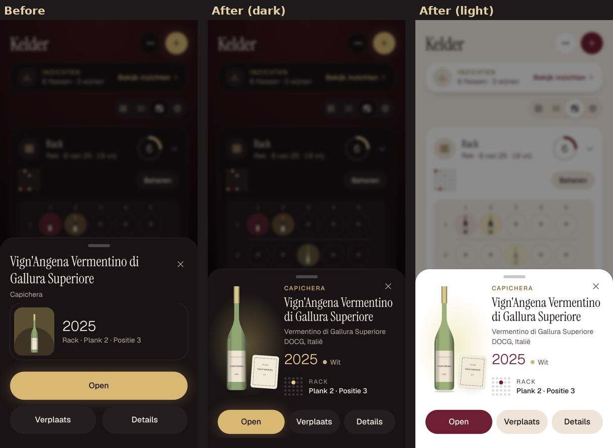
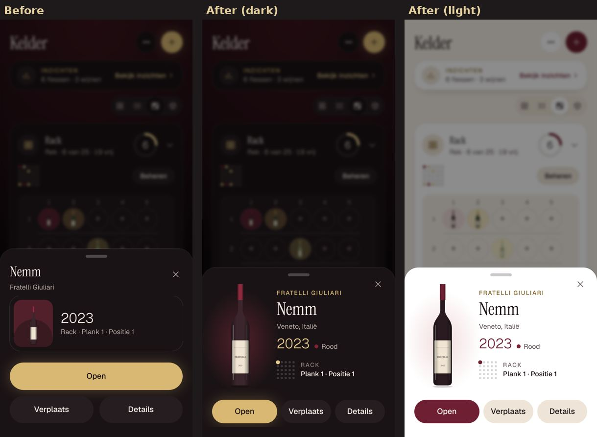
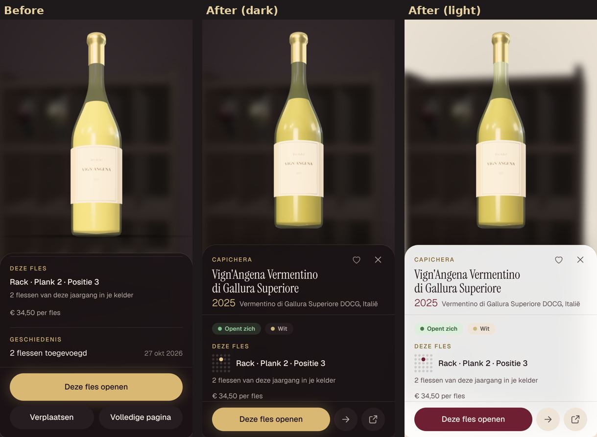
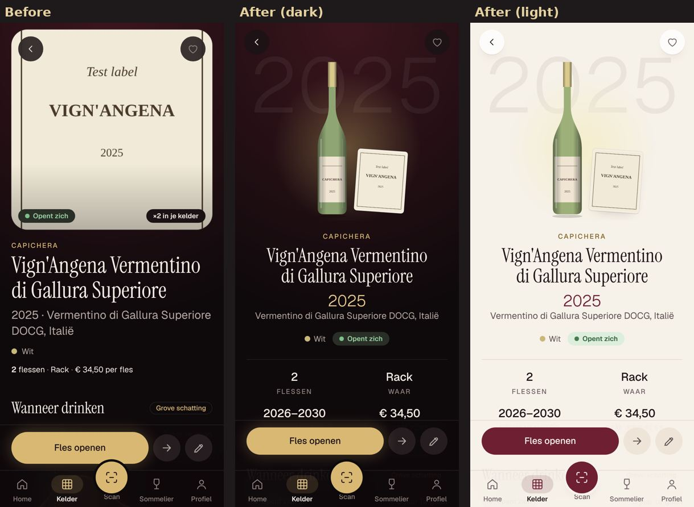
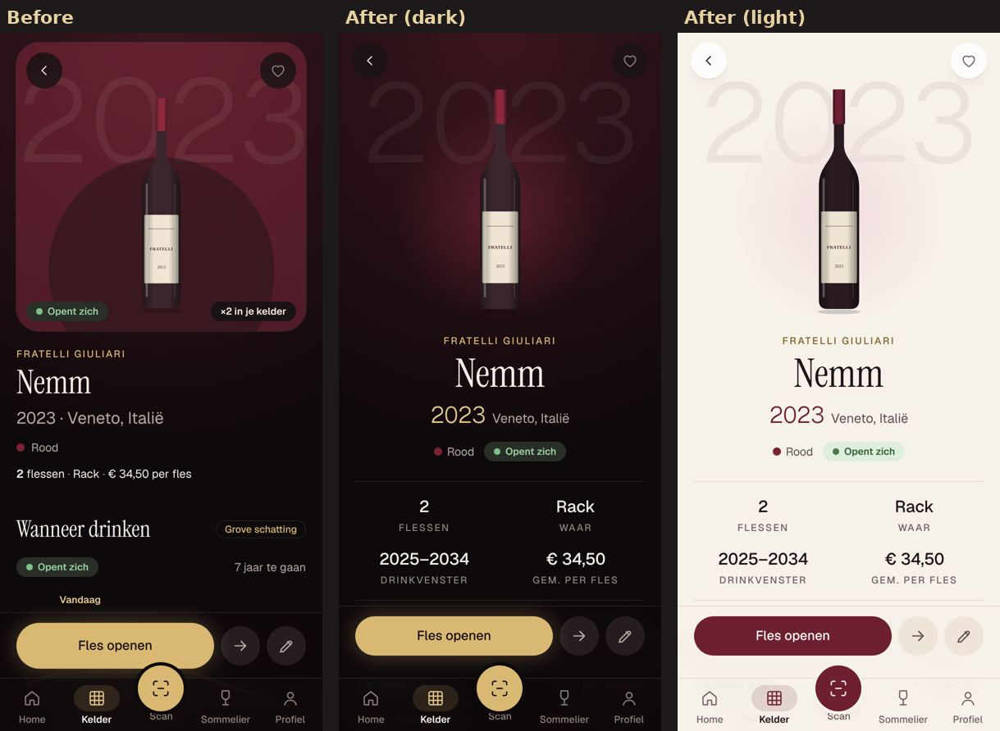

# Sprint L — Premium bottle experience

Three connected screens, one visual language: the bottle is the hero, the name is never cut off, and one action leads.

| | Before → after |
|---|---|
| Quick preview (racks view) |   |
| 3D showcase, after reading another bottle |  |
| Wine page |   |

## The 3D clipping, root cause
The details panel stays mounted between bottles (so it can slide out with its content). Its heading lived inside the
same scroll container as the details, and that container kept its scroll position: after reading one bottle's details
and putting it back, the next bottle opened scrolled down, with its name half hidden under the panel's top edge.
Now the heading (producer, name, vintage, place) sits outside the scroller, and the details scroll back to the top for
every bottle shown (`bottle-showcase-panel.tsx`). Covered by `e2e/sprint-l.spec.ts`.

## Shared pieces
- `BottlePortrait`: the drawn bottle in a soft pool of its wine colour, wearing the straightened label when there is
  one; an un-straightened label photo leans beside it as a print. Never an invented label.
- `nameSize`: display size by name length, so short names have presence and long ones wrap in two or three lines.
- `SlotMap`: where in its place a bottle lies, one dot per spot.
- `BarButton` / `MoveIcon` / `PageIcon` (`action-bar.tsx`): the round secondary actions, the same in the 3D panel and
  on the wine page.
- `Sheet` gained `bare` for content that brings its own heading.

## Photographing the screens
`VISUAL_BOTTLE=1 SHOTS_DIR=/some/dir pnpm exec playwright test visual-bottle --project=phone` (Dutch, both themes,
short and long names, a champagne without vintage, with and without a label photo).
