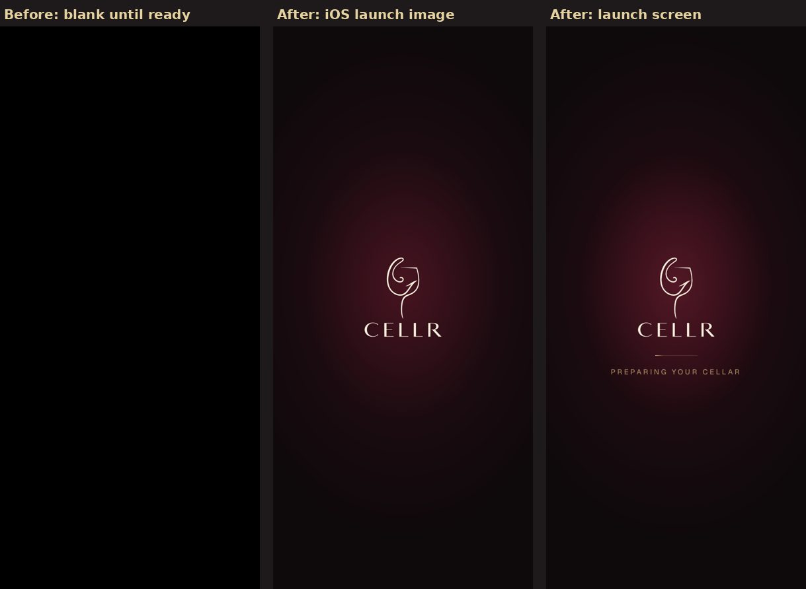

# Sprint M — Premium launch screen

## Where the black screen came from

1. **No iOS launch image.** The home-screen app had no `apple-touch-startup-image`, so iOS showed a plain screen while
   it started the web view.
2. **Nothing was sent until the page was ready.** Every signed-in page waits in `(app)/layout.tsx` for the signed-in
   check and the household (`getPageMe`), and there was no loading boundary above that layout. The response only
   started once all of it was done (370–920 ms to the first byte locally; longer on a phone talking to Supabase), and
   until then the screen stayed blank.

## What opening the app does now

- **iOS launch image** (`public/splash`, `pnpm splash`): one per iPhone size, the same picture as the page's launch
  screen: the CELLR glass and lettering in ivory on deep-wine dark, with a soft glow.
- **Launch screen** (`app/loading.tsx` → `ui/boot-splash.tsx`): sent in the first bytes of the response (50–100 ms
  locally), while the server prepares the page. The logo sits on exactly the same pixels as in the launch image.
  After ~0.5 s a champagne hairline appears with light passing along it; after ~1.2 s "Preparing your cellar". No
  progress is claimed.
- **Hand-over** (home-screen app only): the app's frame draws the same picture once more on top of itself and
  dissolves it in ~0.4 s, so the launch screen fades into the app instead of cutting. It never takes a tap.
- **In a browser tab** the launch screen fades in only after 0.2 s, so a fast load never flashes it.
- **Reduced motion:** no breathing glow and no passing light; the line and the words simply appear.
- **Fixed dark in both themes**, like the home-screen app's splash colour (manifest `background_color`).
