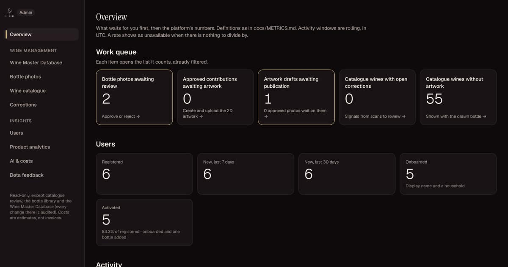
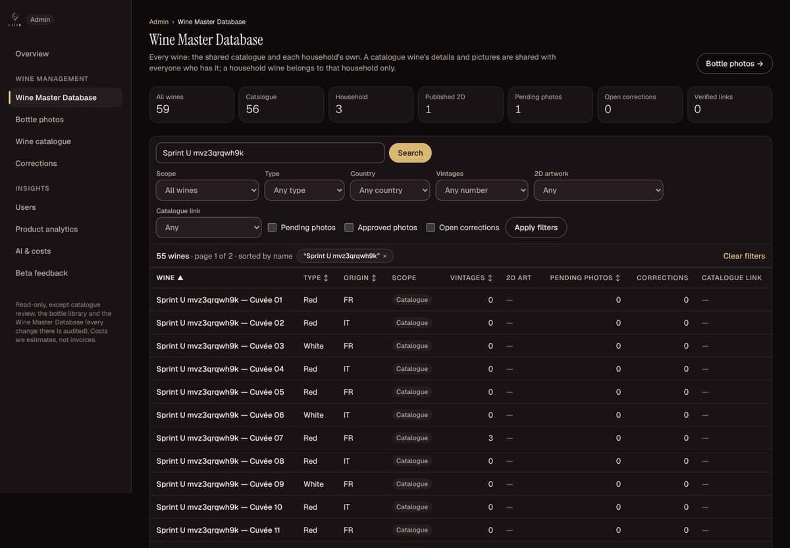
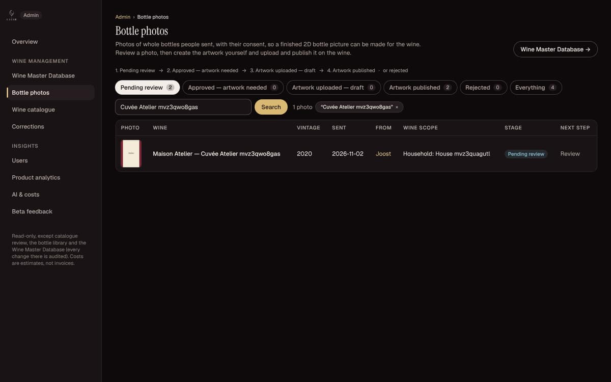
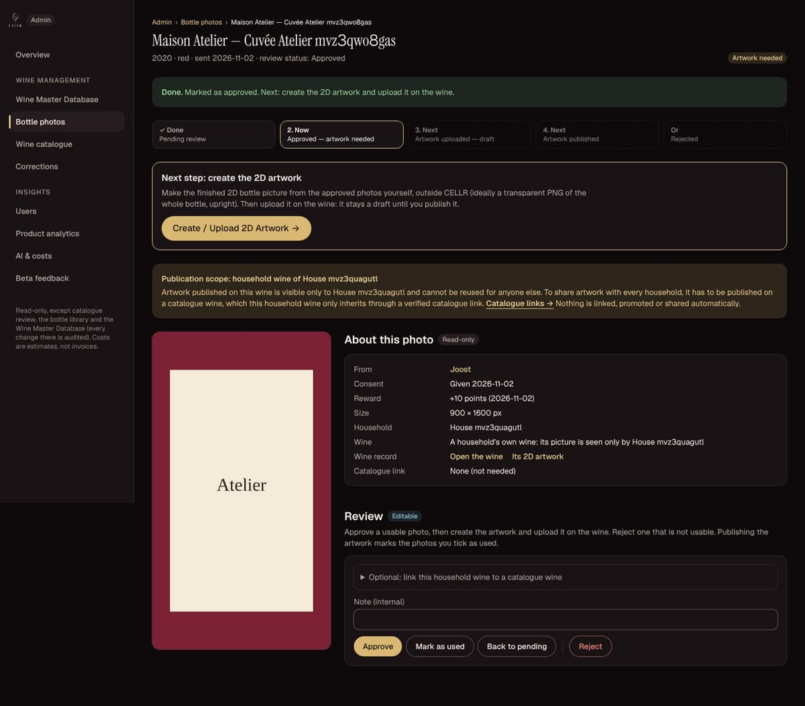
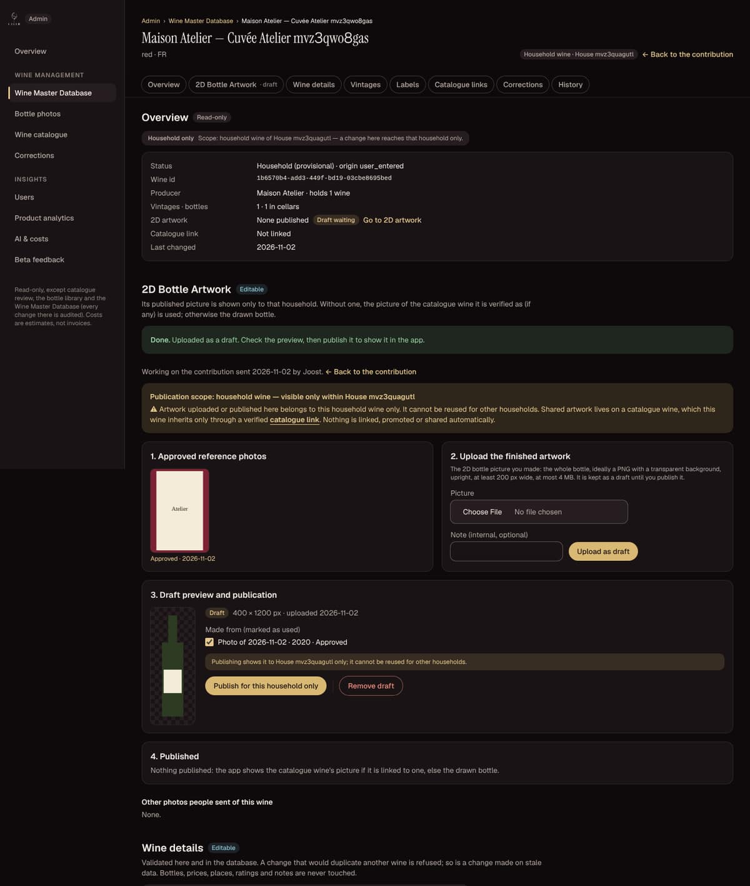
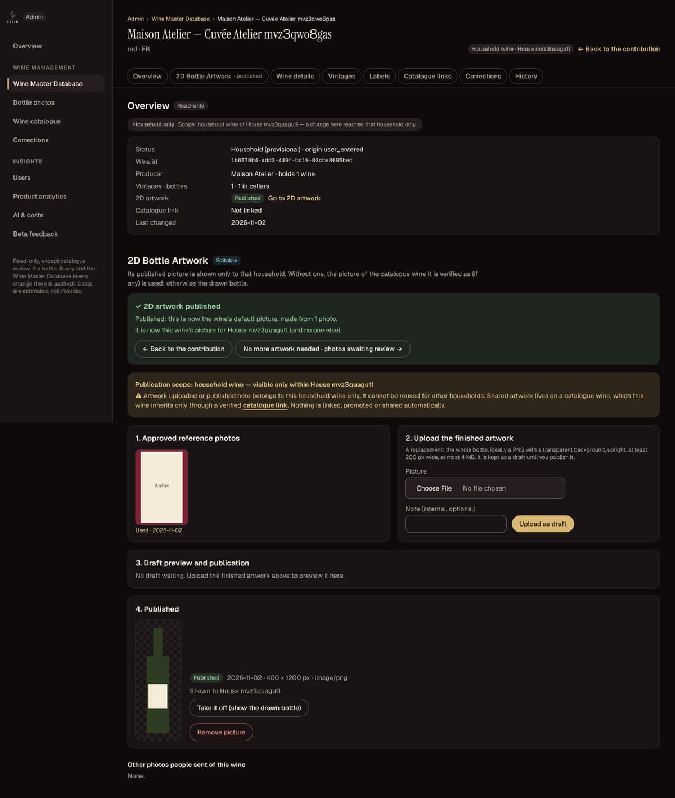
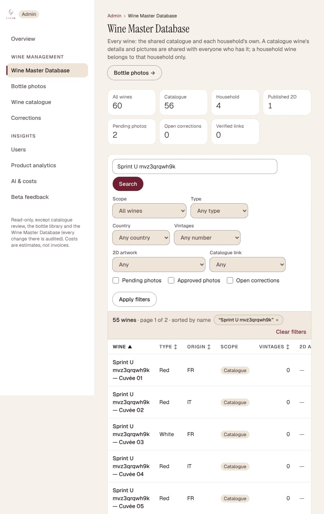
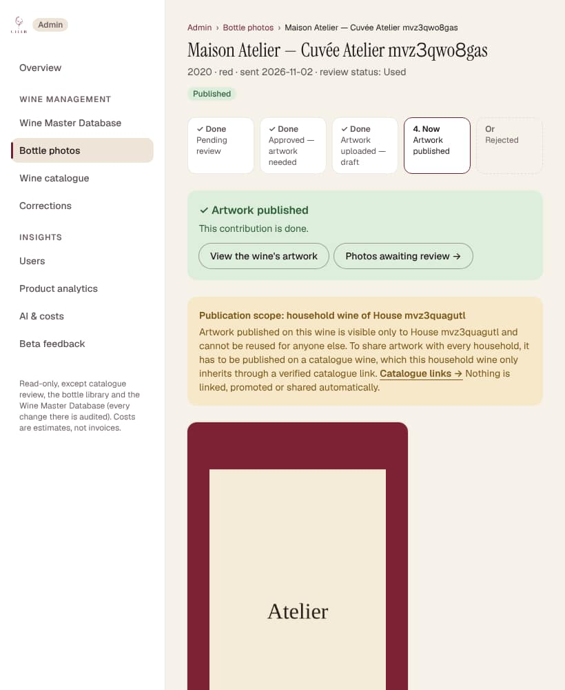

# Sprint U — Admin portal UX & workflow

The existing admin portal, made a daily tool: readable, navigable, filterable, and the bottle-photo → 2D-artwork
workflow walkable without searching for the next step. Same portal, same design system, same business logic.

## What changed

- **Contrast, one shared kit.** Links used `text-accent-ink` (the colour of text _on_ an accent fill, near-black in
  dark mode). All admin links now use `accent-fg`, the design system's link colour. Buttons, inputs, tabs, pills,
  notices, breadcrumbs, the pager and the table live in `app/admin/_ui.tsx`, with visible hover, focus, current and
  disabled states, and control boundaries at ≥ 3:1. Destructive actions (remove picture or draft, delete label, remove
  vintage, unlink, reject) use a danger style, set apart from normal actions.
- **Navigation.** A grouped sidebar (Overview · Wine management · Insights) marks the current page (`aria-current`).
  There is a skip link, breadcrumbs on every list and detail page, and consistent titles and primary actions.
- **Tables.** A row with `href` is one real link on its primary cell, stretched over the row with CSS. The whole row
  is clickable, Tab reaches it and Enter opens it, the focus ring wraps the row, and the row's other links stay
  separate targets (no nested links, no row click handlers). Applied to wines, bottle photos, catalogue candidates,
  corrections and users. Sortable headers are links with `aria-sort`.
- **Wine Master Database.** Filters sit in a toolbar on the table: search, scope, type, country, vintage count,
  2D artwork (published / missing / draft), catalogue link, pending photos, approved photos, open corrections. A
  household's name in a row filters to that household. Sorting covers name, type, country, vintages and pending
  photos. Filtering, sorting and paging all happen in the database, in a stable order (always ending in producer,
  wine, id). The state lives in the URL in one canonical form, kept across paging, opening a wine and going back.
  Active-filter chips, the result count, Clear filters and empty states are shown. Older links (`?f=`, `?filter=`,
  `?scope=all`) redirect to the same list in the new form.
- **Bottle-photo workflow.** Each contribution has a stage, derived and never stored: _Pending review → Approved,
  artwork needed → Artwork uploaded, draft → Artwork published_ (or _Rejected_). It comes from the review status plus
  the artwork of the wine(s) the photo is about. The list's tabs are these stages (older `?status=` links still work).
  The photo page shows a stepper, one next step, and a prominent **Create / Upload 2D Artwork** link straight to the
  wine's `#art` section, which remembers the contribution.
- **Artwork section.** Laid out as the admin works: 1. approved reference photos, 2. upload the finished artwork, 3. draft preview (on a checkerboard) and publish, 4. published. The publication scope is stated before publishing:
  a canonical wine is shared with every eligible household; a household wine is visible only within its household and
  cannot be reused, with a link to catalogue-link management. Nothing is linked, promoted or shared automatically.
  After publishing, a success state links back to the contribution and to the next contribution needing artwork.
- **Wine page.** A sticky section navigation (artwork second, with its state). Sections are tagged Read-only or
  Editable. Shared catalogue changes carry an impact warning with the bottle count. Save confirmations and validation
  errors appear in the section that was changed, and the page returns there.
- **Overview.** A compact work queue, each item linking to its filtered list: photos awaiting review, approved
  contributions awaiting artwork, artwork drafts awaiting publication, catalogue wines with open corrections, and
  catalogue wines without artwork.

## Migration

`20261111000034_admin_portal_workflow.sql`: forward-only, additive, read-only. Five new service-role functions
(`admin_wine_master_search`, `admin_wine_master_facets`, `admin_bottle_photo_queue`, `admin_work_queue`,
`private.bottle_photo_stage`); nothing existing is changed and no row is written. The master search builds its SQL from
the filters in use, with every value bound as a parameter, so each search gets its own plan. Measured at 120,000
wines: default list ~96 ms (Sprint R's list: ~110 ms), search ~89 ms, type + country ~52 ms, deep page ~220 ms,
sort by vintage count ~275 ms; work queue ~45 ms.

## Screenshots

|                                                         |                                                                    |
| ------------------------------------------------------- | ------------------------------------------------------------------ |
|                       |                   |
|             |                      |
|        |           |
|  |  |

## Known limitation (pre-existing)

For a signed-in person who is not an admin, admin pages render the "not found" page but answer HTTP 200, not 404. No
admin data is shown. The cause is the root streaming boundary (`app/loading.tsx`), which sends the shell before the
admin layout's `notFound()`. It reproduces on `main` before this sprint and fails `feedback.spec` and
`catalog-learning.spec`, which assert the status. Answering a real 404 would mean checking admins in the proxy, a
security-sensitive change kept out of this sprint.
