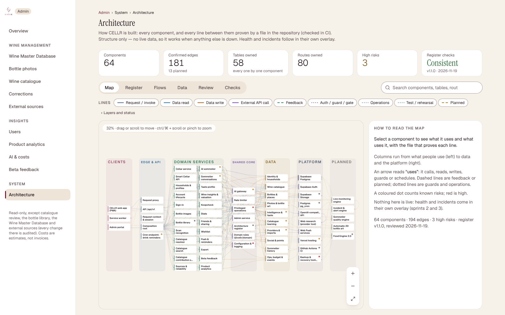
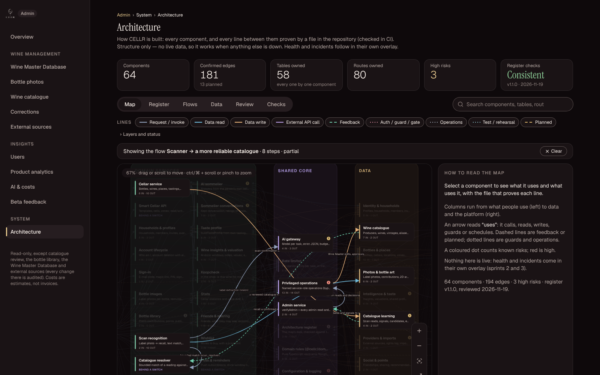
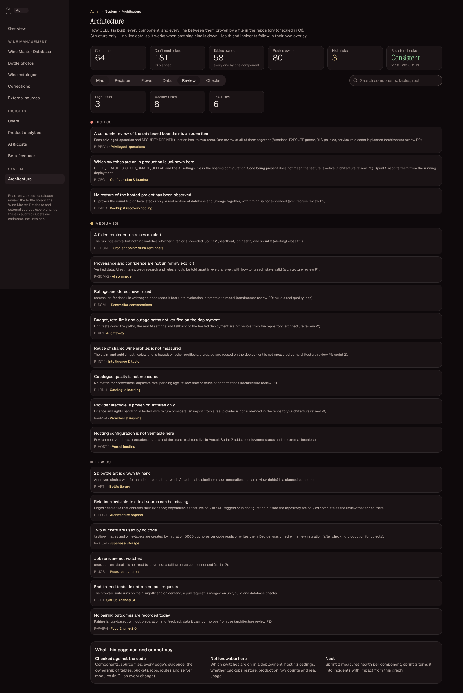
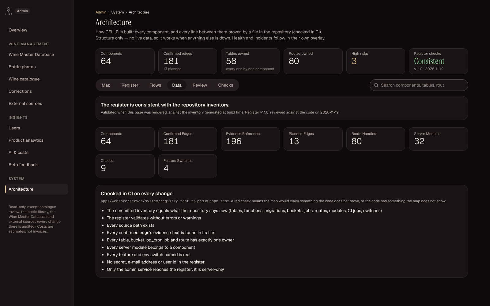
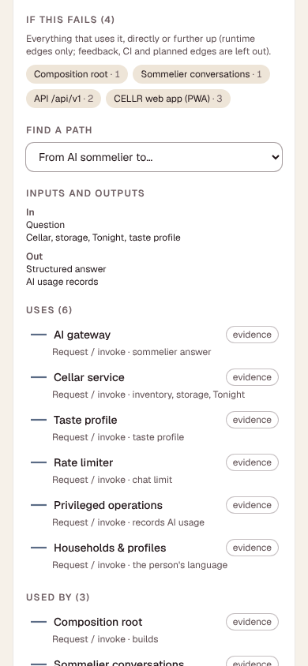

# System Intelligence — Sprint 1 report: Architecture Control Center

Date: 2026-11-19 · Branch: `claude/festive-cannon-joten0` · Plan: [SPRINT-1-PLAN.md](SPRINT-1-PLAN.md) · Decisions:
[ADR-001](ADR-001-architecture-registry.md) · Maintenance: [REGISTRY-GUIDE.md](REGISTRY-GUIDE.md)

**Status: implemented and tested. Not deployed, not operationally verified.** Recommendation: **CONDITIONAL GO**. The
conditions are under §10.

## 1. What was built, and where

| Part                                                                                                                                                           | Where                                                                                                     |
| -------------------------------------------------------------------------------------------------------------------------------------------------------------- | --------------------------------------------------------------------------------------------------------- |
| Admin page `/admin/system` (sidebar: System › Architecture)                                                                                                    | `apps/web/src/app/admin/system/page.tsx`, `app/admin/layout.tsx`                                          |
| Control center: map, detail panel, Register, Flows, Data, Review and Checks views                                                                              | `apps/web/src/features/admin/system/*`                                                                    |
| Computed layered layout, focus/trace/path/search model, URL-hash state                                                                                         | `features/admin/system/layout.ts`, `model.ts`                                                             |
| Contracts, validation, tracing, impact, shortest path, search (pure)                                                                                           | `packages/domain/src/system-architecture.ts`                                                              |
| Curated register: 64 components, 181 confirmed edges (196 evidence references), 13 planned edges, 5 flows, 17 risks                                            | `apps/web/src/server/system/registry.ts`                                                                  |
| Generated repository inventory (58 tables + FKs, 121 functions, 46 migrations, 7 buckets, 2 pg_cron jobs, 80 routes, 32 server modules, 9 CI jobs, 4 switches) | `apps/web/scripts/architecture/`, `server/system/inventory.generated.json`, `pnpm architecture:inventory` |
| Repository checks of the register                                                                                                                              | `apps/web/src/server/system/registry.test.ts` (in `pnpm test`)                                            |
| Docs and screenshots                                                                                                                                           | `docs/sprints/system-health/`                                                                             |

Features compared with the reference HTML:

- **Proof.** Every edge carries file evidence, and CI checks it.
- **Ownership.** Every table, route, bucket, job and server module has exactly one owner.
- **Tracing.** Direction and depth, with a distance badge on each traced component.
- **Analysis.** "If this fails" (impact), a shortest-path finder, flows that are highlighted and auto-fitted, and a search across tables, routes, files and risks.
- **Navigation.** Filters per line kind, layer and status. Deep links (`#c=…&d=…&n=…&f=…&v=…`) that follow back/forward.
- **Input.** Keyboard: Tab through components, Enter, + / − / 0, arrow keys, "/" for search. A component that receives focus outside the view is brought into view.
- **Readability and devices.** An overview mode with large names when zoomed out. Pinch and drag on touch. Light and dark skins. Usable at 390 px.

Not taken over from the reference: relations the code does not show. Two examples are "the Sommelier reads the intelligence tables directly" (it reads them through the cellar and taste services) and "Tonight is a separate service" (it is `cellar.tonight` over the domain rules). The ERD's 70 hand-listed foreign keys were also not copied; they are now read from the generated types.

## 2. Architecture decisions

These are in ADR-001:

- A curated, typed, `server-only` register, plus a generated inventory.
- Evidence-checked edges.
- A status vocabulary (implemented / gated / unverified / planned) that never claims "operational".
- Pure graph functions in `@cellr/domain`, for reuse in sprint 3.
- No live state in the register: health will be a separate overlay keyed by component id, so the map works when everything else is down. The page reads no database.
- Computed layout.
- No new dependency.

The edge kinds are request, data-read, data-write, external-call, feedback, control, ops, verifies and planned. `verifies` (CI and rehearsals) was added after the review, so that CI is not counted as a runtime dependency in impact.

## 3. Existing systems reused

- The admin access chain, unchanged: proxy 404, `getAdminSession`, `verifyAdmin`, `assertAdmin`, and the page-level `notFound()`.
- The admin layout, `PageTitle` and breadcrumbs, and `ui/segmented`.
- Design tokens via `light-dark()`.
- The lint layering rules and the `server-only` convention.
- The generated `database.types.ts` (source of tables and foreign keys).
- The `FEATURES` list, `vercel.json` and `ci.yml`.
- The Playwright local stack and its admin fixture, and the axe audit helper.

## 4. Tests and results

| Check                                                               | Result                                                                                                                                                                                |
| ------------------------------------------------------------------- | ------------------------------------------------------------------------------------------------------------------------------------------------------------------------------------- |
| `pnpm check` (format, lint, types, unit, database permission suite) | green. Web 1231 passed (12 skipped, as before); domain 937; database 1591 assertions; scripts 244                                                                                     |
| New unit tests                                                      | domain 15, layout/model 19, register 13. The admin boundary test now counts 17 pages                                                                                                  |
| `pnpm build`                                                        | green (see §6 on the Next.js advisory)                                                                                                                                                |
| `scripts/check-bundle-secrets.sh`                                   | clean. The register text is absent from `.next/static` (grep `R-PRIV-1`: 0 files)                                                                                                     |
| Playwright `admin-system.spec.ts`, desktop + phone                  | green. Covers: 404 and no register text for a non-admin (page and RSC); redirect for a signed-out visitor; the full desktop flow; phone at 390 px; axe WCAG 2.1 AA with no violations |
| Existing admin specs (`admin-http`, `admin-sources`, `feedback`)    | green. No regression                                                                                                                                                                  |
| Independent reviews (security; correctness and register accuracy)   | done. Findings and fixes in §5                                                                                                                                                        |

## 5. Security checks, and what the reviews changed

**Access**

- The page checks the session before it reads anything.
- No API route or Server Action reaches the register.
- The register is `server-only`, and a test asserts that only the admin service imports it.

**Client side**

- No inline `<style>`, so it is CSP-compatible.
- No `dangerouslySetInnerHTML`.
- The hash is parsed against allowlists.
- Source links are built from a constant repository name, with `noopener noreferrer`.

**Secrets**

- A test rejects anything in the register that looks like a key, a JWT, an e-mail address or a UUID.

**Security review**

- Nothing exploitable was found.
- **One material point: the repository is public.** The register, its risk notes and the docs are readable by anyone on GitHub, whatever the admin gate does. What I did:
  - removed the production observations (row counts from the 18-11 snapshot);
  - rephrased the risks as open review items rather than descriptions of weaknesses;
  - corrected the comments so they no longer imply the register is confidential;
  - added a "the repository is public" rule to the guide.

  Sensitive or live observations belong in sprint 2's database, behind the admin session.

- Also fixed: the builder now rejects a pg_cron "schedule" that is not cron syntax, so a job's SQL command can never leak into the inventory. It no longer follows symbolic links.

**Correctness review**

All of these are fixed:

- **Focus was lost when opening from another view.** The map now applies a request that was made before it mounted. A new e2e step covers this.
- **Edge directions corrected:**
  - admin portal → proxy;
  - pg_cron → the tables it purges;
  - API and admin portal → Vercel;
  - a non-existent "cron endpoint → push service" edge was removed.
- **Missing dependencies added:**
  - Koopcheck → AI-usage recording, rate limit, insights and language;
  - households → bottle-art purge;
  - friends → profile handle;
  - scans → bottles (recall);
  - reminders → cellar data (service role).
- **Gates.** `CELLR_SMART_CELLAR_3D` moved to the app. Push is now `gated` on its VAPID keys.
- **A flow text was wrong.** Ratings _are_ read back for display, but never into evaluation.
- **Evidence strengthened.** Edges that rested on type-only imports now point at the call itself.
- **UI and model:**
  - path finding honours the line filters and no longer follows feedback or CI edges;
  - aria-live is now scoped to the trace summary;
  - the tabs got arrow-key navigation;
  - `hashchange` is handled;
  - Enter in search uses the current text;
  - a stuck-pointer case is fixed;
  - the Flows tab no longer crashes on an unknown step.
- **Coverage.** The register test now also checks that every folder under `src/app` has an owner.

Not changed, by choice:

- **Impact overstates the blast radius on coarse nodes.** Any service failure reaches "API /api/v1" and "web app", because those nodes bundle many routes. This is correct but coarse; per-route granularity would be a sprint 3 decision.
- **The wheel always moves the map** while the pointer is over it.
- **The path target and the search text are not in the URL.**
- **`engines` still says Node ≥ 22.12.** The inventory script needs ≥ 22.18 and now says so clearly; CI uses the latest 22.

## 6. Open limitations and risks

- **Next.js advisory.** During this sprint, `next build` three times stopped after a successful compile with "Your version of Next.js is affected by a known security vulnerability" (16.4.1). It passed when rerun. This can also hit CI. The upgrade is a dependency change outside this sprint and needs your approval.
- **The register is curated.** CI proves every claim it makes and every inventory item it must own. It cannot prove a relation it does not list (R-REG-1), for example dependencies that live only in SQL triggers.
- **The map shows structure, not health.** Nothing here says whether a component is up. That is sprint 2.
- **Desktop overview zoom is about 32% on a 1600 px screen.** Names stay legible through overview mode, and search, the register and auto-fit cover detailed navigation.

## 7. Migrations and configuration

None. No migration, no environment variable, no change to production, Supabase or Vercel. One new root script, `pnpm architecture:inventory`. CI picks up the new checks through the existing `pnpm test`.

## 8. Actions that need explicit approval

1. Merge the pull request (and with it, deployment through the normal Vercel flow).
2. Decide on the public repository (§5): accept the register as public information (the current state), or keep risk notes out of the repository, or make the repository private.
3. Optionally, the Next.js security upgrade (§6), as its own change.

## 9. Pull request

See the PR from `claude/festive-cannon-joten0` to `main`.

## 10. Verdict: CONDITIONAL GO

Ready for review. Conditions:

- (a) you accept §8.2, that the register is public information;
- (b) CI is green on the PR, keeping §6's Next.js advisory in mind;
- (c) after deployment, a one-time manual look at `/admin/system` as an admin. That look is the "operationally verified" step this report cannot make.

## Screenshots

|                                         |                                                                  |
| --------------------------------------- | ---------------------------------------------------------------- |
| Overview (dark)                         |                                         |
| Overview (light)                        |                                        |
| Trace: everything Scan recognition uses |                                 |
| Flow: scanner → catalogue, auto-fitted  |                          |
| Review                                  |                                      |
| Data                                    |                                        |
| Checks                                  |                                      |
| Phone                                   |   |
