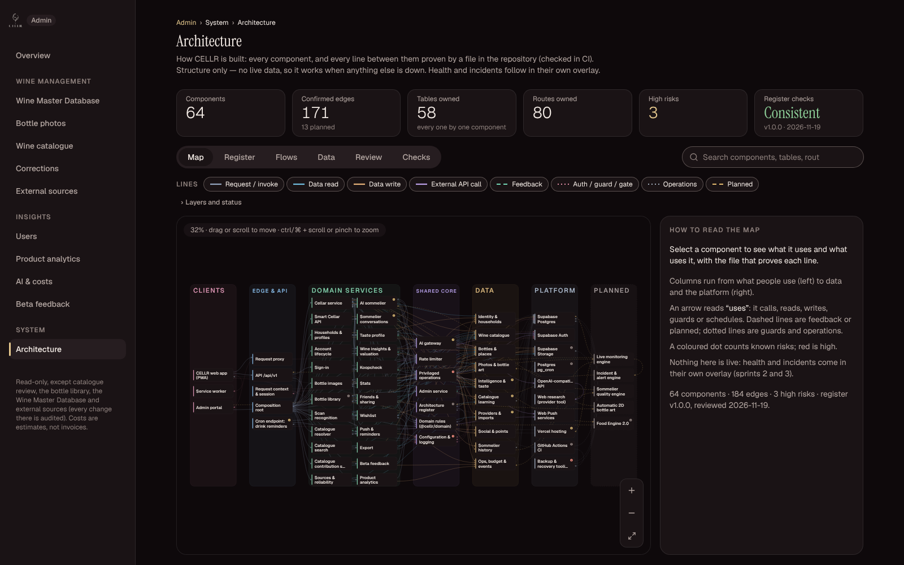
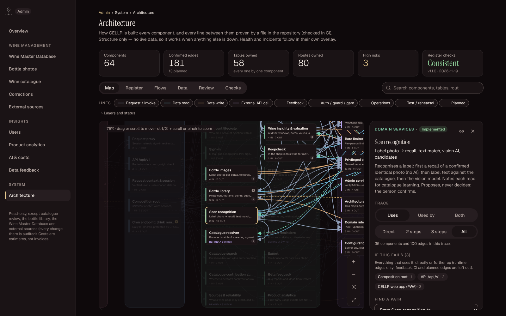
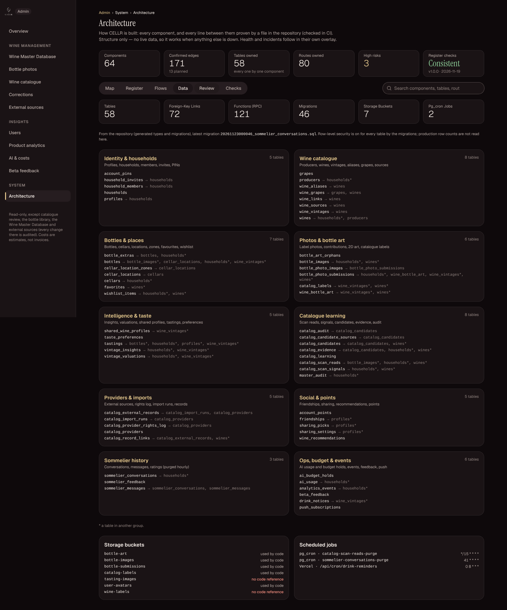
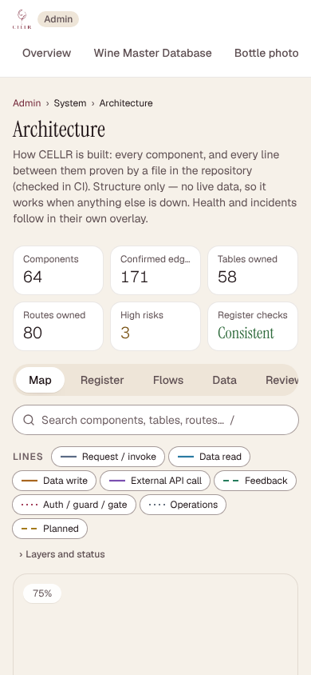

# System Intelligence — Sprint 1 report: Architecture Control Center

Date: 2026-11-19 · Branch: `claude/festive-cannon-joten0` · Plan: [SPRINT-1-PLAN.md](SPRINT-1-PLAN.md) · Decisions:
[ADR-001](ADR-001-architecture-registry.md) · Maintenance: [REGISTRY-GUIDE.md](REGISTRY-GUIDE.md)

**Status: implemented, tested, and deployed to a Vercel preview. Not yet operationally verified in production.**
Recommendation: **GO** (§10). See "Final status" for the evidence.

## 1. What was built, and where

| Part                                                                                                                                                           | Where                                                                                                     |
| -------------------------------------------------------------------------------------------------------------------------------------------------------------- | --------------------------------------------------------------------------------------------------------- |
| Admin page `/admin/system` (sidebar: System › Architecture)                                                                                                    | `apps/web/src/app/admin/system/page.tsx`, `app/admin/layout.tsx`                                          |
| Control center: map, detail panel, Register, Flows, Data, Review and Checks views                                                                              | `apps/web/src/features/admin/system/*`                                                                    |
| Computed layered layout, focus/trace/path/search model, URL-hash state                                                                                         | `features/admin/system/layout.ts`, `model.ts`                                                             |
| Contracts, validation, tracing, impact, shortest path, search (pure)                                                                                           | `packages/domain/src/system-architecture.ts`                                                              |
| Curated register: 64 components, 181 confirmed edges (196 evidence references), 13 planned edges, 5 flows, 17 risks                                            | `apps/web/src/server/system/registry.ts`                                                                  |
| Generated repository inventory (58 tables + FKs, 121 functions, 46 migrations, 7 buckets, 2 pg_cron jobs, 80 routes, 32 server modules, 9 CI jobs, 4 switches) | `apps/web/scripts/architecture/`, `server/system/inventory.generated.json`, `pnpm architecture:inventory` |
| Repository checks of the register                                                                                                                              | `apps/web/src/server/system/registry.test.ts` (in `pnpm test`)                                            |
| Docs and screenshots                                                                                                                                           | `docs/sprints/system-health/`                                                                             |

Features compared with the reference HTML:

- **Proof.** Every edge carries file evidence, and CI checks it.
- **Ownership.** Every table, route, bucket, job and server module has exactly one owner.
- **Tracing.** Direction and depth, with a distance badge on each traced component.
- **Analysis.** "If this fails" (impact), a shortest-path finder, flows that are highlighted and auto-fitted, and a search across tables, routes, files and risks.
- **Navigation.** Filters per line kind, layer and status. Deep links (`#c=…&d=…&n=…&f=…&v=…`) that follow back/forward.
- **Input.** Keyboard: Tab through components, Enter, + / − / 0, arrow keys, "/" for search. A component that receives focus outside the view is brought into view.
- **Readability and devices.** An overview mode with large names when zoomed out. Pinch and drag on touch. Light and dark skins. Usable at 390 px.

Not taken over from the reference: relations the code does not show. Two examples are "the Sommelier reads the intelligence tables directly" (it reads them through the cellar and taste services) and "Tonight is a separate service" (it is `cellar.tonight` over the domain rules). The ERD's 70 hand-listed foreign keys were also not copied; they are now read from the generated types.

## 2. Architecture decisions

These are in ADR-001:

- A curated, typed, `server-only` register, plus a generated inventory.
- Evidence-checked edges.
- A status vocabulary (implemented / gated / unverified / planned) that never claims "operational".
- Pure graph functions in `@cellr/domain`, for reuse in sprint 3.
- No live state in the register: health will be a separate overlay keyed by component id, so the map works when everything else is down. The page reads no database.
- Computed layout.
- No new dependency.

The edge kinds are request, data-read, data-write, external-call, feedback, control, ops, verifies and planned. `verifies` (CI and rehearsals) was added after the review, so that CI is not counted as a runtime dependency in impact.

## 3. Existing systems reused

- The admin access chain, unchanged: proxy 404, `getAdminSession`, `verifyAdmin`, `assertAdmin`, and the page-level `notFound()`.
- The admin layout, `PageTitle` and breadcrumbs, and `ui/segmented`.
- Design tokens via `light-dark()`.
- The lint layering rules and the `server-only` convention.
- The generated `database.types.ts` (source of tables and foreign keys).
- The `FEATURES` list, `vercel.json` and `ci.yml`.
- The Playwright local stack and its admin fixture, and the axe audit helper.

## 4. Tests and results

| Check                                                               | Result                                                                                                                                                                                |
| ------------------------------------------------------------------- | ------------------------------------------------------------------------------------------------------------------------------------------------------------------------------------- |
| `pnpm check` (format, lint, types, unit, database permission suite) | green. Web 1231 passed (12 skipped, as before); domain 937; database 1591 assertions; scripts 244                                                                                     |
| New unit tests                                                      | domain 15, layout/model 19, register 13. The admin boundary test now counts 17 pages                                                                                                  |
| `pnpm build`                                                        | green (see §6 on the Next.js advisory)                                                                                                                                                |
| `scripts/check-bundle-secrets.sh`                                   | clean. The register text is absent from `.next/static` (grep `R-PRIV-1`: 0 files)                                                                                                     |
| Playwright `admin-system.spec.ts`, desktop + phone                  | green. Covers: 404 and no register text for a non-admin (page and RSC); redirect for a signed-out visitor; the full desktop flow; phone at 390 px; axe WCAG 2.1 AA with no violations |
| Existing admin specs (`admin-http`, `admin-sources`, `feedback`)    | green. No regression                                                                                                                                                                  |
| Independent reviews (security; correctness and register accuracy)   | done. Findings and fixes in §5                                                                                                                                                        |

## 5. Security checks, and what the reviews changed

**Access**

- The page checks the session before it reads anything.
- No API route or Server Action reaches the register.
- The register is `server-only`, and a test asserts that only the admin service imports it.

**Client side**

- No inline `<style>`, so it is CSP-compatible.
- No `dangerouslySetInnerHTML`.
- The hash is parsed against allowlists.
- Source links are built from a constant repository name, with `noopener noreferrer`.

**Secrets**

- A test rejects anything in the register that looks like a key, a JWT, an e-mail address or a UUID.

**Security review**

- Nothing exploitable was found.
- **One material point: the repository is public.** The register, its risk notes and the docs are readable by anyone on GitHub, whatever the admin gate does. What I did:
  - removed the production observations (row counts from the 18-11 snapshot);
  - rephrased the risks as open review items rather than descriptions of weaknesses;
  - corrected the comments so they no longer imply the register is confidential;
  - added a "the repository is public" rule to the guide.

  Sensitive or live observations belong in sprint 2's database, behind the admin session.

- Also fixed: the builder now rejects a pg_cron "schedule" that is not cron syntax, so a job's SQL command can never leak into the inventory. It no longer follows symbolic links.

**Correctness review**

All of these are fixed:

- **Focus was lost when opening from another view.** The map now applies a request that was made before it mounted. A new e2e step covers this.
- **Edge directions corrected:**
  - admin portal → proxy;
  - pg_cron → the tables it purges;
  - API and admin portal → Vercel;
  - a non-existent "cron endpoint → push service" edge was removed.
- **Missing dependencies added:**
  - Koopcheck → AI-usage recording, rate limit, insights and language;
  - households → bottle-art purge;
  - friends → profile handle;
  - scans → bottles (recall);
  - reminders → cellar data (service role).
- **Gates.** `CELLR_SMART_CELLAR_3D` moved to the app. Push is now `gated` on its VAPID keys.
- **A flow text was wrong.** Ratings _are_ read back for display, but never into evaluation.
- **Evidence strengthened.** Edges that rested on type-only imports now point at the call itself.
- **UI and model:**
  - path finding honours the line filters and no longer follows feedback or CI edges;
  - aria-live is now scoped to the trace summary;
  - the tabs got arrow-key navigation;
  - `hashchange` is handled;
  - Enter in search uses the current text;
  - a stuck-pointer case is fixed;
  - the Flows tab no longer crashes on an unknown step.
- **Coverage.** The register test now also checks that every folder under `src/app` has an owner.

Not changed, by choice:

- **Impact overstates the blast radius on coarse nodes.** Any service failure reaches "API /api/v1" and "web app", because those nodes bundle many routes. This is correct but coarse; per-route granularity would be a sprint 3 decision.
- **The wheel always moves the map** while the pointer is over it.
- **The path target and the search text are not in the URL.**
- **`engines` still says Node ≥ 22.12.** The inventory script needs ≥ 22.18 and now says so clearly; CI uses the latest 22.

## 6. Open limitations and risks

- **Next.js advisory.** Being fixed separately in PR #86, so it is not a blocker for this PR (see "Final status" below).
  - The advisories are GHSA-mfr8-8qww-v76h and GHSA-vc7v-qv4w-wrv8, both moderate, against 16.4.1. They concern `'use cache'` / `unstable_cache`, which CELLR does not use.
  - The local build stop did not occur in CI.
- **The register is curated.** CI proves every claim it makes and every inventory item it must own. It cannot prove a relation it does not list (R-REG-1), for example dependencies that live only in SQL triggers.
- **The map shows structure, not health.** Nothing here says whether a component is up. That is sprint 2.
- **Desktop overview zoom is about 32% on a 1600 px screen.** Names stay legible through overview mode, and search, the register and auto-fit cover detailed navigation.

## 7. Migrations and configuration

None. No migration, no environment variable, no change to production, Supabase or Vercel. One new root script, `pnpm architecture:inventory`. CI picks up the new checks through the existing `pnpm test`.

## 8. Actions that need explicit approval

1. Merge the pull request (and with it, deployment through the normal Vercel flow).
2. ~~Decide on the public repository~~. Decided on 2026-11-19: the cleaned register is accepted as public for now. Sensitive production observations and concrete security findings stay out of the repository.
3. Merge the Next.js security upgrade, PR #86, as its own change. It is best merged before this PR. After that, this PR needs `main` merged in (lockfile).

## 9. Pull requests

- [Blockionaire/CELLR#85](https://github.com/Blockionaire/CELLR/pull/85): this sprint.
- [Blockionaire/CELLR#86](https://github.com/Blockionaire/CELLR/pull/86): Next.js 16.4.1 → 16.4.6, separate and urgent.

## 10. Verdict: GO

This sprint is ready to merge. Condition (a) is met: the public register is accepted. Condition (b) is met: see the final status below. Condition (c) cannot be done before merge: after deployment, open `/admin/system` once as an admin. That look is the "operationally verified" step no automated check here can make.

## Final status (2026-11-19, after PR review)

| Check                                                       | Status                                                                                                                                                                                      |
| ----------------------------------------------------------- | ------------------------------------------------------------------------------------------------------------------------------------------------------------------------------------------- |
| PR CI on head `23c84e3`                                     | ✅ all 8 jobs (run 44495663220)                                                                                                                                                             |
| Full e2e, shards 1–7 (`workflow_dispatch`, run 44502366355) | ✅ all green, including `admin-system.spec.ts`                                                                                                                                              |
| Full e2e, shard 8                                           | ✅ 125 passed. One failure, `storage-showcase.spec.ts:82` (3D timeout), is already red on `main` (run 44385777061, 2026-11-18) and is not touched by this PR. A follow-up task is proposed. |
| Review comments on the PR                                   | none                                                                                                                                                                                        |
| Vercel preview deployment of `23c84e3`                      | ✅ "Deployment has completed" (GitHub status). Protected by Vercel Authentication.                                                                                                          |
| `/admin/system` viewed as an admin on a deployment          | ⏳ only the owner can sign in as admin; this is condition (c)                                                                                                                               |
| Vercel build and runtime logs                               | not read: the Vercel connector needs approval for the `jp-builds` team                                                                                                                      |

**Implemented, tested, deployed to a preview. Not yet operationally verified in production.**

Remaining risks, in priority order:

1. **The full e2e suite is not green on `main` itself.** The cause is `storage-showcase` timeouts and shard 8 sitting close to its 30-minute limit. This is pre-existing and handled as a follow-up task, not in this sprint.
2. **Next.js 16.4.1 stays in production until PR #86 is merged.** The exposure is moderate and not known to be exploitable here.
3. **Two e2e tests are unstable on `main`:**
   - OCR `sprint-s.spec.ts:104` fails in about 1 of 3 runs on both versions. A follow-up task is proposed.
   - `rack-fill` had a test bug, fixed in PR #86.
4. **The open risks in the register** (Review tab): the privileged-boundary review, unproven restore, and switches whose production values are unknown. These belong to sprints 2–4.

## Release (2026-11-19)

| Step                          | Result                                                                                                                                                                                                         |
| ----------------------------- | -------------------------------------------------------------------------------------------------------------------------------------------------------------------------------------------------------------- |
| PR #86 (Next.js 16.4.6)       | Synced with `main` (incl. #87); `rack-fill` fix taken from the smart-cellar session (bab5a92), own variant reverted. Required checks green on 5a42f11. Merged as c62af1a                                       |
| PR #85 (sprint 1)             | Updated with the new `main` (3e381e6: 16.4.6 + lockfile). Required checks green; local e2e 108 passed. Merged as 07bc80c                                                                                       |
| Full CI on `main` (07bc80c)   | Run 44532312963: all non-e2e jobs green; e2e shards 1, 2, 4, 5, 7 green; `admin-system.spec.ts` green. Shards 3 and 6 failed on two flakes (below) and were green on re-run; shard 8 has the known #79 failure |
| `/admin/system` access        | Verified by e2e on CI and locally: non-admin gets a real 404 with nothing of the register (HTML and RSC); signed-out visitor is sent to sign-in; admin sees the full control center                            |
| `/admin/system` in production | **Not operationally verified.** The Vercel connector has no access to the team, and the admin view needs the owner's own sign-in                                                                               |

Flakes seen on `main` after the release, none reproducible locally (4/4 green each) and green on re-run:

- `insights.spec.ts:113` [desktop]: axe `document-title` (no `<title>` at the moment of the audit). New; watch it. If it
  repeats, check whether metadata streaming in Next 16.4.x leaves the title out after a client-side update.
- `smart-cellar-3d.spec.ts:466` [phone]: the 3D stage not found after changing place. Same family as #79 (software WebGL).
- `racks.spec.ts:371`: axe colour contrast, flaky (passed on retry).

Tracked elsewhere: #77 (shard 8 capacity), #78 (OCR), #79 (3D timeouts). Evidence from today was added to each.

## Screenshots

|                                         |                                                                  |
| --------------------------------------- | ---------------------------------------------------------------- |
| Overview (dark)                         |                                         |
| Overview (light)                        |                                        |
| Trace: everything Scan recognition uses |                                 |
| Flow: scanner → catalogue, auto-fitted  |                          |
| Review                                  |                                      |
| Data                                    |                                        |
| Checks                                  |                                      |
| Phone                                   |   |
