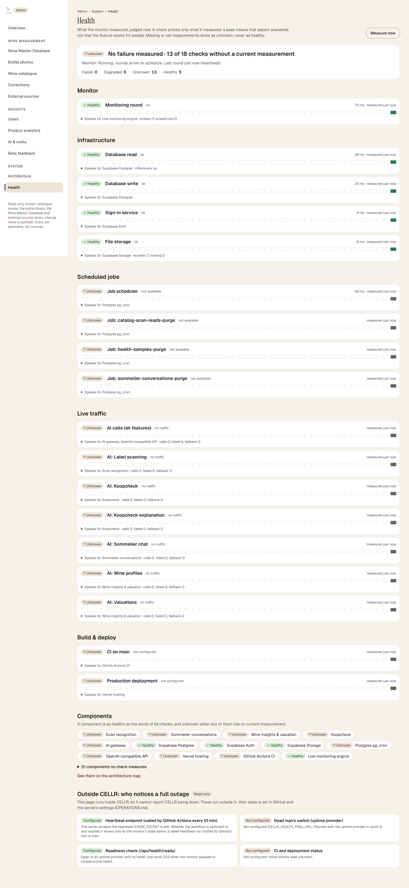
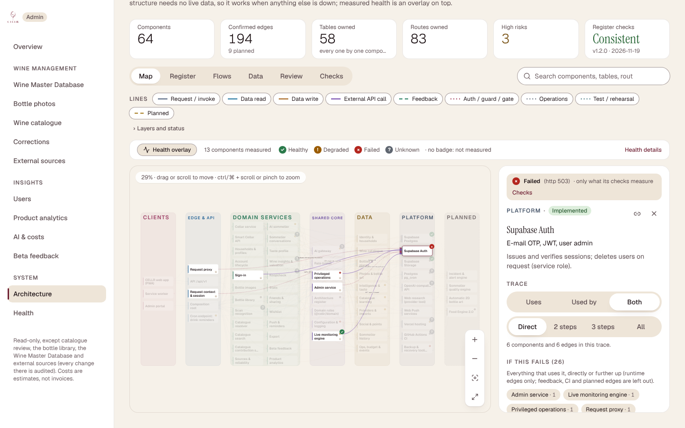
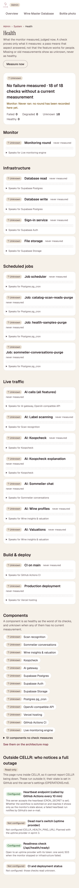

# System Intelligence — Sprint 2 report: Live Monitoring Engine

- Branch `claude/festive-cannon-joten0`, PR #88, based on `main` at 07bc80c.
- **Final status (2026-11-19):** implemented, tested and reviewed; required CI green; PR mergeable. **Not
  deployed, not operationally verified** (by decision D3/D4): no migration in production and no external
  monitoring switched on.

## 1. What was built, and where

| Part                                                               | Where                                                                                                                                                                                      |
| ------------------------------------------------------------------ | ------------------------------------------------------------------------------------------------------------------------------------------------------------------------------------------ |
| Status model, roll-up, classifiers                                 | `packages/domain/src/system-health.ts` (+ 27 tests)                                                                                                                                        |
| Database: rounds, samples, 8 service-role functions, retention job | `supabase/migrations/20261124000047_system_health.sql` (+ `supabase/tests/99_system_health.test.sql`, 21 checks)                                                                           |
| Probe catalogue (what is measured, what it does not prove)         | `apps/web/src/server/health/catalogue.ts` (18 probes)                                                                                                                                      |
| Probes, round, HTTP handlers                                       | `apps/web/src/server/health/{probes,round,http}.ts` (+ `health.test.ts`, 24 tests)                                                                                                         |
| Service-role access with a hard timeout                            | `apps/web/src/server/privileged/health.ts`, `privileged/client.ts` (`createProbeClient`)                                                                                                   |
| Endpoints                                                          | `GET /api/health` (public liveness), `GET /api/health/ready` (token), `GET /api/cron/health` (CRON_SECRET)                                                                                 |
| Admin                                                              | **System › Health** `/admin/system/health`, **Measure now** (`app/admin/system/actions.ts`), health overlay on `/admin/system`                                                             |
| Heartbeat                                                          | `.github/workflows/health-heartbeat.yml` (inactive until switched on)                                                                                                                      |
| Register                                                           | v1.2.0: `health-monitor` implemented (replaces the planned one), 13 new evidence-checked edges, new job owned; `health-catalogue.test.ts` keeps catalogue, register and migrations in step |
| Test stack                                                         | `scripts/local-stack/mock-supabase.mjs`: Auth health endpoint, bucket list, outage switch for probe requests only                                                                          |

Probes (18):

- **Monitor round:** 1.
- **Infrastructure:** 4 (database read, database write, Auth, Storage with bucket check).
- **Scheduled jobs:** 4 (pg_cron itself and its 3 jobs).
- **Live AI traffic:** 7 (all, plus 6 tasks).
- **Delivery:** 2 (CI on main, production deployment).

## 2. Architecture decisions (ADR-002)

- **Judged at read time.** Samples store what was measured; whether it is still valid is decided when the page,
  overlay or readiness reads it. Stale (more than 30 min), clock skew or missing all read `unknown`.
- **Roll-up:** failed > degraded > unknown > healthy. A component no check measures gets no badge, never green.
- **Codes, not text.** The reason is `^[a-z0-9_]{1,64}$`; the detail holds numbers, booleans and nulls only. Both
  are CHECK constraints in the database, whoever writes.
- **Health is its own page, not a tab.** The map reads only a bounded overlay (1.5 s, latest state only, never
  throws).
- **Outage detection outside CELLR in three layers:**
  - heartbeat workflow (built, inactive);
  - uptime provider HTTP check on `/api/health/ready` (endpoint built);
  - dead man's switch `CELLR_HEALTH_PING_URL` (built).

  The provider and its alerting are chosen in sprint 3.

## 3. Existing systems reused

- The admin boundary (proxy 404, `getAdminSession`, `assertAdmin`) and the `admin_*` RPC pattern (service role
  only, "missing" when a migration is not applied).
- `ai_usage` (sprint 0006/0017) for AI health: no new instrumentation, no test calls.
- pg_cron's own `cron.job_run_details`.
- The local test stack (real Postgres + PostgREST, fake Auth/Storage), extended with an outage switch.
- The architecture register and its evidence checks (ADR-001), and the `_ui` admin components.

## 4. Tests and results (local, on this branch)

| Check                                                                                                          | Result                                                                                                                                                                                                                                                                    |
| -------------------------------------------------------------------------------------------------------------- | ------------------------------------------------------------------------------------------------------------------------------------------------------------------------------------------------------------------------------------------------------------------------- |
| `pnpm check` (format, lint, types, all unit tests, database suite)                                             | green: domain 966, web 1318, database **1627** (0 failed)                                                                                                                                                                                                                 |
| `pnpm db:types:check`, `architecture:inventory --check`                                                        | up to date                                                                                                                                                                                                                                                                |
| `pnpm build`                                                                                                   | green (new routes listed)                                                                                                                                                                                                                                                 |
| e2e `system-health.spec.ts` + `admin-system.spec.ts`                                                           | **21 passed**, 0 failed (desktop + phone)                                                                                                                                                                                                                                 |
| e2e admin-related specs (admin-http, admin-sources, feedback, reminders, sources, admin-system, system-health) | **53 passed**, 0 failed                                                                                                                                                                                                                                                   |
| PR checks on head `2fd6b07` (run 44559077901)                                                                  | **all green**, incl. the real Supabase stack with pg_cron (it caught a test that read `cron` as `service_role`; fixed)                                                                                                                                                    |
| Full e2e on CI, manual dispatch on `f95827f` (run 44558396651)                                                 | shards 1, 2, 3, 5, 7 green, including both new specs. Shards 4, 6, 8 red only on tests this PR does not touch: 3D storage specs (#79/#77) and `racks.spec.ts:371` (contrast flake, 4/10 locally with `main`'s CSS vs 6/10 with this branch's); evidence in the PR comment |

What the e2e spec proves against real services:

- **Before any round:** nothing is healthy, and the monitor "never ran".
- **A real round:** database read and write, Auth and Storage are healthy. pg_cron on plain Postgres is
  `unknown (not available)`. CI and deployment are `unknown (not configured)`. The headline is not healthy, and
  readiness is 200.
- **Auth answers 503:** `auth.api` is failed (`http_503`, the error text is never shown) and the headline is
  failed. Readiness is 503. On the map, Auth is failed, a component nothing measures has no badge, and switching
  the overlay off leaves the map the same. The heartbeat's answer counts 1 failed infrastructure check.
- **Storage hangs for 8 s:** `storage.api` is failed (`timeout`), and the round still finishes in under 7 s.
- **REST answers 503:** the round answers 503 `database_unreachable`, and readiness is 503.
- **Monitoring hangs for 10 s:** the map renders fully in under 8 s, saying health "did not arrive in time".
  System › Health says the same.
- **Monitoring not installed:** the map is unaffected and the notice names migration 0047.
- **Rounds stopped (40 min):** the monitor is "stopped", nothing is healthy, the checks read
  `stale (last said healthy)`, readiness is 503 `unknown`, and the overlay shows unknown.
- **Non-admins:** a real 404 with nothing in the HTML or RSC. Liveness returns only `{"status":"ok"}`. Round and
  readiness refuse a request without their secret.
- **Accessibility:** axe is clean on the Health page and on the map with the overlay. On a phone at 390 px there
  is no sideways scroll.

## 5. Security and correctness: what the reviews changed

Two independent reviews (security, correctness) read the diff. Every finding is fixed (commit `f95827f`) and the
checks re-ran green.

| Severity | Finding                                                                                                                                               | Fix                                                                                                                                                                 |
| -------- | ----------------------------------------------------------------------------------------------------------------------------------------------------- | ------------------------------------------------------------------------------------------------------------------------------------------------------------------- |
| High     | The CI probe read the newest run of any workflow on main, usually the heartbeat itself in progress, which counted as healthy                          | Reads the newest **finished** `ci.yml` run. A run in progress is `unknown`; a deployment in progress too                                                            |
| Medium   | Readiness said `ok` while an infrastructure check was unmeasured                                                                                      | 200 only when the monitor runs on time and every infrastructure check is measured and not failed                                                                    |
| Medium   | A database refusing writes left the old healthy results on show for up to 30 min                                                                      | New monitor state `failing` (newest round not recorded); the monitor's own check follows late/failing; readiness 503 from "late"                                    |
| Medium   | e2e hooks of the serial group also ran in the phone project and could reset state mid-test                                                            | Hooks act only in the desktop project                                                                                                                               |
| Medium   | The heartbeat's log published production health on a public repository                                                                                | It prints `ok` / `Heartbeat failed` only, and has **no schedule** in this public repository (owner's preference); rounds come from a private external provider (§9) |
| Low      | A skipped round (Measure now just before) could hide a failure from the heartbeat                                                                     | A skipped round answers with the findings of the round that ran instead                                                                                             |
| Low      | The gap could be lowered by a caller; `CRON_SECRET` had no minimum; provider calls followed redirects; one jq value unsanitised; free text in `?msg=` | 60 s floor in SQL; `CRON_SECRET` ≥ 16 for the round; `redirect: "error"`; every value sanitised; a result kind instead of text                                      |
| Info     | Reasons allowed host-like codes; the secret comparison leaked length; the history query slowed the overlay; 5 unrecorded rounds hid the last good one | Reasons without dots/colons/dashes; SHA-256 digests compared; overlay reads latest only; newest finished round always returned                                      |

Kept as designed:

- Liveness is public and says only `ok`.
- `/api/health/ready` gives an empty 404 while no token is set.
- The `x-cellr-probe` header is harmless in production. Nothing reads it; the outage switch exists only in the local
  mock.

## 6. Open limitations and risks

1. **No outside alerting until external monitoring is set up (R-MON-1).** The owner prefers no operational status
   in public GitHub Actions, so the heartbeat workflow has no schedule. Until the uptime provider of OPERATIONS.md
   §3 is set up, nothing outside CELLR notices a full outage. The endpoints, the dead man's switch and the round's own
   secret all exist.
2. **Aspects, not features (R-MON-2).** No end-to-end flow (sign in, scan, save) is measured, and neither are
   per-route API error rates or the Vercel drink-reminder cron. Each is stated on the page.
3. **AI health needs traffic.** At quiet times the AI checks read `unknown (no traffic)`. That is honest, but the
   headline will usually say "No failure measured · N checks without a current measurement" rather than "All pass".
4. **When the database refuses writes,** nothing can be recorded. The monitor turns `failing` or late. Readiness
   answers 503 from "late" on, and monitor A (the round trigger) gets 503 at once.
5. **E2e capacity (#77).** This PR's 13 tests move the count-based shard boundaries, so 3D phone tests now land in
   shard 4. They time out there on CI (software WebGL) and pass locally. Expect shard 4 to show them on `main` until
   #77 is resolved; option 2 (a separate 3D job) ends it.
6. **Flakes without an issue:** `racks.spec.ts:371` (axe contrast; about half of local runs on `main` too) and
   `insights.spec.ts:113` (axe document-title). A tracking issue is recommended.

## 7. Final CI status and e2e classification

**Required PR checks: green on every head since `2fd6b07`.** That covers `2fd6b07`, `4df9fa2` (run 44563289948) and
`f680648` (run 44568899333), and the final commit. All seven required jobs pass:

- format/lint/types/unit;
- Postgres permission suite;
- real Supabase stack with pg_cron;
- backup and recovery;
- migration integrity;
- dependency audit;
- secret scan.

The PR is mergeable (`clean`) against `main` at 07bc80c.

**Full e2e, manual dispatch on `f95827f`, run 44558396651, two attempts.** Later commits change docs, one SQL test,
the badge position, the round secret and the workflow trigger. Those were checked with unit tests and the
`system-health` spec locally (15/15); no full re-run was needed. Shards 1, 2, 3, 5 and 7 are green, and shard 6 is
green on the re-run. Both new specs pass. Every remaining red test, classified:

| Test (shard)                                                               | Class                                  | Evidence                                                                                                                                                                  |
| -------------------------------------------------------------------------- | -------------------------------------- | ------------------------------------------------------------------------------------------------------------------------------------------------------------------------- |
| `racks.spec.ts:371` (6)                                                    | **proven existing flake**              | flaky on `main` (run 44532312963); green on the re-run; locally 4/10 failing with `main`'s CSS vs 6/10 with this branch's                                                 |
| `storage-showcase.spec.ts:82` (8)                                          | **proven existing failure**            | red on `main` since run 44385777061 (#79)                                                                                                                                 |
| shard 8 hitting the 30-min job limit (8, re-run)                           | **proven existing capacity**           | #77; seen on PR #85's runs too                                                                                                                                            |
| `storage-gallery.spec.ts:351` (4)                                          | **proven existing flake**              | listed in #79 as flaky on `main`                                                                                                                                          |
| `storage-premium.spec.ts:80`, `storage-gallery.spec.ts:123/228` (4, phone) | **existing 3D family, new to shard 4** | the same software-WebGL timeouts (#79); this PR touches no 3D code; both failing tests pass 4/4 locally on this branch. Cause of the move: shard boundaries (#77, risk 5) |
| `Database · real Supabase stack` (re-run of the old head)                  | **fixed on later heads**               | the old SQL test on `f95827f`; green since `2fd6b07`                                                                                                                      |

**No new regression was found.** Nothing red touches code this PR changes. The one effect of the PR is the shard
move, which is a capacity problem, not a defect.

## 8. Migrations and configuration

- **One new migration, `20261124000047_system_health.sql`: not applied (D4).** Plan, verification and rollback:
  [OPERATIONS.md §2](OPERATIONS.md), by `docs/MIGRATIONS.md` §2. It is safe to merge before applying it: the app
  shows "not installed", and that is tested.
- No other migration branch is open; checked on 2026-11-19.
- **New optional server settings** (all may stay unset):
  - `CELLR_HEALTH_ROUND_SECRET` (≥ 16 chars; falls back to `CRON_SECRET`);
  - `CELLR_HEALTH_READY_TOKEN` (≥ 24 chars);
  - `CELLR_HEALTH_PING_URL` (https);
  - `CELLR_HEALTH_GITHUB_REPO` + `_TOKEN`;
  - `CELLR_HEALTH_VERCEL_PROJECT_ID` + `_TEAM_ID` + `_TOKEN`.
- **GitHub:** nothing needs setting. The workflow runs only by hand, and only with the variable `HEALTH_HEARTBEAT=on`
  and the secrets `HEALTH_BASE_URL` and `HEALTH_CRON_SECRET`.

## 9. Actions that need the owner (none were taken)

1. Approve and merge PR #88.
2. Apply migration 0047 to production (OPERATIONS.md §2).
3. Set up external monitoring (OPERATIONS.md §3):
   - the round secret, the ready token and the ping URL in Vercel;
   - monitors A, B, C (and D) at a private, preferably EU-hosted uptime provider;
   - verify, including one alert test.
4. Optionally, read tokens for CI and deployment (§4).
5. Decide #77 (a separate 3D e2e job), and create a tracking issue for `racks.spec.ts:371`.

## 10. Verdict

- **Merging PR #88: GO.** All required checks are green and the PR is mergeable. Every review finding is in the code
  (24 checked). No e2e regression was found; every red e2e test is classified above. Merging changes nothing for
  users. Without migration 0047 the admin sees "not installed".
- **Production migration 0047: GO, after the merge, at the owner's moment.** It is additive (new objects only) and
  tested on plain Postgres and the real Supabase stack with pg_cron. It is bounded (one round a minute, about 36k
  rows at most) and has a rollback. Daily backups (Pro) cover it. Prerequisite: the dry run lists exactly 0047.
- **Monitoring "operational": NO-GO until §9.3 is done** and production shows rounds every 10 minutes for a day,
  with one alert test passed.

## Screenshots (local stack, from the e2e run)

|                                                     |                                            |
| --------------------------------------------------- | ------------------------------------------ |
| System › Health after a real round (light)          |          |
| Map with the overlay during a simulated Auth outage |  |
| Phone, before any round (nothing healthy)           |            |
